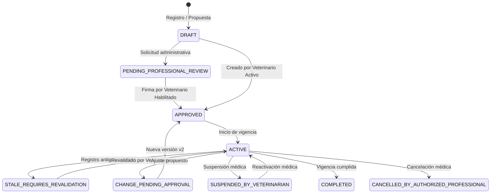
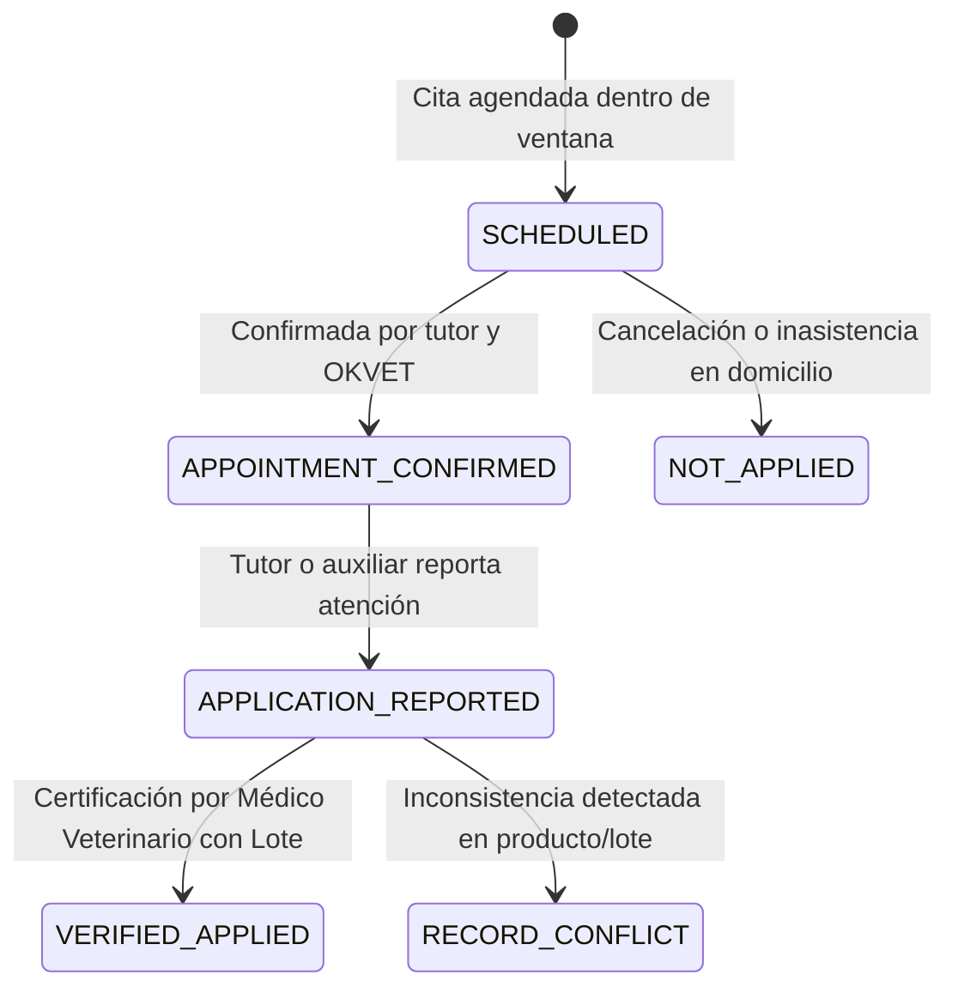

# VET FREEDOM OS — PREVENTIVE CARE STATE MACHINE
## Ciclo de Vida de Planes, Registros y Aplicaciones Preventivas
**Módulo:** VET-CORE-10  
**Dirección Médica:** Dr. Luis Eduardo Ríos  

---

## 1. Máquina de Estados del Plan Preventivo (`preventive_care_plans`)

---

## 2. Máquina de Estados de la Información y Fuentes (`confidence_status` / `conflict_status`)

- **CONFIRMED / VERIFIED_HIGH:** Registro respaldado por documento clínico oficial en OKVET.
- **PENDING_VERIFICATION / UNVERIFIED:** Información reportada por el tutor o entrada manual pendiente de contraste.
- **STALE:** Registro con más de 365 días de antigüedad sin actualización que requiere revalidación humana obligatoria.
- **CONFLICTING:** Datos contradictorios entre fuentes históricas que bloquean afirmaciones categóricas hacia el cliente.

---

## 3. Máquina de Estados de la Aplicación Clínica (`preventive_care_application_records`)

