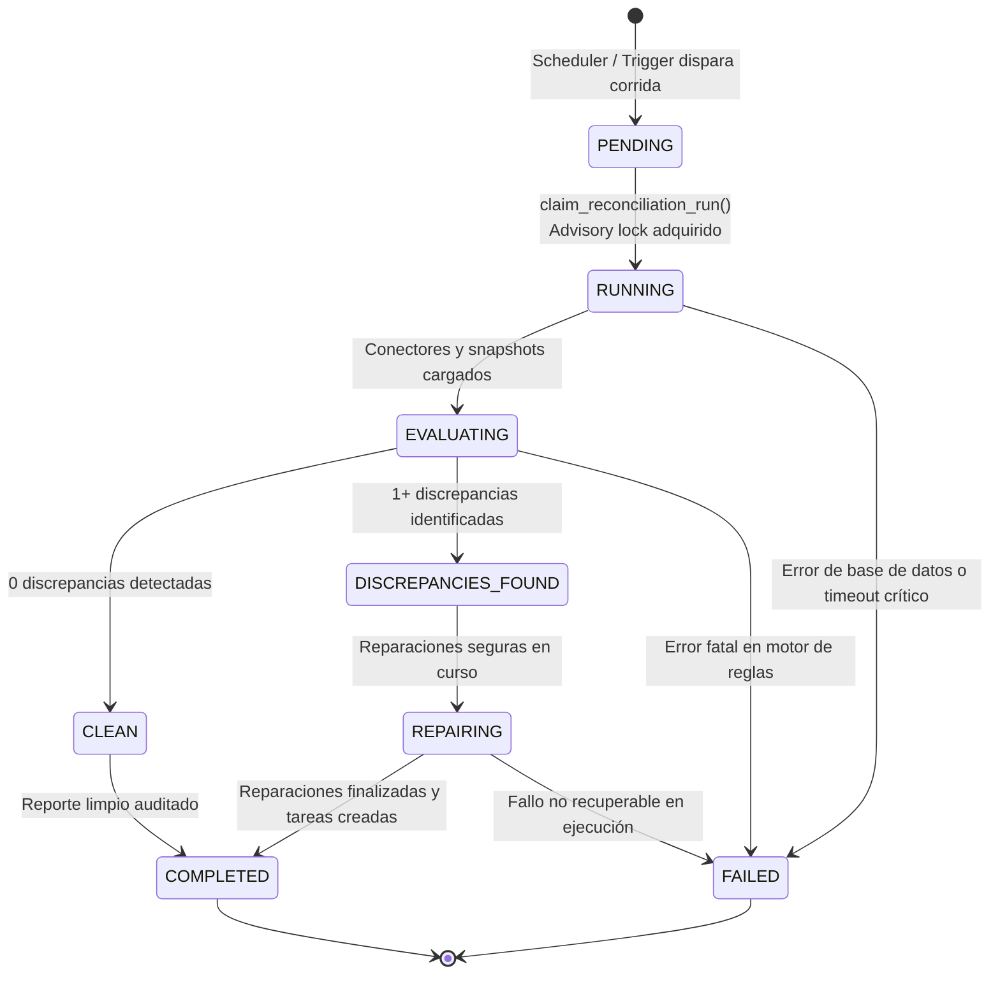
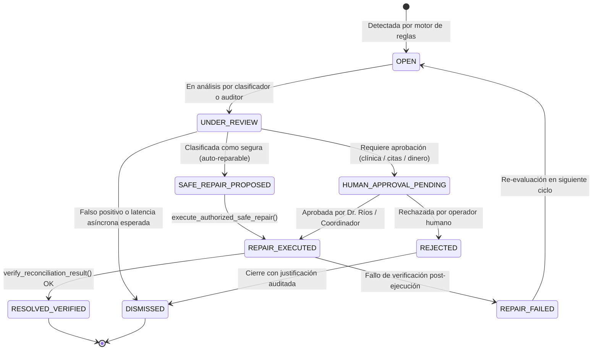

# VET FREEDOM OS — MÁQUINA DE ESTADOS DE CONCILIACIÓN
## Ciclo de Vida de Corridas, Discrepancias y Reparaciones

---

### 1. Ciclo de Vida de una Corrida de Conciliación (`integration_reconciliation_runs`)

Cada ejecución del motor VET-CORE-18 (programada a las 02:00 AM, gatillada por webhook o manual) transiciona a través de estados formalmente controlados:

- **Mecanismo Concurrente**: `claim_reconciliation_run` utiliza `pg_try_advisory_xact_lock(hashtext('vet_reconciliation_run_lock'))` para garantizar que dos workers o schedulers paralelos no compitan ni corrompan el estado.

---

### 2. Ciclo de Vida de una Discrepancia (`integration_reconciliation_discrepancies`)

Toda desviación detectada se registra como una fila inmutable en `integration_reconciliation_discrepancies` y sigue la siguiente máquina de estados:

---

### 3. Matriz de Transiciones Permitidas y Prohibidas

| Estado Origen | Estado Destino Permitido | Estados Prohibidos | Criterio de Bloqueo |
| :--- | :--- | :--- | :--- |
| `OPEN` | `UNDER_REVIEW`, `DISMISSED` | `RESOLVED_VERIFIED`, `REPAIR_EXECUTED` | No se puede marcar como resuelta sin haber sido evaluada ni reparada. |
| `UNDER_REVIEW` | `SAFE_REPAIR_PROPOSED`, `HUMAN_APPROVAL_PENDING`, `DISMISSED` | `REPAIR_EXECUTED` | Requiere propuesta previa y autorización formal. |
| `HUMAN_APPROVAL_PENDING` | `REPAIR_EXECUTED` (si aprobada), `REJECTED` | `SAFE_REPAIR_PROPOSED` | Una vez escalada a humano, no puede ser degradada a auto-reparación por IA. |
| `REPAIR_EXECUTED` | `RESOLVED_VERIFIED`, `REPAIR_FAILED` | `OPEN`, `DISMISSED` | Requiere verificación instrumental obligatoria post-ejecución. |
| `RESOLVED_VERIFIED` | *(Ninguno - Estado Terminal)* | Cualquier cambio de estado | La auditoría es inmutable (append-only). |
