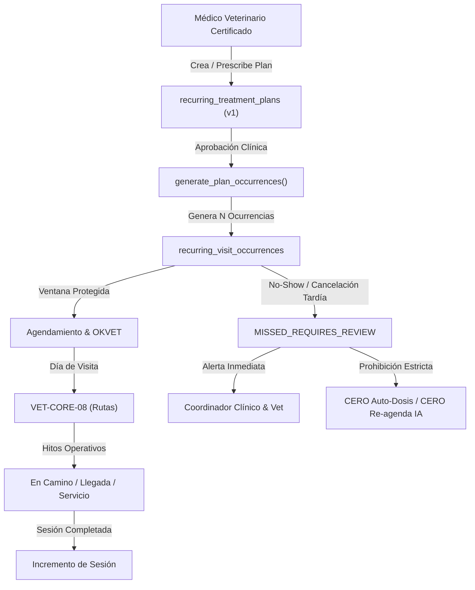

# VET FREEDOM OS — RECURRING CARE ARCHITECTURE
## Módulo: VET-CORE-09 | Recurring Care Communications & Clinical Continuity
**Dirección Médica:** Dr. Luis Eduardo Ríos  
**Dirección Estratégica:** Alpha Vision Method  
**Plataformas:** Google Antigravity + Supabase (PostgreSQL 17) + n8n Cloud + Lovable  
**Modo:** DEVELOPMENT / SAFE MODE (CERO ENVÍOS EXTERNOS REALES)

---

## 1. Misión del Módulo

El módulo **VET-CORE-09 (Recurring Care Communications)** gobierna la continuidad operativa y comunicativa de los pacientes crónicos y geriátricos atendidos bajo el modelo domiciliario de **Vet Life**.

Su propósito fundamental es asegurar que ningún tratamiento médico prescrito (enfermedad renal crónica, insuficiencia cardíaca congestiva, diabetes mellitus, fisioterapia postquirúrgica, dermatología avanzada, oncología paliativa) sufra interrupciones, abandono terapéutico o desvíos logísticos no autorizados.

---

## 2. Axiomas Fundamentales de Seguridad Clínica

1. **Autoridad Médica Exclusiva:** El plan operativo deriva única y exclusivamente de la prescripción de un médico veterinario habilitado (`is_clinical = true`). Ni n8n, ni agentes IA, ni personal administrativo pueden alterar dosis, frecuencias o suspender tratamientos sin aval profesional.
2. **Preservación de Ventanas Clínicas:** Las ocurrencias poseen fechas objetivo y franjas de tolerancia clínica (`window_start_date` a `window_end_date`). En protocolos críticos (`is_window_strict = true`), la tolerancia es cero y ningún algoritmo logístico puede mover la visita sin aprobación médica.
3. **Protocolo Estricto de Visita Perdida:** Ante la inasistencia o cancelación de una sesión, el sistema la marca categóricamente en `MISSED_REQUIRES_REVIEW`. Queda terminantemente prohibido compensar automáticamente doblando la dosis o postergando el calendario por cuenta propia.
4. **Continuidad de Profesional:** Se promueve la atención por el veterinario titular (`continuity_vet_id`). En caso de ausencia, la suplencia exige validación de competencias y consentimiento clínico documentado.
5. **Safe Mode Integral:** Todas las notificaciones generadas se procesan con `send_enabled: false`, resguardando la privacidad médica y la estabilidad operacional.
