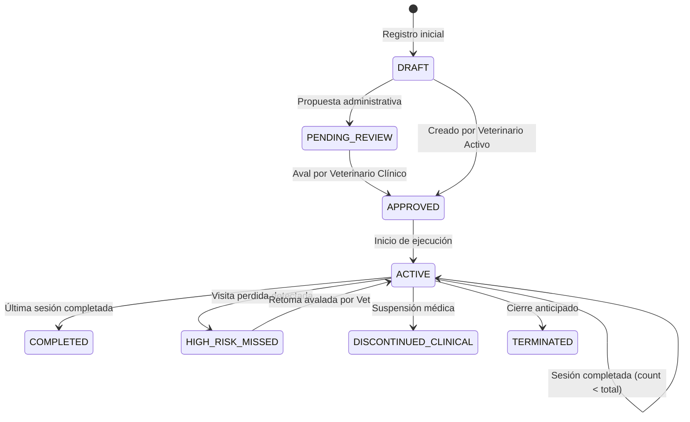
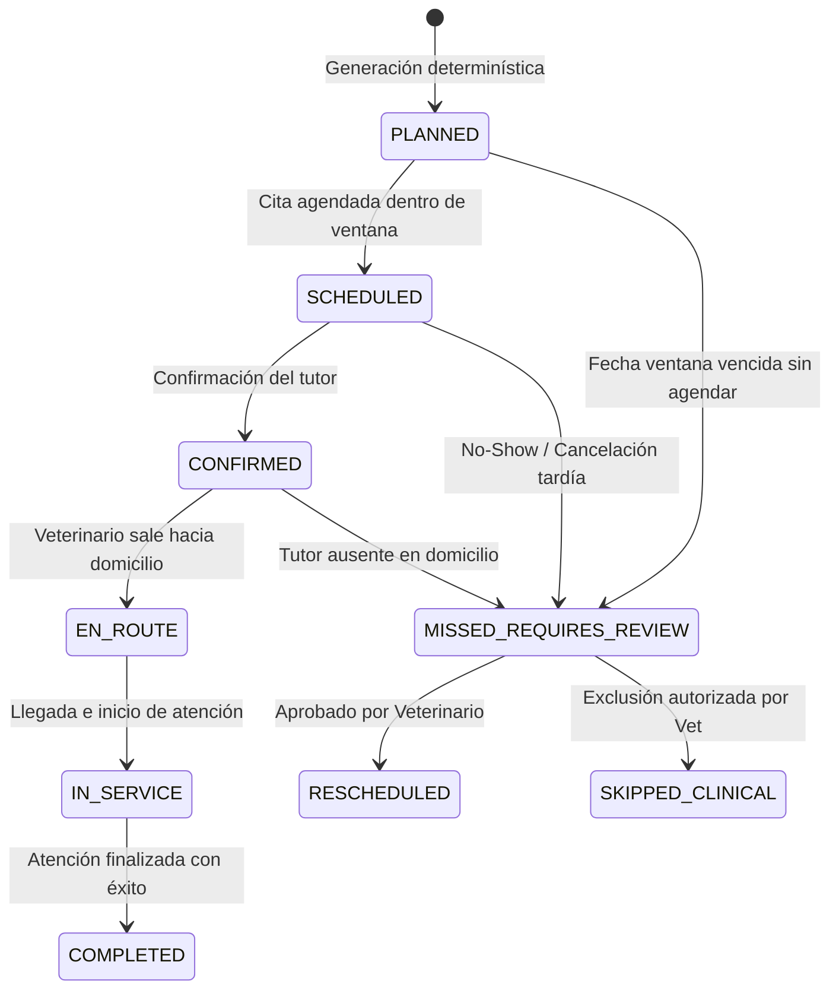

# VET FREEDOM OS — RECURRING CARE STATE MACHINE
## Ciclo de Vida de Planes y Ocurrencias Recurrentes
**Módulo:** VET-CORE-09  
**Dirección Médica:** Dr. Luis Eduardo Ríos  

---

## 1. Máquina de Estados del Plan Maestro (`recurring_treatment_plans`)

### Definición de Estados del Plan
- **DRAFT:** Borrador inicial en confección.
- **PENDING_REVIEW:** Plan estructurado por auxiliar o coordinación pendiente de revisión y firma médica.
- **APPROVED / ACTIVE:** Plan autorizado legalmente con ocurrencias generadas y en proceso de ejecución.
- **HIGH_RISK_MISSED:** Semáforo de riesgo activado por inasistencia o interrupción de sesiones.
- **COMPLETED:** Cumplimiento exitoso de la totalidad de sesiones prescritas.
- **DISCONTINUED_CLINICAL:** Cancelación o suspensión justificada clínicamente en historia clínica de OKVET.

---

## 2. Máquina de Estados de la Ocurrencia Individual (`recurring_visit_occurrences`)

### Transiciones Críticas
1. **PLANNED -> SCHEDULED:** Requiere verificación estricta de ventana `[window_start_date, window_end_date]`.
2. **IN_SERVICE -> COMPLETED:** Gatilla el incremento del contador del plan (`completed_sessions_count += 1`).
3. **Cualquier estado -> MISSED_REQUIRES_REVIEW:** Detiene el flujo automático, genera incidente formal y alerta al coordinador.
