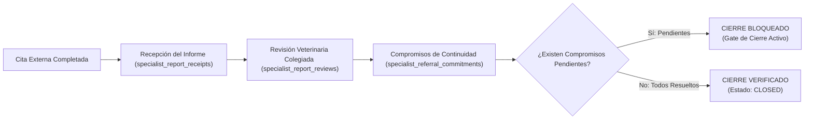

# VET FREEDOM OS — REFERRAL CONTINUITY & CLOSURE GATE
## Modelo de Continuidad Asistencial, Trazabilidad de Informes y Protocolo de Cierre Verificado
**Módulo:** VET-CORE-11 | SPECIALIST COORDINATION  
**Dirección Médica:** Dr. Luis Eduardo Ríos  
**Conexión Operativa:** VET-CORE-07, VET-CORE-10 y VET-CORE-12  

---

## 1. La Filosofía de Continuidad de Vet Freedom OS

Una remisión a un especialista externo **no es un traspaso desentendido del paciente**. Para Vet Life — Veterinaria a Domicilio, la remisión es una extensión especializada del acto médico domiciliario que exige:

1. **Recepción formal del informe y exámenes paraclínicos.**
2. **Revisión y juicio crítico por el médico veterinario tratante de Vet Life.**
3. **Generación explícita de compromisos de seguimiento (tratamientos, ajustes dietarios, controles en casa).**
4. **Cierre formal solo cuando no queden cabos sueltos en la atención del paciente.**



---

## 2. Gate Estricto de Cierre Verificado (`close_specialist_referral_verified`)

El Stored Procedure en Supabase `close_specialist_referral_verified` hace valer a nivel de base de datos el axioma médico:

```sql
-- Fragmento de regla de integridad relacional en Supabase:
SELECT count(*) INTO v_pending_commitments
FROM public.specialist_referral_commitments
WHERE referral_id = p_referral_id
  AND commitment_status IN ('PENDING', 'IN_PROGRESS', 'OVERDUE');

IF v_pending_commitments > 0 THEN
    RAISE EXCEPTION 'No es posible cerrar la remisión %: Existen % compromiso(s) de continuidad clínico(s) pendiente(s).',
        p_referral_id, v_pending_commitments;
END IF;
```

### Condiciones de Éxito para el Cierre:
- La remisión debe estar en estado `REPORT_REVIEWED` o `NO_SHOW`.
- El informe clínico debe haber sido calificado por el veterinario con `review_decision IN ('ACCEPTED_COMPLIANT', 'ACCEPTED_WITH_OBSERVATIONS')`.
- Todos los compromisos registrados en `specialist_referral_commitments` deben encontrarse en estado `COMPLETED`, `SUPERSEDED` o `WAIVED_BY_VET`.
- Debe registrarse la firma digital o ID del veterinario que autoriza el cierre definitivo.

---

## 3. Tipología de Compromisos de Continuidad (`specialist_referral_commitments`)

| Tipo de Compromiso (`commitment_type`) | Descripción Operativa | Subsistema Responsable |
|---|---|---|
| `MEDICATION_FOLLOWUP` | Ajuste o monitoreo de nueva terapia farmacológica indicada por el especialista. | VET-CORE-12 / Médico Tratante |
| `IN_HOME_CHECKUP` | Cita de control domiciliario a los 7, 15 o 30 días para evaluar evolución clínica. | VET-CORE-05 / Agenda |
| `LAB_MONITORING` | Toma de muestras sanguíneas o paraclínicos de control en casa. | VET-CORE-07 / Logística |
| `SPECIALIST_COUNTER_REFERRAL` | Reconsulta con el mismo u otro especialista según evolución. | VET-CORE-11 |
| `CLIENT_HOME_OBSERVATION` | Tareas de monitoreo asignadas al tutor (registro de convulsiones, ingesta hídrica, etc.). | VET-CORE-02 / Tutor |
