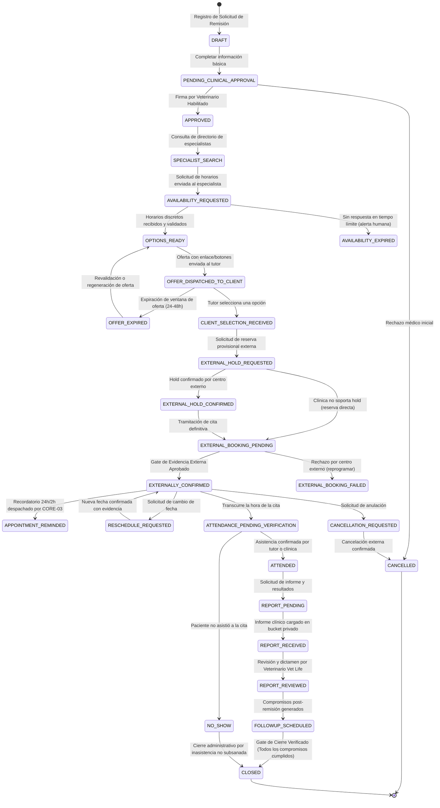

# VET FREEDOM OS — REFERRAL STATE MACHINE
## Ciclo de Vida y Máquina de Estados de Remisiones Veterinarias
**Módulo:** VET-CORE-11 | SPECIALIST COORDINATION  
**Dirección Médica:** Dr. Luis Eduardo Ríos  
**Plataforma:** PostgreSQL 17 (Supabase) + n8n Cloud  

---

## 1. Diagrama de Transición de Estados

---

## 2. Definición Canónica de los 24 Estados

| # | Estado (`coordination_status`) | Descripción y Rol Operativo | Invariante de Seguridad / Salida |
|---|--------------------------------|-----------------------------|----------------------------------|
| 1 | `DRAFT` | Registro preliminar de la necesidad de remisión. | Solo borrador, no visible para clientes ni terceros. |
| 2 | `PENDING_CLINICAL_APPROVAL` | En espera de validación médica por profesional activo. | Requiere cédula profesional veterinaria. |
| 3 | `APPROVED` | Remisión aprobada formalmente por el veterinario. | Genera snapshot v1 inmutable en historial. |
| 4 | `SPECIALIST_SEARCH` | Sistema y coordinación buscan especialistas activos. | Filtra exclusivamente perfiles `VERIFIED_ACTIVE`. |
| 5 | `AVAILABILITY_REQUESTED` | Petición de horarios enviada a la clínica externa. | Abre contador de seguimiento (máx. 24h). |
| 6 | `AVAILABILITY_EXPIRED` | El especialista no contestó en el plazo establecido. | Notifica a coordinación para activar backup. |
| 7 | `OPTIONS_READY` | Franjas horarias registradas y validadas. | Requiere fechas futuras y dirección de atención. |
| 8 | `OFFER_DISPATCHED_TO_CLIENT` | Opciones enviadas al cliente mediante token opaco. | `send_enabled: false` en QA; expira en 24h. |
| 9 | `OFFER_EXPIRED` | El tutor no seleccionó antes del vencimiento. | Prohíbe agendamiento tardío sin revalidar. |
| 10 | `CLIENT_SELECTION_RECEIVED` | El tutor seleccionó un horario de preferencia. | **Axioma:** NO equivale a cita confirmada. |
| 11 | `EXTERNAL_HOLD_REQUESTED` | Se solicita bloqueo temporal del cupo a la clínica. | Vigencia finita del bloqueo (ej. 2 a 4 horas). |
| 12 | `EXTERNAL_HOLD_CONFIRMED` | La clínica confirmó el bloqueo provisional del cupo. | Espera trámite de cita formal. |
| 13 | `EXTERNAL_BOOKING_PENDING` | Trámite de reserva definitiva en curso. | Encola tarea humana si el canal no es síncrono. |
| 14 | `EXTERNALLY_CONFIRMED` | **Cita confirmada:** Radicado y evidencia externa validada. | Habilita acceso documental y recordatorios. |
| 15 | `EXTERNAL_BOOKING_FAILED` | La clínica externa rechazó o agotó el cupo. | Regresa el caso a opciones o búsqueda. |
| 16 | `APPOINTMENT_REMINDED` | Recordatorio previo a la cita entregado al cliente. | Suprimido en caso de luto o revocación. |
| 17 | `RESCHEDULE_REQUESTED` | El tutor o especialista solicita cambio de fecha. | La cita previa sigue activa hasta confirmar nueva. |
| 18 | `CANCELLATION_REQUESTED` | Solicitud de anulación en trámite. | Prohíbe notificar al cliente sin confirmación médica. |
| 19 | `ATTENDANCE_PENDING_VERIFICATION` | La cita ya transcurrió; se indaga si asistieron. | Dispara protocolo de seguimiento a las +2h. |
| 20 | `ATTENDED` | Asistencia al centro de especialidad confirmada. | Transita inmediatamente a requerimiento de informe. |
| 21 | `NO_SHOW` | El paciente no asistió a la cita externa. | Notifica al veterinario tratante para plan alterno. |
| 22 | `REPORT_PENDING` | Esperando informe clínico y resultados de laboratorio. | Genera recordatorio a los 3 días hábiles. |
| 23 | `REPORT_RECEIVED` | Informe médico radicado en bucket privado. | Espera revisión médica colegiada obligatoria. |
| 24 | `REPORT_REVIEWED` | Veterinario de Vet Life revisó y dictaminó el caso. | Genera compromisos en `specialist_referral_commitments`. |
| 25 | `FOLLOWUP_SCHEDULED` | Cita de control o tratamiento continuado programado. | Conexión con VET-CORE-05 y VET-CORE-12. |
| 26 | `CLOSED` | **Cierre formal:** Todos los compromisos cumplidos. | **Gate de Cierre:** Cero compromisos pendientes. |
| 27 | `CANCELLED` | Remisión cancelada definitivamente con justificación. | Revoca de inmediato tokens documentales activos. |

---

## 3. Matriz de Transiciones Permitidas y Prohibidas

| Estado Origen | Estado Destino Permitido | Acción / Trigger | Condición / Validaciones |
|---|---|---|---|
| `DRAFT` | `PENDING_CLINICAL_APPROVAL`, `CANCELLED` | Edición de borrador | Completitud de indicación y paciente. |
| `PENDING_CLINICAL_APPROVAL` | `APPROVED`, `CANCELLED` | `approve_specialist_referral` | Profesional con rol VETERINARIAN activo. |
| `APPROVED` | `SPECIALIST_SEARCH`, `CANCELLED` | Búsqueda de especialistas | Snapshot inmutable v1 creado. |
| `OPTIONS_READY` | `OFFER_DISPATCHED_TO_CLIENT` | `generate_and_dispatch_client_offer` | Opciones no expiradas; token opaco emitido. |
| `OFFER_DISPATCHED_TO_CLIENT` | `CLIENT_SELECTION_RECEIVED`, `OFFER_EXPIRED` | `record_client_slot_selection` | Selección antes de `expires_at`. |
| `CLIENT_SELECTION_RECEIVED` | `EXTERNAL_HOLD_REQUESTED`, `EXTERNAL_BOOKING_PENDING` | Tramitación externa | Registro de intención del cliente. |
| `EXTERNAL_BOOKING_PENDING` | `EXTERNALLY_CONFIRMED`, `EXTERNAL_BOOKING_FAILED` | `confirm_external_specialist_booking` | **Evidencia externa verificable obligatoria.** |
| `EXTERNALLY_CONFIRMED` | `ATTENDED`, `NO_SHOW`, `RESCHEDULE_REQUESTED`, `CANCELLATION_REQUESTED` | Seguimiento post-cita | Verificación humana o documental. |
| `REPORT_RECEIVED` | `REPORT_REVIEWED` | `record_and_review_specialist_report` | Dictamen y firma de veterinario tratante. |
| `REPORT_REVIEWED` | `CLOSED` | `close_specialist_referral_verified` | **Prohibido si existen compromisos pendientes.** |
