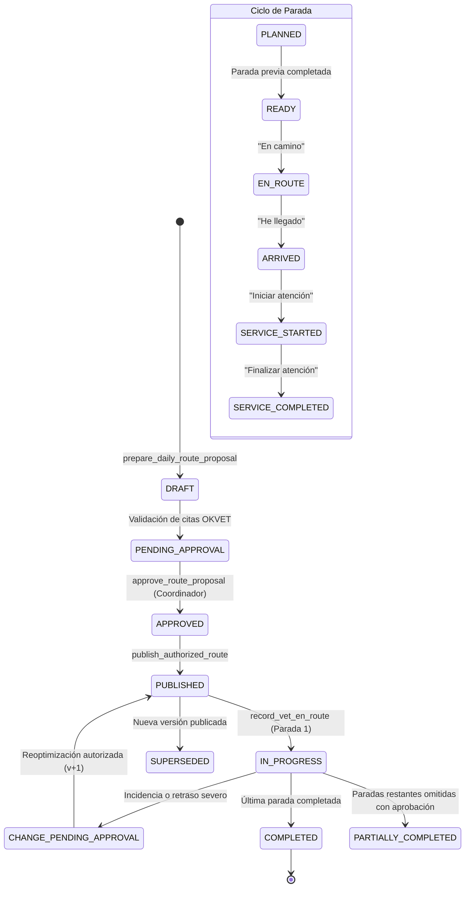

# VET FREEDOM OS — MÁQUINA DE ESTADOS DE RUTAS Y PARADAS
**Módulo:** VET-CORE-08 | Route Lifecycle State Machine  
**Dirección Médica:** Dr. Luis Eduardo Ríos  
**Dirección Estratégica:** Alpha Vision Method  

---

## 1. Máquina de Estados de la Ruta (`public.routes.status`)

El ciclo de vida de una jornada de visitas a domicilio se rige por los siguientes estados determinísticos:

| Estado | Significado Operativo | ¿Bloqueante? | Actor Habilitado |
| :--- | :--- | :---: | :--- |
| `DRAFT` | Propuesta inicial generada automáticamente a partir de citas confirmadas. | No | Sistema / Coordinador |
| `PREPARING` | Verificando geocodificación, insumos y tiempos de viaje. | Sí | Sistema |
| `SIMULATED` | Escenario optimizado con cálculo de kilómetros y tiempos. | No | Optimizador / Coordinador |
| `PENDING_APPROVAL` | Ruta consolidada esperando revisión formal de la coordinación. | Sí | Coordinador / Director |
| `APPROVED` | Ruta autorizada por coordinación o dirección médica. | No | Coordinador / Director |
| `PUBLISHED` | Ruta oficial publicada en la app del veterinario asignado. | No | Sistema / Coordinador |
| `IN_PROGRESS` | Veterinario inició el primer desplazamiento de la jornada. | No | Veterinario asignado |
| `CHANGE_PENDING_APPROVAL` | Solicitud de reordenamiento o reemplazo en espera de autorización. | Sí | Coordinador / Director |
| `PARTIALLY_COMPLETED` | Jornada finalizada con paradas canceladas u omitidas justificadamente. | No | Coordinador |
| `COMPLETED` | Todas las visitas de la jornada concluidas exitosamente. | No (Final) | Sistema |
| `SUPERSEDED` | Versión anterior sustituida por una reoptimización autorizada. | No (Histórico)| Sistema |
| `CANCELLED` | Ruta anulada por contingencia médica o cierre de operación. | No (Final) | Director / Coordinador |
| `DISRUPTED` | Bloqueo general por catástrofe climática, paro o fuerza mayor. | Sí | Director / SRE |

---

## 2. Máquina de Estados de la Parada (`public.route_stops.status`)

Cada parada de la ruta representa una visita y tiene su propio ciclo de vida operacional:

| Estado | Significado Operativo | Acción del Veterinario | Siguiente Estado Válido |
| :--- | :--- | :--- | :--- |
| `PLANNED` | Parada programada en la ruta publicada. | En espera de turno. | `READY` |
| `READY` | Es la siguiente parada a atender en la secuencia de ruta. | Revisar insumos y presionar "En camino". | `EN_ROUTE` |
| `EN_ROUTE` | Veterinario en desplazamiento activo hacia el domicilio. | Navegando con Google Maps o Waze. | `ARRIVED` |
| `ARRIVED` | Veterinario en la puerta o portería del domicilio. | Presionar "He llegado" y anunciar arribo. | `SERVICE_STARTED` |
| `SERVICE_STARTED` | Atención clínica iniciada en el domicilio del paciente. | Examen clínico, toma de muestras o terapia. | `SERVICE_COMPLETED` |
| `SERVICE_COMPLETED` | Atención física finalizada en el domicilio. | Presionar "Finalizar atención". Siguiente pasa a `READY`. | Final |
| `SKIPPED_WITH_APPROVAL` | Parada saltada justificadamente con autorización de coordinación. | Omitir parada autorizada. | Final |
| `RESCHEDULE_PENDING` | Paciente ausente o reprogramación solicitada. | Reportar reprogramación a coordinación. | `CANCELLED_OFFICIALLY` |
| `CANCELLED_OFFICIALLY` | Cita cancelada oficialmente por el tutor o clínica. | Omitir parada. | Final |

---

## 3. Diagrama de Transición de Estados

