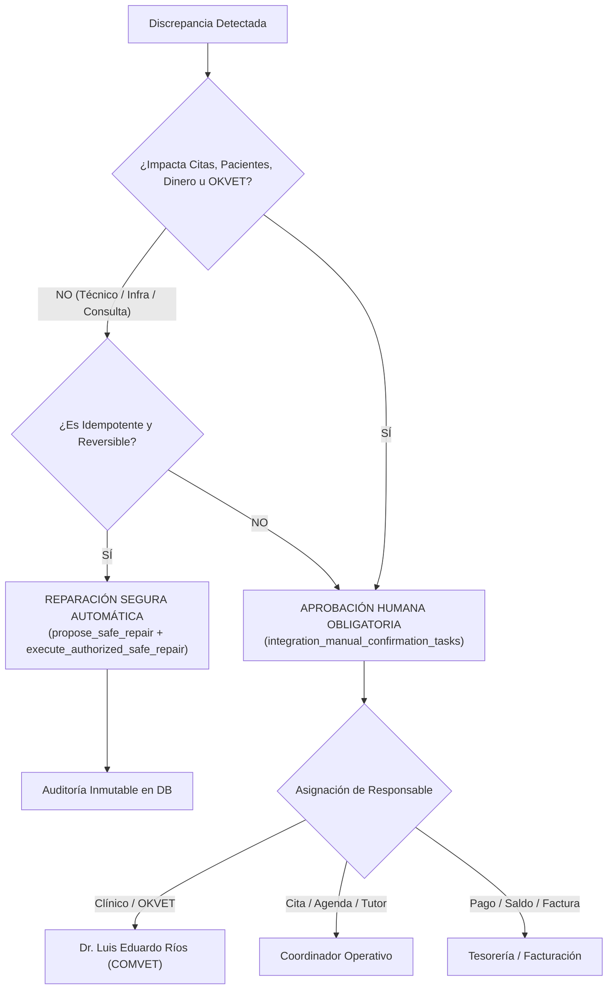

# VET FREEDOM OS — POLÍTICA DE REPARACIÓN SEGURA VS APROBACIÓN HUMANA
## Criterios de Automatización, Límites de Seguridad y Escalado a Centro de Control

---

### 1. Filosofía de Reparación Segura

En una clínica veterinaria donde cada cita representa un compromiso presencial y cada tratamiento impacta la salud animal, **la automatización ciega es inaceptable**.

VET FREEDOM OS divide categóricamente cualquier intento de corrección o reparación en dos grupos herméticos:
1. **Reparaciones Seguras Automatizables (`SAFE_REPAIR_PROPOSED`)**:
   Acciones técnicas puramente operativas, de infraestructura o de consulta idempotente que no alteran compromisos del mundo real, cobros ni diagnósticos médicos.
2. **Acciones con Aprobación Humana Obligatoria (`HUMAN_APPROVAL_PENDING`)**:
   Cualquier modificación que afecte citas pactadas, tratamientos, identidades de clientes/pacientes, transferencias de dinero o historias clínicas.

---

### 2. Catálogo Detallado de Clasificación de Acciones

#### A. Acciones Autorizadas como Reparación Segura (Auto-Reparables)
- **Re-consulta idempotente a API externa**: Volver a consultar el estado de un webhook perdido o confirmar un ID de transacción bancaria.
- **Liberación de lease/lock expirado**: Desbloquear un evento atascado en el transactional outbox con más de 5 minutos de inactividad.
- **Actualización de checkpoints de sincronización**: Mover el cursor de eventos tras verificar que todos los mensajes del lote anterior fueron procesados satisfactoriamente.
- **Descarte de eventos duplicados**: Marcar como `DUPLICATE_IGNORED` mensajes con `idempotency_key` repetida.
- **Renovación automática de suscripciones webhook**: Ejecutar la llamada de renovación de suscripción a Google Calendar o Meta API antes de su expiración.
- **Normalización de formatos no clínicos**: Estandarizar números telefónicos a formato internacional E.164 (`+57...`) o fechas a zona horaria `America/Bogota`.

#### B. Acciones que Exigen Aprobación Humana Obligatoria (Prohibido Auto-Reparar)
- **Modificación o Cancelación de Citas**: Cambiar el horario, veterinario asignado, dirección domiciliaria o cancelar una cita pactada con el cliente.
- **Aprobación o Sincronización en OKVET**: Cualquier inserción, alteración o firma de historia clínica, diagnóstico, receta médica o constancia de procedimiento.
- **Fusión de Clientes o Mascotas**: Unificar historiales clínicos o fichas familiares ante coincidencias de nombre o teléfono.
- **Alteración de Saldos o Estados de Pago**: Marcar una cita como pagada sin extracto bancario confirmado o condonar deudas.
- **Revocación o Re-autorización de Cuidadores**: Modificar la lista de tutores legales con acceso a documentos privados.
- **Envío de Mensajes Fuera de Protocolo**: Enviar notificaciones no estandarizadas a clientes o personal médico.

---

### 3. Matriz de Autorización por Rol Humano

| Tipo de Decisión | Rol Requerido | Nivel Mínimo de Permiso | Restricción Especial |
| :--- | :--- | :--- | :--- |
| **Clínica / Médica** | Médico Veterinario | Director Médico (Dr. Ríos) | Requiere matrícula profesional COMVET |
| **Operativa / Citas** | Coordinación Operativa | Coordinador General | Requiere justificación auditable y contacto al tutor |
| **Financiera / Pagos** | Tesorería / Facturación | Responsable Financiero | Requiere cotejo con extracto bancario Wompi |
| **Seguridad / Permisos**| Administrador del Sistema| Superadministrador | Requiere verificación de identidad del tutor legal |

- **Prohibición para la IA**: Los agentes de Inteligencia Artificial (LLMs) tienen **terminantemente prohibido** autorizar propuestas de reparación o cerrar discrepancias humanas. La IA solo puede clasificar, recopilar evidencia y redactar propuestas preliminares para la revisión de un humano responsable.
