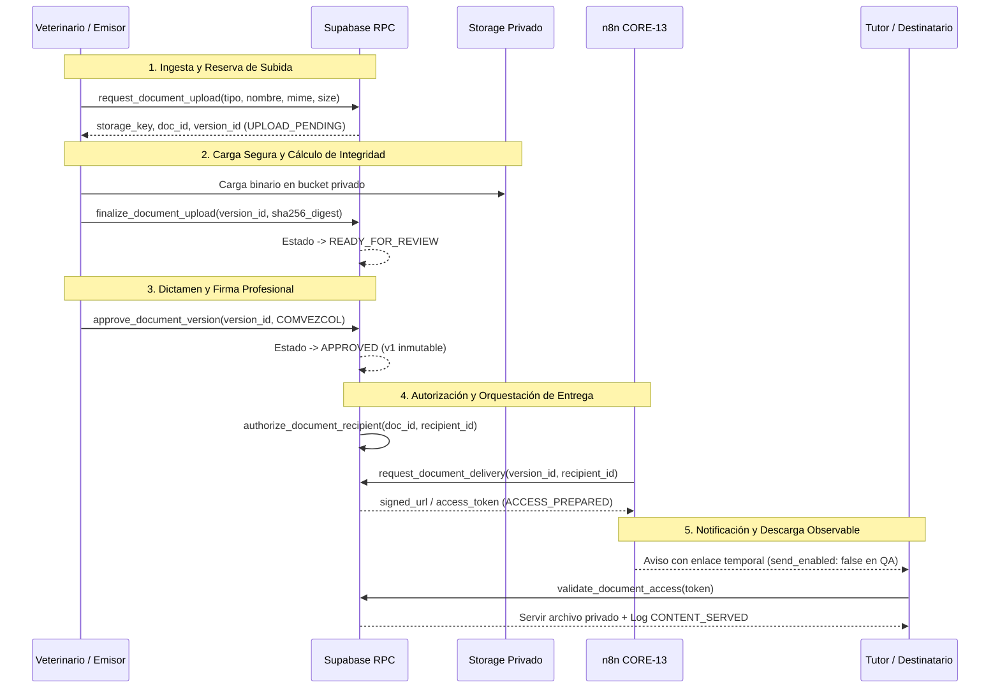

# VET FREEDOM OS — SECURE DOCUMENT LIFECYCLE
## Ciclo de Vida Completo del Documento: Desde la Carga hasta la Custodia Histórica
**Módulo:** VET-CORE-13 | APPROVED DOCUMENT DELIVERY  
**Dirección Médica:** Dr. Luis Eduardo Ríos  
**Plataformas:** Supabase Storage + PostgreSQL 17 + n8n Cloud  

---

## 1. Fases del Ciclo de Vida Documental

El ciclo de vida de todo documento dentro de Vet Freedom OS se rige por un procedimiento determinístico y verificable:

---

## 2. Detalle de las Etapas Operativas

### Etapa 1: Ingesta y Validación Preliminar
- Se valida la existencia del paciente (`pet_id`) y del cliente (`customer_id`) en `public.pets` y `public.owners`.
- Validación de cuotas de archivo: máximo 50 MB (`52428800 bytes`).
- Restricción de tipos MIME admitidos: `application/pdf`, `image/jpeg`, `image/png`, `image/webp`. Cualquier ejecutable (`.exe`, `.bat`, `.sh`) o formato no tipado es rechazado en seco.
- Creación del registro en `public.documents` (`document_status = 'UPLOAD_PENDING'`) y versión `v1` en `public.document_versions`.

### Etapa 2: Finalización de Subida y Huella Criptográfica
- Tras la subida al bucket privado, se calcula el hash criptográfico SHA-256 del binario.
- La función `finalize_document_upload` asienta el `sha256_digest`, valida el tamaño y transiciona el documento a `READY_FOR_REVIEW`.

### Etapa 3: Dictamen Profesional Veterinaria
- El profesional con tarjeta COMVEZCOL inspecciona el documento en Lovable.
- Si es aprobado, se invoca `approve_document_version`:
  - Se registra la firma en `public.document_approvals`.
  - El documento y la versión pasan a `APPROVED`.
- Si es rechazado, se invoca `reject_document_version`:
  - Se registra el motivo clínico.
  - El documento queda en `REJECTED`, bloqueando permanentemente su entrega.

### Etapa 4: Autorización de Destinatarios y Filtro de Privacidad
- La función `authorize_document_recipient` comprueba:
  - Si es tutor principal: parentesco activo en `owners`.
  - Si es cuidador: verificación en `caregiver_authorizations` de que `is_active = true`. Si fue revocado (`is_revoked = true`), la asignación se aborta inmediatamente.
  - Protocolo de Duelo: si la mascota falleció (`is_bereaved = true`), se cancelan los recordatorios asociados.

### Etapa 5: Entrega Segura y Concesión de Acceso
- La función `request_document_delivery` genera un token seguro opaco (`doc_tok_...`) con vigencia estricta de 24 horas.
- La entrega transiciona a `ACCESS_PREPARED`.

### Etapa 6: Acceso Observable y Descarga
- Cuando el tutor hace clic en el enlace, el gateway `validate_document_access` revalida en tiempo real que el token no haya expirado y que el cuidador no haya sido revocado en el intervalo.
- Si la validación es exitosa, se entrega el archivo y se registra el evento `DOCUMENT_CONTENT_SERVED` en `public.document_access_events`.
- **Axioma:** La descarga observable confirma la entrega técnica del archivo, pero no implica lectura ni comprensión clínica por parte del tutor.
