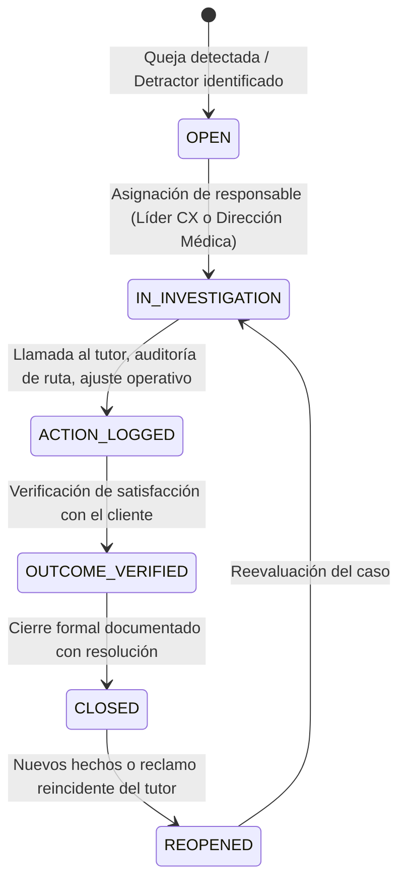

# VET FREEDOM OS — MÁQUINA DE ESTADOS: SERVICE RECOVERY

## 1. Ciclo de Vida del Caso de Recuperación
Todo caso de insatisfacción detectado (NPS <= 6 o reporte directo de queja) se gestiona formalmente en `customer_experience_recovery_cases`.

## 2. Reglas de Cierre y Verificación
1. **Prohibición de Cierre sin Acción:** Un caso no puede cerrarse sin haber registrado al menos una acción correctiva formal (`customer_experience_recovery_actions`).
2. **Verificación de Desenlace:** El desenlace debe estar tipificado (`RESOLVED_SATISFIED`, `RESOLVED_PARTIAL`, `UNRESOLVED`) con declaración o acuse del cliente.
3. **Reapertura Ilimitada:** Si el tutor expresa inconformidad posterior o se identifican errores adicionales, el caso se reabre con trazabilidad auditable.
