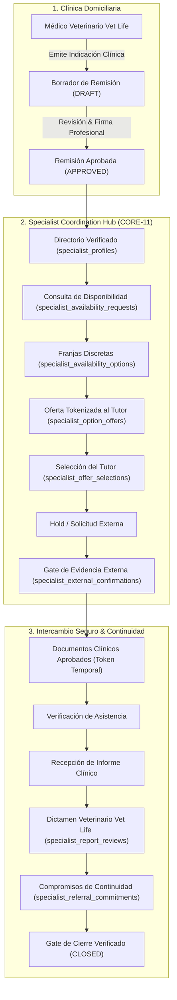

# VET FREEDOM OS — SPECIALIST REFERRAL HUB
## Arquitectura de Coordinación de Especialistas Externos y Remisiones Veterinarias
**Módulo:** VET-CORE-11 | SPECIALIST COORDINATION  
**Dirección Médica:** Dr. Luis Eduardo Ríos  
**Arquitectura:** Google Antigravity + n8n + Supabase + Lovable  
**Zona Horaria:** America/Bogota  
**Entorno:** DEVELOPMENT / QA (Safe Mode: Envíos externos y reservas reales desactivadas)

---

## 1. Visión General del Hub

El **Specialist Referral Hub** es el subsistema centralizado de Vet Freedom OS responsable de orquestar de punta a punta las derivaciones clínicas desde el servicio domiciliario de Vet Life hacia médicos veterinarios especialistas, clínicas de referencia y centros de diagnóstico autorizados.

---

## 2. Principios y Axiomas Inviolables

1. **Axioma de Autoría Clínica Exclusiva:** Solo un Médico Veterinario con tarjeta profesional activa puede indicar, modificar o aprobar una remisión. La Inteligencia Artificial, el personal no veterinario o los tutores tienen estrictamente prohibido originar o alterar indicaciones clínicas (`evaluate_action_risk = CLINICAL_APPROVAL_REQUIRED`).
2. **Axioma de la Selección del Cliente:** La selección de un horario por parte del tutor (`specialist_offer_selections`) bajo ninguna circunstancia constituye una cita médica confirmada. Constituye únicamente una manifestación de preferencia que habilita la gestión de reserva externa.
3. **Gate de Confirmación Externa:** Ninguna remisión transita al estado `EXTERNALLY_CONFIRMED` sin registrar evidencia externa verificable (`OFFICIAL_PROVIDER_REFERENCE`, confirmación por escrito, número de radicado o comunicación directa con la clínica receptora).
4. **Almacenamiento y Acceso Privado:** Todo informe y resumen clínico reside exclusivamente en buckets de almacenamiento privados (`referral-documents`). El acceso por parte de especialistas se realiza mediante URLs firmadas con tokens opacos de vigencia finita (máximo 72 horas) y revocación inmediata ante cancelación o reasignación.
5. **Gate Estricto de Cierre:** Una remisión no puede cerrarse (`CLOSED`) si existen compromisos médicos de seguimiento pendientes de atención (`specialist_referral_commitments`) o si el informe del especialista no ha sido revisado y dictaminado por un veterinario colegiado de Vet Life.
6. **Seguridad y Safe Mode:** Durante los entornos de desarrollo y QA, todos los despachos externos están forzados a `send_enabled: false`. Queda prohibido el envío de mensajes a tutores o la creación de reservas reales en agendas de terceros.

---

## 3. Integración con el Ecosistema Vet Freedom OS

- **VET-CORE-01 (Event Dispatcher):** Entrega eventos autorizados (`SPECIALIST_REFERRAL_REQUESTED`, `SPECIALIST_SLOT_SELECTED`).
- **VET-CORE-02 (WhatsApp Inbound):** Proporciona contexto de la conversación del tutor y canaliza respuestas de botones o enlaces de selección.
- **VET-CORE-03 (WhatsApp Outbound):** Gestiona el envío seguro de ofertas tokenizadas, confirmaciones y recordatorios mediante plantillas aprobadas por Meta.
- **VET-CORE-04 (Escalation):** Transfiere casos con objeciones del cliente, especialistas no disponibles o retrasos externos a coordinación humana.
- **VET-CORE-07 (Operational Reminders):** Monitorea vencimientos de ofertas, seguimientos de disponibilidad sin respuesta y tareas operativas.
- **VET-CORE-12 (Post-Visit Commitments):** Recibe los compromisos y planes de continuidad terapéutica dictaminados tras la evaluación del especialista.
- **VET-CORE-19 (Error Recovery):** Gestiona la idempotencia y reintentos ante fallos de red en webhooks externos.
- **VET-CORE-20 (Dead-Letter & Stale Detection):** Audita remisiones estancadas en estados intermedios sin avance por más de 72 horas.
