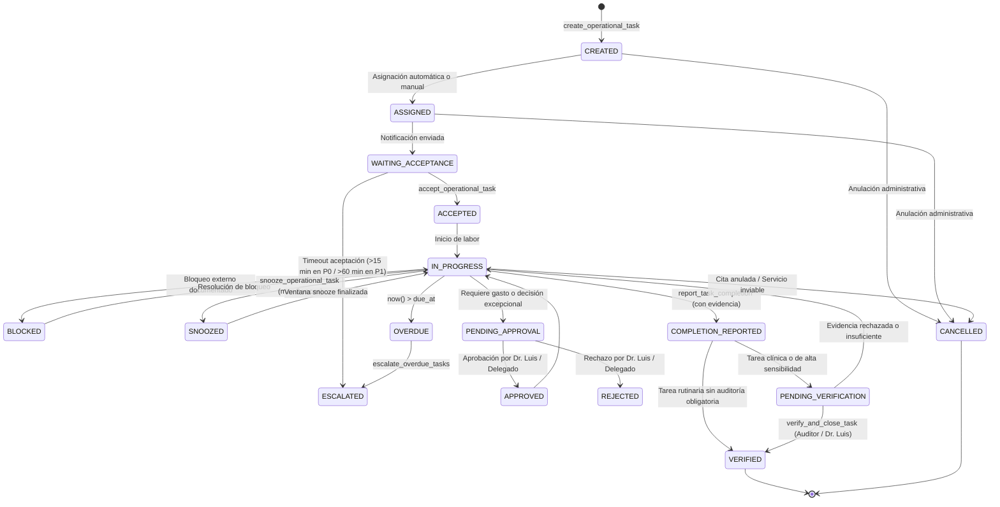

# VET FREEDOM OS — MÁQUINA DE ESTADOS DE TAREAS OPERATIVAS
**Módulo:** VET-CORE-07 | Task Lifecycle State Machine  
**Dirección Médica:** Dr. Luis Eduardo Ríos  
**Dirección Estratégica:** Alpha Vision Method  

---

## 1. Definición de Estados

La máquina de estados de `operational_tasks` gestiona 18 estados bien diferenciados para garantizar trazabilidad y claridad de responsabilidades:

| Estado | Significado Operativo | ¿Bloqueante? | Roles Habilitados |
| :--- | :--- | :---: | :--- |
| `CREATED` | Tarea registrada en BD, pendiente de asignación formal. | No | Sistema / Coordinador |
| `ASSIGNED` | Tarea asignada a un colaborador específico. | No | Sistema / Coordinador |
| `WAITING_ACCEPTANCE` | Notificación entregada al responsable; esperando confirmación de lectura y compromiso. | Sí (SLA) | Responsable asignado |
| `ACCEPTED` | Responsable aceptó formalmente la tarea y asumió la ejecución. | No | Responsable asignado |
| `IN_PROGRESS` | Tarea en curso de ejecución física o administrativa. | No | Responsable asignado |
| `BLOCKED` | Tarea detenida por dependencia externa (proveedor, cliente, laboratorio, OKVET). | Sí | Responsable / Coordinador |
| `WAITING_EXTERNAL` | Espera de resultado externo formal (ej. análisis patológico o slot de especialista). | Sí | Responsable |
| `WAITING_CLIENT` | Espera de respuesta o confirmación del tutor del paciente. | Sí | Responsable |
| `SNOOZED` | Tarea pospuesta temporalmente (máximo 3 veces por tarea). | No | Responsable / Coordinador |
| `OVERDUE` | Se ha superado `due_at` sin reporte de finalización. | Sí (Alerta) | Sistema |
| `ESCALATED` | Tarea escalada a supervisor o Dirección por incumplimiento o ausencia. | Sí (Prioridad) | Supervisor / Dr. Luis Ríos |
| `PENDING_APPROVAL` | Requiere autorización directiva o financiera antes de continuar. | Sí | Dr. Luis Ríos / Delegado |
| `APPROVED` | Aprobación directiva concedida; lista para ejecución. | No | Responsable |
| `REJECTED` | Propuesta o solicitud rechazada por Dirección; devuelta con notas. | No | Responsable / Sistema |
| `COMPLETION_REPORTED` | Responsable reportó la tarea como hecha y adjuntó evidencia. | No | Responsable |
| `PENDING_VERIFICATION` | En cola de auditoría; requiere validación de evidencia por supervisor/veterinario. | Sí (Cierre) | Supervisor / Dr. Luis Ríos |
| `VERIFIED` | Evidencia validada; tarea oficialmente concluida y cerrada con éxito. | No (Final) | Supervisor / Dr. Luis Ríos |
| `CANCELLED` | Tarea anulada justificadamente; recordatorios purgados. | No (Final) | Coordinador / Dirección |

---

## 2. Diagrama de Transición de Estados

---

## 3. Reglas de Validación de Transiciones

1. **Anti-Auto-Cierre Clínico:** Ningún colaborador operativo o administrativo puede transicionar una tarea con `is_clinically_sensitive = true` a `VERIFIED`. Esta transición es rechazada por el backend si el usuario ejecutor carece de atributo profesional veterinario.
2. **Límite de Aplazamientos (Anti-Snooze Abuse):** Cada llamado a `snooze_operational_task` incrementa `snooze_count`. Si `snooze_count >= max_snooze_limit` (por defecto 3), el sistema lanza una excepción `MAX_SNOOZE_LIMIT_EXCEEDED` y obliga al responsable a ejecutar, justificar bloqueo o escalar.
3. **Purga Inmediata de Recordatorios:** Al alcanzar `VERIFIED` o `CANCELLED`, los jobs en `operational_task_reminder_jobs` con estado `SCHEDULED` son actualizados atómicamente a `CANCELLED`, previniendo notificaciones huérfanas o erróneas.
