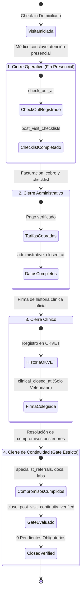

# VET FREEDOM OS — VISIT VS. CONTINUITY CLOSURE
## Modelo de Desacoplamiento de los Cuatro Cierres Asistenciales
**Módulo:** VET-CORE-12 | POST-VISIT COMMITMENTS  
**Dirección Médica:** Dr. Luis Eduardo Ríos  
**Plataforma:** PostgreSQL 17 (Supabase)  

---

## 1. El Dilema Operativo del Cierre Único

En sistemas veterinarios tradicionales, existe la peligrosa confusión de un "botón de Cerrar Visita" genérico que asume que, al terminar la presencia del profesional en el hogar del paciente, todo el caso médico ha finalizado. Esto causa que:
- Remisiones a especialistas queden en el limbo.
- Resultados de laboratorio nunca sean revisados por el médico tratante.
- Documentos prometidos a la familia no sean entregados.

Vet Freedom OS resuelve esta falencia mediante el **Desacoplamiento Canónico de los Cuatro Cierres**.



---

## 2. Definición y Alcance de Cada Cierre

| Dimensión de Cierre | Campo en `post_visit_cases` | Actor Autorizado | Condición de Aprobación | Impacto en Pendientes |
|---|---|---|---|---|
| **1. Cierre Operativo** | `operational_closed_at` | Médico Veterinario / Auxiliar | Salida del domicilio, hora de check-out y checklist inicial. | **NO afecta compromisos.** Los pendientes continúan abiertos y vigilados. |
| **2. Cierre Administrativo** | `administrative_closed_at` | Coordinación / Recepción / Finanzas | Registro de pago, validación de datos de contacto y consentimiento. | Permite radicar liquidaciones contables. |
| **3. Cierre Clínico** | `clinical_closed_at` | **Exclusivo:** Médico Veterinario con Tarjeta Profesional activa | Anamnesis, examen físico, diagnóstico y conducta médica asentados en OKVET. | **Inviolable:** Prohibido por IA o personal no médico. |
| **4. Cierre de Continuidad** | `continuity_closed_at` | Coordinación Médica / Dirección Médica | **Gate Estricto:** Cero compromisos pendientes, cero informes sin dictamen y cero documentos no entregados. | Marca el caso como `CLOSED_VERIFIED` o `CLOSED_WITH_EXCEPTION`. |

---

## 3. Invariante de Seguridad Relacional

El procedimiento `close_post_visit_continuity_verified` hace valer a nivel de base de datos la integridad del cierre:
```sql
-- Regla de Integridad en Supabase:
SELECT count(*) INTO v_pending_count
FROM public.post_visit_commitments
WHERE case_id = p_case_id
  AND status NOT IN ('VERIFIED_COMPLETE', 'CLOSED_WITH_DOCUMENTED_OUTCOME', 'CANCELLED_WITH_AUTHORIZATION');

IF v_pending_count > 0 THEN
    RAISE EXCEPTION 'Gate de Cierre Bloqueado: Existen % compromiso(s) obligatorio(s) pendiente(s).', v_pending_count;
END IF;
```
