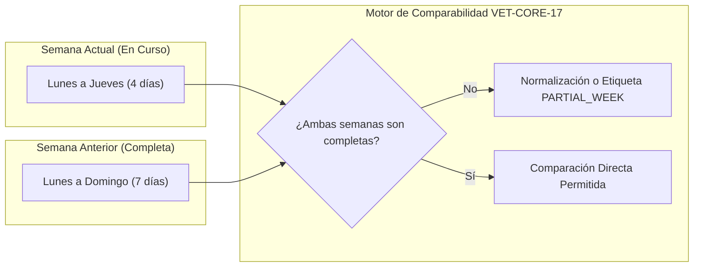

# Reglas de Comparabilidad y Equivalencia Temporal (VET-CORE-17)

**Módulo:** `VET-CORE-17 | WEEKLY REPORTING`  
**Proyecto:** VET FREEDOM OS — Vet Life: Veterinaria a Domicilio  
**Dirección Médica:** Dr. Luis Eduardo Ríos  
**Dirección Estratégica:** Alpha Vision Method  
**Entorno:** DEVELOPMENT / QA  
**Fecha:** 2026-11-21  

---

## 1. Principio de Comparabilidad Homogénea

> **Sólo pueden compararse períodos estrictamente homogéneos y equivalentes.**  
> Comparar una semana de 7 días contra una semana en curso de 3 días produce conclusiones erróneas. Comparar una semana normal contra una semana con festivos sin normalizar distorsiona la productividad del equipo médico.

---

## 2. Reglas de Validación de Comparabilidad

### Regla 1: Semanas Completas vs Semanas Parciales
- Si el reporte semanal se dispara a mitad de semana (por solicitud manual o webhook antes del domingo 23:59:59), el sistema emite el flag `PARTIAL_WEEK`.
- Las comparaciones contra la semana previa quedan marcadas con advertencia: `INCOMPARABLE_PERIODS: Current week is partial (4 days) vs 7 days baseline`.

### Regla 2: Tratamiento de Semanas con Días Festivos (Festivos Colombia)
- En Colombia existen semanas con 1 o 2 lunes festivos.
- Si una semana cuenta con 5 días hábiles y la semana previa contó con 6, la productividad absoluta descenderá de forma natural.
- El sistema calcula:
  1. Variación absoluta de visitas.
  2. Visitas por hora de turno efectivamente programada (métrica normalizada que elimina el sesgo del festivo).

### Regla 3: Cambios de Definición Metodológica
- Si la definición de una métrica cambia (por ejemplo, si la definición de "solicitud" pasa de "todo mensaje entrante" a "mensaje que supera el triaje inicial de IA"), se actualiza el `metric_catalog_version`.
- Las series históricas previas al cambio se etiquetan con `METHODOLOGY_CHANGE_SPLIT`, prohibiendo el cálculo directo de variaciones porcentuales sobre la frontera del cambio.

### Regla 4: Comparaciones Financieras Multi-Divisa
- Moneda base de operación: `COP` (Peso colombiano).
- Queda terminantemente prohibido comparar montos en USD o EUR directamente contra COP sin aplicar la tasa representativa del mercado (TRM) oficial del día de la transacción.

### Regla 5: Variaciones con Base Cero
- Si la semana anterior una métrica fue 0 (ej. 0 cirugías especializadas) y la semana actual es 3:
  - **No dividir por cero (evitar `Infinity` o `NaN`).**
  - Mostrar cambio absoluto: `+3 unidades`.
  - Nota metodológica: `Base previa cero; variación porcentual no calculable matemáticamente`.
