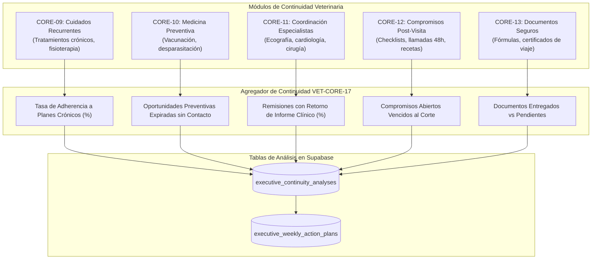

# Análisis Semanal de Continuidad Clínica y Compromisos (VET-CORE-17)

**Módulo:** `VET-CORE-17 | WEEKLY REPORTING`  
**Proyecto:** VET FREEDOM OS — Vet Life: Veterinaria a Domicilio  
**Dirección Médica:** Dr. Luis Eduardo Ríos  
**Dirección Estratégica:** Alpha Vision Method  
**Entorno:** DEVELOPMENT / QA  
**Fecha:** 2026-11-21  

---

## 1. Misión de la Continuidad Clínica en Vet Life

La medicina veterinaria de excelencia no concluye con la despedida en la puerta del tutor. La recuperación de un paciente y la fidelización del cliente dependen del cumplimiento estricto de los planes continuos: recurrencias (CORE-09), prevención periódica (CORE-10), remisiones a especialistas (CORE-11), compromisos post-visita (CORE-12) y entrega oportuna de documentos (CORE-13).

---

## 2. Indicadores Clave de Continuidad Semanal

### 1. Adherencia al Tratamiento Recurrente (CORE-09)
- **Definición:** Porcentaje de visitas de tratamiento crónico ejecutadas en la fecha prescrita versus las programadas.
- **Riesgo Clínico:** Si un paciente epiléptico o cardiópata suspende o aplaza su visita de control, el sistema emite una alerta roja médica hacia la Asistente Privada de Luis.

### 2. Brecha Preventiva (CORE-10)
- **Definición:** Mascotas que alcanzaron su fecha de refuerzo vacunal o desparasitación en la semana pero cuyos tutores no agendaron la visita preventiva tras los recordatorios autorizados.

### 3. Trazabilidad de Interconsultas y Especialistas (CORE-11)
- **Definición:** Porcentaje de remisiones emitidas que cuentan con:
  - Cita confirmada con el especialista externo.
  - Informe clínico y radiológico/ecográfico recibido de vuelta e integrado a OKVET.
  - Comunicación al tutor con el concepto consolidado del Dr. Luis.

### 4. Vencimiento de Compromisos Post-Visita (CORE-12)
- **Regla de Auditoría (T65):** Ningún compromiso puede permanecer en estado "abierto" indefinidamente. Si un compromiso de entrega de resultados supera las 48 horas de retraso:
  - Se etiqueta como `OVERDUE_BREACH`.
  - Se asigna automáticamente un plan de acción de mitigación en `executive_weekly_action_plans`.

### 5. Documentos Aprobados y Entregados (CORE-13)
- Ratio de fórmulas y certificados médicos firmados y entregados con link seguro efímero antes de 4 horas post-consulta.
