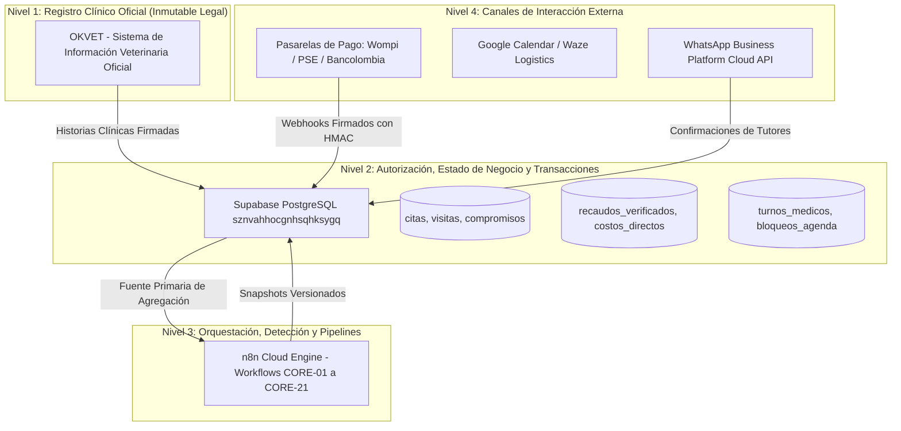

# Fuentes de Verdad y Jerarquía de Autoridad de Datos Semanales (VET-CORE-17)

**Módulo:** `VET-CORE-17 | WEEKLY REPORTING`  
**Proyecto:** VET FREEDOM OS — Vet Life: Veterinaria a Domicilio  
**Dirección Médica:** Dr. Luis Eduardo Ríos  
**Dirección Estratégica:** Alpha Vision Method  
**Entorno:** DEVELOPMENT / QA  
**Fecha:** 2026-11-21  

---

## 1. Jerarquía de Fuentes de Verdad (Single Source of Truth)

Para evitar contradicciones entre sistemas externos (OKVET, Google Calendar, pasarelas de pago) y la orquestación de n8n, Vet Life establece una jerarquía normativa inquebrantable:

---

## 2. Definición de Autoridad por Dominio de Negocio

| Dominio | Fuente de Autoridad Primaria | Regla de Validación y Conflicto |
| :--- | :--- | :--- |
| **Atención Clínica** | OKVET | Una visita se considera con cierre clínico oficial si y sólo si existe registro de historia clínica cerrada en OKVET. Una nota en WhatsApp no sustituye a OKVET. |
| **Estado de Visitas** | Supabase (`appointments`, `visits`) | El check-in presencial geolocalizado en la app del veterinario define la realización efectiva de la visita. |
| **Finanzas y Pagos** | Supabase (`financial_transactions`) | Un pago se reconoce como "Cobrado Verificado" sólo tras la validación de la firma criptográfica (HMAC) o conciliación bancaria. |
| **Horarios y Capacidad** | Supabase (`staff_schedules`, `protected_blocks`) | Google Calendar es un canal de visualización; los turnos y descansos válidos residen en Supabase. |
| **Compromisos y Tareas** | Supabase (`post_visit_commitments`) | Trazabilidad del responsable, fecha límite y estado verificable. |
| **Métricas Agregadas** | Supabase (`executive_weekly_reports`) | Ningún dashboard o cliente externo puede calcular sus propias métricas independientes; deben consultar los snapshots autorizados. |

---

## 3. Manejo de Discrepancias y Caídas de Fuentes

Cuando una fuente externa se encuentra caída o desincronizada:
1. **No inventar valores:** La métrica afectada se marca como `SOURCE_UNAVAILABLE`.
2. **Aislamiento de Dominios:** La indisponibilidad de la pasarela de pagos no interrumpe el cálculo de visitas médicas ni de compromisos clínicos.
3. **Registro en el Catálogo de Incidencias:** Se emite un registro hacia `VET-CORE-19` (DLQ e Incidentes) y se clasifica la anomalía para la conciliación transversal en `VET-CORE-18`.
