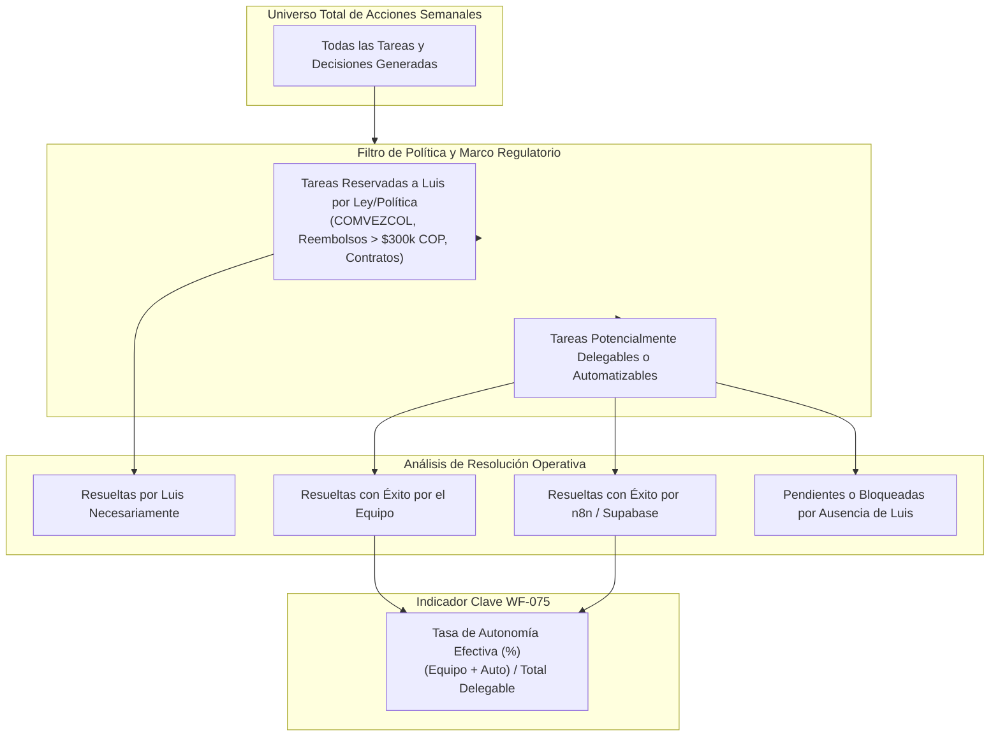

# Autonomía del Fundador y Desacoplamiento Operativo (WF-075)

**Módulo:** `VET-CORE-17 | WEEKLY REPORTING`  
**Proyecto:** VET FREEDOM OS — Vet Life: Veterinaria a Domicilio  
**Dirección Médica:** Dr. Luis Eduardo Ríos  
**Dirección Estratégica:** Alpha Vision Method  
**Entorno:** DEVELOPMENT / QA  
**Fecha:** 2026-11-21  

---

## 1. Misión Estratégica: Vet Freedom OS y la Libertad de Luis

El propósito nuclear de Vet Freedom OS y del método Alpha Vision es liberar al Dr. Luis Eduardo Ríos de la micro-operación rutinaria, permitiéndole operar en su zona de genialidad (Dirección Médica, estrategia clínica y crecimiento empresarial) sin que el negocio se detenga ante su ausencia.

---

## 2. Tipología de Tareas y Cuellos de Botella

### A. Tareas Reservadas al Fundador (No son Cuellos de Botella Negativos)
- Aprobación final de protocolos clínicos de alto riesgo.
- Firma y certificación legal médica (exigencia de COMVEZCOL).
- Autorización de devoluciones de dinero superiores a montos umbral preestablecidos.
- Decisiones de contratación o desvinculación de personal profesional.
> **Regla de Auditoría (T84):** El tiempo dedicado a tareas reservadas por ley o política jamás se clasifica como ineficiencia, dependencia tóxica o cuello de botella administrativo.

### B. Tareas Delegables Resueltas Autónomamente
- Reagendamiento de citas dentro de las políticas de cancelaciones.
- Gestión de quejas estándar de clientes y resolución de dudas no médicas.
- Seguimiento a resultados de laboratorio y recordatorios de prevención.
- Confirmación de pagos bancarios rutinarios.

### C. Procesos Automatizados con Éxito
- Generación y entrega segura de fórmulas médicas pre-aprobadas (CORE-13).
- Envío de encuestas de satisfacción post-visita (CORE-15).
- Despacho de briefs ejecutivos matutinos (CORE-16).
- Sincronización de eventos de calendario protegidos (CORE-03).

### D. Cuellos de Botella Críticos por Dependencia de Luis
- Citas que quedaron en espera de confirmación porque nadie más tenía permiso de agendar en la zona.
- Remisiones a especialistas retrasadas por falta de validación de un documento estándar.
- Facturas pendientes de emisión por aprobación de un descuento comercial ordinario.

---

## 3. Fórmula Matemática de la Tasa de Autonomía

$$\text{Tasa de Autonomía Operativa} = \left( \frac{\text{Tareas Delegables Resueltas por Equipo} + \text{Tareas Automatizadas Con Éxito}}{\text{Total de Tareas Delegables Generadas en la Semana}} \right) \times 100$$

### Reglas de Control:
1. **Denominador Explícito (T90):** Si no se generaron tareas delegables en la semana, la tasa se reporta como `100% (No delegable demand)` o `N/A`, nunca un error de división por cero.
2. **Ahorros de Tiempo Demostrables (T86, T87):** Queda terminantemente prohibido calcular "horas ahorradas" con fórmulas especulativas. Sólo se computan ahorros basados en tiempos estándar medidos empíricamente para flujos completados exitosamente.
3. **Automatizaciones Fallidas (T86):** Si un workflow de n8n falló y tuvo que ser intervenido manualmente por Luis, ese evento **no suma como ahorro** y se registra como incidente en CORE-19.
