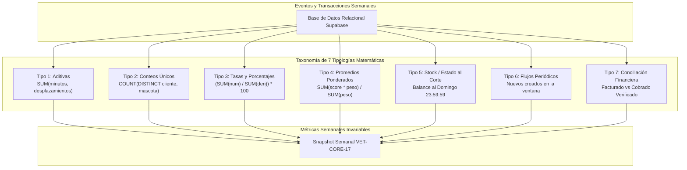

# Taxonomía y Reglas Matemáticas de Agregación Semanal (VET-CORE-17)

**Módulo:** `VET-CORE-17 | WEEKLY REPORTING`  
**Proyecto:** VET FREEDOM OS — Vet Life: Veterinaria a Domicilio  
**Dirección Médica:** Dr. Luis Eduardo Ríos  
**Dirección Estratégica:** Alpha Vision Method  
**Entorno:** DEVELOPMENT / QA  
**Fecha:** 2026-11-21  

---

## 1. El Axioma Fundamental de la Agregación

> **Un reporte semanal JAMÁS es la simple suma de los 7 reportes diarios.**  
> Sumar promedios produce falacias estadísticas; sumar clientes únicos diarios infla artificialmente la base de tutores atendidos; sumar saldos de cartera multiplica el capital adeudado.

El motor de `VET-CORE-17` implementa una **Taxonomía de Agregación en 7 Tipos Matemáticos**, auditada contra los tests T11 a T20.

---

## 2. Taxonomía de las 7 Tipologías Matemáticas

### Detalle de Implementación por Tipología:

### Tipo 1: Métricas Aditivas (Suma Pura)
- **Definición:** Magnitudes continuas donde cada unidad temporal añade valor independiente.
- **Ejemplos:** Minutos de atención médica presencial, kilómetros recorridos por móviles, horas totales de turno prestadas.
- **Fórmula:**
  $$\text{Total Semanal} = \sum_{i=1}^{n} \text{valor}_i$$

### Tipo 2: Conteos Únicos (COUNT DISTINCT Obligatorio)
- **Definición:** Entidades individuales que interactúan durante la semana. Si un tutor solicita servicio el martes para su perro y el viernes para su gato, o realiza dos visitas con la misma mascota, sigue siendo **un único tutor atendido en la semana**.
- **Fórmula:**
  $$\text{Tutores Únicos} = \text{COUNT}(\text{DISTINCT tutor\_id})$$
  $$\text{Mascotas Únicas} = \text{COUNT}(\text{DISTINCT pet\_id})$$
- **Regla Estricta:** Queda terminantemente prohibido hacer $\sum_{d=\text{lun}}^{\text{dom}} \text{tutores\_del\_día}_d$.

### Tipo 3: Tasas y Porcentajes Globales
- **Definición:** Ratios de conversión o cumplimiento. No se promedian los porcentajes diarios porque cada día tiene distinta ponderación muestral.
- **Fórmula:**
  $$\text{Tasa de Conversión Semanal} = \left( \frac{\sum_{i=1}^{7} \text{citas\_completadas}_i}{\sum_{i=1}^{7} \text{solicitudes\_recibidas}_i} \right) \times 100$$
- **Control de Denominador Cero:** Si $\sum \text{solicitudes} == 0$, el resultado es `null` con etiqueta `NOT_APPLICABLE` o `NO_DATA`. **Jamás se muestra 100% ni NaN.**

### Tipo 4: Promedios Ponderados
- **Definición:** Indicadores de satisfacción o tiempos de respuesta donde el peso de cada observación debe respetarse.
- **Fórmula:**
  $$\overline{\text{CSAT}} = \frac{\sum_{j=1}^{k} (\text{score}_j \times \text{respuestas}_j)}{\sum_{j=1}^{k} \text{respuestas}_j}$$

### Tipo 5: Métricas de Stock / Estado al Corte
- **Definición:** Magnitudes acumuladas vivas en un instante determinado.
- **Ejemplos:** Compromisos post-visita abiertos al corte dominical, cuentas por cobrar vigentes al cierre.
- **Regla Estricta:** Se evalúan exactamente al instante `2026-11-22T23:59:59.999-05:00`. No se acumulan ni suman saldos de días previos.

### Tipo 6: Métricas de Flujo
- **Definición:** Unidades creadas, resueltas o expiradas dentro de la ventana semanal.
- **Ejemplos:** Nuevos planes de cuidado recurrente iniciados, quejas ingresadas en la semana, quejas resueltas en la semana.

### Tipo 7: Métricas Financieras y Conciliación
- **Definición:** Reconocimiento monetario estricto distinguiendo lo devengado de lo efectivamente recaudado.
- **Regla Estricta:** Separación matemática entre:
  - `Monto Facturado Bruto` (Emisión de cuenta de cobro / factura).
  - `Monto Cobrado Verificado` (Confirmación bancaria o pasarela exitosa).
  - `Monto Cobrado Conciliado` (Confirmación con recibo contable definitivo).
  - `Costos Directos Variables` (Combustible registrado + Insumos clínicos documentados + Honorarios de especialistas).
  - `Margen de Contribución` = `Cobrado Verificado - Costos Directos Variables`.

---

## 3. Tratamiento de Faltantes y Calidad de Datos

- **Axioma:** `null != 0`. Si la pasarela de pagos estuvo inaccesible, el recaudo es `null` con estado `SOURCE_UNAVAILABLE`. Mostrar `$0 COP` falsificaría la realidad financiera y generaría pánico injustificado en la Dirección.
- **Muestras Pequeñas:** Si una métrica estadística (ej. CSAT) cuenta con menos de 5 observaciones, se le añade un tag obligatorio `LOW_SAMPLE_SIZE_WARNING`.
