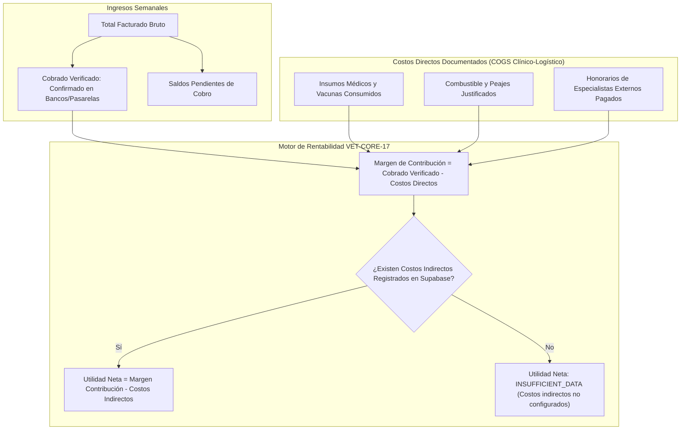

# Análisis Semanal de Rentabilidad y Guardrails Financieros (VET-CORE-17)

**Módulo:** `VET-CORE-17 | WEEKLY REPORTING`  
**Proyecto:** VET FREEDOM OS — Vet Life: Veterinaria a Domicilio  
**Dirección Médica:** Dr. Luis Eduardo Ríos  
**Dirección Estratégica:** Alpha Vision Method  
**Entorno:** DEVELOPMENT / QA  
**Fecha:** 2026-11-21  

---

## 1. El Mandato de Rigor Contable y Financiero

> **Prohibido terminantemente inventar márgenes, costos o utilidades netas.**  
> Si los costos fijos indirectos (alquiler, software contable, honorarios de asesoría legal) no están registrados en la base de datos, el sistema **no puede ni debe calcular una supuesta "utilidad neta"**. Presentar números de ganancia sin base documental expone a Vet Life a decisiones de gasto temerarias.

---

## 2. Niveles de Análisis de Rentabilidad

### Nivel 1: Cobranza y Efectividad de Caja
- **Índice de Efectividad de Recaudo:**
  $$\text{Efectividad de Recaudo} = \left( \frac{\text{Cobrado Verificado}}{\text{Facturado Bruto Total}} \right) \times 100$$
- Los pagos en disputa, pendientes de validación o con rechazo bancario se aíslan en la categoría `CARTERA_POR_GESTIONAR`.

### Nivel 2: Margen de Contribución por Servicio y Ruta
- Calcula la rentabilidad directa de cada desplazamiento domiciliario:
  - Ingreso recaudado por consulta/procedimiento.
  - Menos insumos biológicos o farmacológicos usados.
  - Menos costo de combustible asignado por kilometraje registrado en ruta.
  - Menos pago a especialista (si la consulta requirió interconsulta).

### Nivel 3: Lucro Cesante por Cancelaciones Tardías
- Cuando un tutor cancela una visita con menos de 2 horas de anticipación:
  - Se registra el tiempo clínico bloqueado que no pudo ser reasignado a otro paciente.
  - Se calcula el costo de oportunidad estimado sin distorsionar el recaudo real.
  - Se analiza si la política de penalidad o cobro de anticipo (CORE-14) fue aplicada.

---

## 3. Estados de Calidad Financiera

| Estado | Significado | Acción del Sistema |
| :--- | :--- | :--- |
| `VERIFIED` | Datos cruzados y conciliados contra extracto bancario o webhook firmado. | Cálculo oficial de ingresos y margen de contribución. |
| `PARTIALLY_VERIFIED` | Parte de los pagos se verificó por pasarela, pero faltan transferencias manuales. | Muestra cifra provisional con advertencia de auditoría pendiente. |
| `INSUFFICIENT_DATA` | Costos fijos o costos de insumos no suministrados para la semana. | Inhibe el cálculo de Utilidad Neta; muestra únicamente Margen de Contribución con nota explicativa. |
| `SOURCE_UNAVAILABLE` | Pasarela o ERP contable inaccesible durante el procesamiento del corte. | No asume `$0 COP`; emite alerta de integración financiera hacia CORE-19. |
