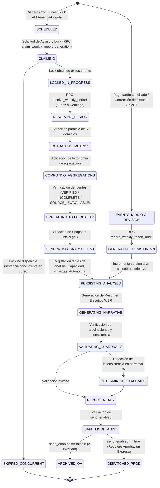

# Máquina de Estados del Reporte Semanal (VET-CORE-17)

**Módulo:** `VET-CORE-17 | WEEKLY REPORTING`  
**Proyecto:** VET FREEDOM OS — Vet Life: Veterinaria a Domicilio  
**Dirección Médica:** Dr. Luis Eduardo Ríos  
**Dirección Estratégica:** Alpha Vision Method  
**Entorno:** DEVELOPMENT / QA  
**Fecha:** 2026-11-21  

---

## 1. Ciclo de Vida del Reporte Semanal

El ciclo de vida del reporte ejecutivo semanal garantiza la consistencia de los datos, el bloqueo ante ejecuciones concurrentes, la inmutabilidad histórica de los snapshots y la trazabilidad de revisiones posteriores.

---

## 2. Estados Detallados y Transiciones

| Estado | Descripción | Precondición | Postcondición |
| :--- | :--- | :--- | :--- |
| `SCHEDULED` | Evento temporal alcanzado (Lunes 07:00 AM Bogota). | Reloj del sistema alcanza el instante programado. | Se invoca el workflow de n8n. |
| `CLAIMING` | Intento de reserva exclusiva para la semana. | Identificador `year_week` (ej. `2026-W47`). | RPC ejecuta `pg_try_advisory_xact_lock()`. |
| `LOCKED_IN_PROGRESS` | Bloqueo activo otorgado a este proceso. | Ningún otro proceso posee el lock. | Estado en `executive_weekly_reports` = `GENERATING`. |
| `EXTRACTING_METRICS` | Consulta multi-fuente en Supabase. | Lock activo y fechas de período delimitadas. | Payloads JSON de operación, finanzas, capacidad, etc. |
| `COMPUTING_AGGREGATIONS` | Procesamiento matemático riguroso. | Payloads recibidos. | Conteos únicos, tasas semanales y promedios ponderados. |
| `EVALUATING_DATA_QUALITY` | Clasificación de confianza de métricas. | Agregaciones calculadas. | Asignación de flags `VERIFIED`, `PROVISIONAL`, `SOURCE_UNAVAILABLE`. |
| `GENERATING_SNAPSHOT_V1` | Inserción inmutable del primer corte. | Calidad evaluada. | Fila en `executive_weekly_snapshots` con `version_number = 1`. |
| `REPORT_READY` | Reporte completo con WBR y tablas auxiliares. | Snapshot y análisis persistidos. | Reporte disponible para lectura RLS en Supabase y Lovable. |
| `REVISED_VN` | Nueva versión generada por datos extemporáneos. | Existencia previa de versión `v(n-1)`. | Fila en `executive_weekly_report_versions` con diff documentado. |

---

## 3. Garantías de Inmutabilidad y No Sobreescritura

1. **Snapshots como Cajas Negras:** Una vez creada la versión `v1` en `executive_weekly_snapshots`, sus campos de resultados jamás son alterados por un `UPDATE`.
2. **Revisiones Incrementales:** Cuando un pago de la semana anterior es conciliado el martes o miércoles posterior, el sistema dispara una revisión controlada que crea `version_number = 2`, registrando en `executive_weekly_audit`:
   - Motivo del recálculo (`recalculation_reason`).
   - Diferencias cuantitativas exactas (`diff_json`).
   - Actor o proceso que solicitó la revisión (`triggered_by`).
