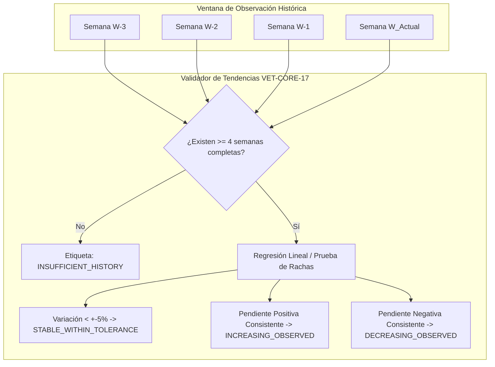

# Validación Científica de Tendencias y Anomalías (VET-CORE-17)

**Módulo:** `VET-CORE-17 | WEEKLY REPORTING`  
**Proyecto:** VET FREEDOM OS — Vet Life: Veterinaria a Domicilio  
**Dirección Médica:** Dr. Luis Eduardo Ríos  
**Dirección Estratégica:** Alpha Vision Method  
**Entorno:** DEVELOPMENT / QA  
**Fecha:** 2026-11-21  

---

## 1. Principio Contra la Alucinación de Tendencias

> **Una variación de una única semana NO constituye una tendencia.**  
> Si las consultas caen un 8% durante una semana lluviosa en Bogotá, presentar el hecho como *"colapso en la demanda de servicios"* es una alucinación analítica irresponsable.

El motor de tendencias de `VET-CORE-17` exige un mínimo de **4 semanas completas consecutivas** para calificar un comportamiento como tendencia (`INCREASING_OBSERVED`, `DECREASING_OBSERVED` o `STABLE_WITHIN_TOLERANCE`).

---

## 2. Clasificación Normativa de Tendencias

| Estado de Tendencia | Requisito Mínimo | Interpretación Operativa para Luis |
| :--- | :--- | :--- |
| `INSUFFICIENT_HISTORY` | Menos de 4 semanas de datos completos. | No se emiten juicios estructurales; se presenta el dato aislado como hecho coyuntural. |
| `STABLE_WITHIN_TOLERANCE` | $\geq 4$ semanas con variaciones dentro de una banda de $\pm 5\%$. | Operación predecible y bajo control estadístico. |
| `INCREASING_OBSERVED` | $\geq 4$ semanas con pendiente positiva monótona o estadísticamente significativa. | Crecimiento sostenido. Evaluar capacidad de respuesta para no saturar al equipo. |
| `DECREASING_OBSERVED` | $\geq 4$ semanas con pendiente negativa sostenida. | Deterioro estructural. Requiere activación de análisis de causa raíz. |
| `HIGH_VOLATILITY` | Variaciones aleatorias $> \pm 25\%$ entre semanas sin patrón. | Inestabilidad en la demanda o irregularidad logística en rutas. |

---

## 3. Detección de Anomalías Operativas

El sistema compara la semana actual contra el promedio móvil y la desviación estándar de las últimas 8 semanas completas:
1. **Anomalía Leve ($1.5 \sigma < |z| \le 2.0 \sigma$):** Se incluye en el reporte como nota informativa amarilla.
2. **Anomalía Severa ($|z| > 2.0 \sigma$):** Dispara una bandera de atención prioritaria en el resumen ejecutivo WBR.
3. **Causa Conjetural vs Causa Demostrada:** Toda anomalía señalada por la IA debe distinguir explícitamente entre:
   - *Hecho comprobable:* "El tiempo de traslado vehicular aumentó 35% en la zona Norte".
   - *Hipótesis por validar:* "Posible impacto de obras viales en la Autopista Norte". Jamás afirmar la conjetura como hecho consumado sin evidencia telemática.
