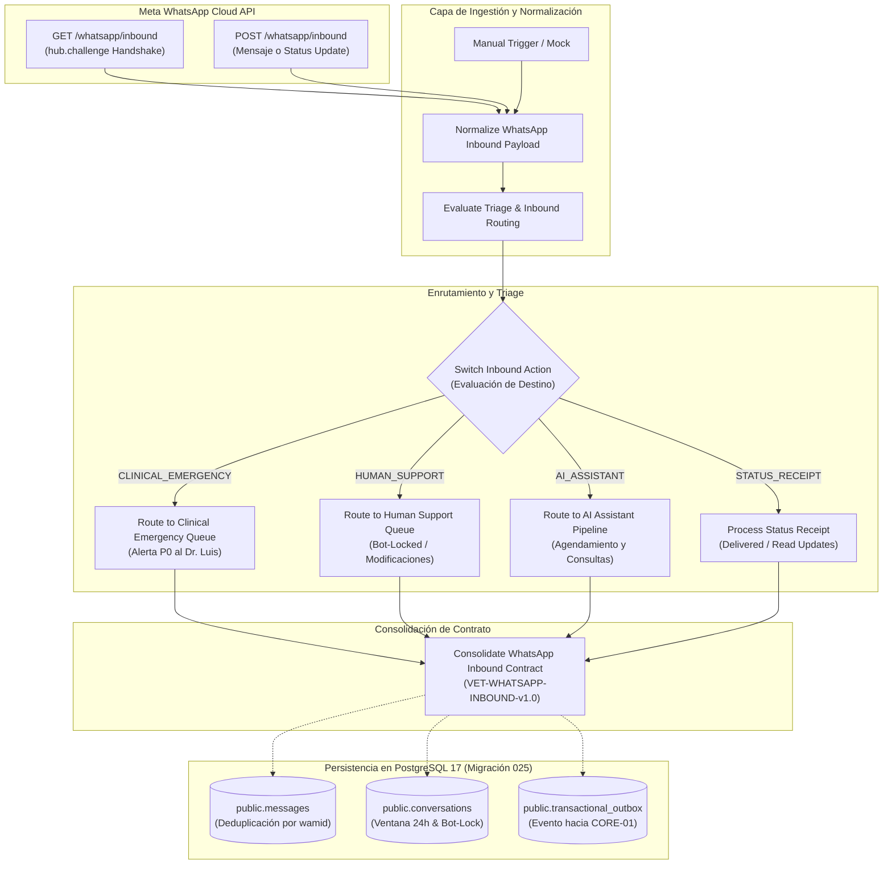

# ARQUITECTURA DE ENTRADA Y ENRUTAMIENTO WHATSAPP (VET-CORE-02)
**Proyecto:** VET FREEDOM OS — Vet Life (Veterinaria a Domicilio)  
**Dirección Médica:** Dr. Luis Eduardo Ríos  
**Dirección Estratégica:** Alpha Vision Method  
**Módulo:** `VET-CORE-02 | WhatsApp Inbound Webhook & Routing`  
**ID en n8n Cloud:** `aE0sFsDFsQiAXfNy`  
**ID de Carpeta:** `EWfSa40jLDxPUOKX`  
**Base de Datos:** Supabase PostgreSQL 17 (`sznvahhocgnhsqhksygq`)  
**Zona Horaria:** `America/Bogota` (UTC-5)  
**Estado:** `VERIFIED`

---

## 1. Misión Arquitectónica
`VET-CORE-02` es la puerta de entrada principal para la comunicación con tutores y clientes de Vet Life vía WhatsApp Business Cloud API. Realiza la ingestión determinista, normalización multiformato, deduplicación estricta por `wamid`, identificación de tutores y pacientes en Supabase, triage clínico automático y respeto incondicional a la bandera `is_bot_locked`.

### Principios Fundamentales:
1. **Deduplicación Estricta:** Todo mensaje cuenta con un identificador único de proveedor (`wamid`). Si un mensaje ya fue procesado, se descarta idempotentemente respondiendo 200 OK para evitar reintentos de Meta.
2. **Prioridad Vital y Triage Inmediato:** Ante palabras clave de emergencias críticas (convulsiones, hemorragias, intoxicaciones, disnea), el bot se bloquea preventivamente y se genera una alerta prioritaria `P0` al Dr. Luis Eduardo Ríos.
3. **Respeto a la Intervención Humana (Bot-Lock):** Cuando un veterinario o asesor humano toma el control de una conversación (`is_bot_locked = true`), las respuestas automáticas de IA quedan suspendidas y los mensajes se dirigen a la bandeja de entrada del personal.
4. **Desacoplamiento Mediante Transactional Outbox:** Cada mensaje válido se persiste en `public.messages` y emite un evento atómico a `public.transactional_outbox` para ser consumido por `VET-CORE-01` (Event Dispatcher), garantizando resiliencia sin acoplamiento temporal.

---

## 2. Diagrama Arquitectónico de Flujo

---

## 3. Componentes de Base de Datos (Migración 025)

### 3.1. Índices Desplegados
- `idx_messages_external_id_unique`: Índice parcial único en `public.messages(external_message_id)` que garantiza deduplicación física en base de datos.
- `idx_owners_primary_phone` y `idx_owners_secondary_phone`: Búsqueda instantánea de tutores por teléfono normalizado E.164.
- `idx_conversations_channel_phone`: Indexación de conversaciones activas por organización, canal y teléfono.

### 3.2. Funciones RPC Atómicas
- `public.ingest_whatsapp_inbound_message(p_payload jsonb)`: Ingesta el payload, deduplica por `wamid`, vincula tutor y paciente, evalúa triage y emite al outbox.
- `public.set_conversation_bot_lock(p_conversation_id uuid, p_locked boolean, p_reason text)`: Bloquea o desbloquea el bot con auditoría de motivo en metadata.
- `public.get_conversation_context(p_conversation_id uuid)`: Recupera el contexto completo (tutor, mascotas, últimos 10 mensajes y estado) para consumo de Lovable y agentes.
