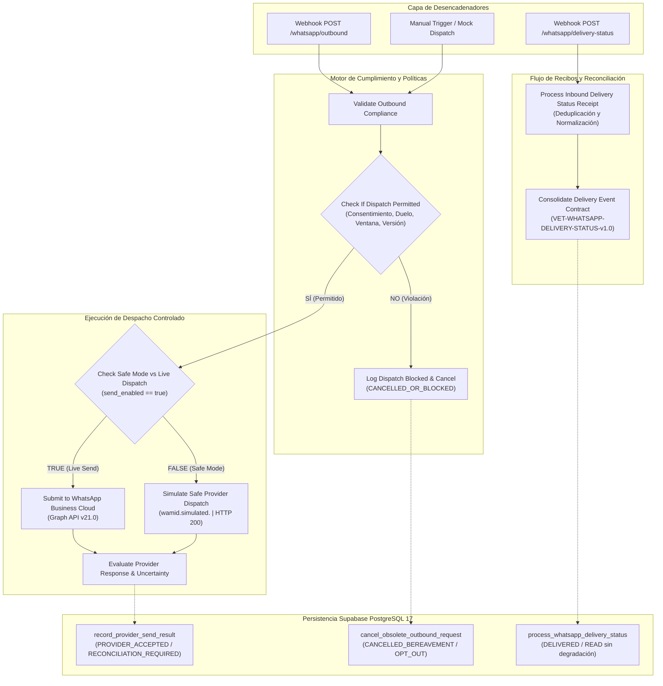
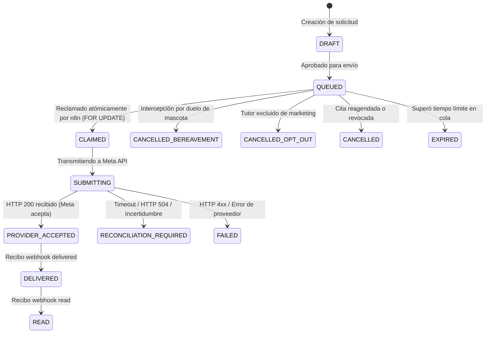

# ARQUITECTURA DE SALIDA Y RECONCILIACIÓN WHATSAPP (VET-CORE-03)
**Proyecto:** VET FREEDOM OS — Vet Life (Veterinaria a Domicilio)  
**Dirección Médica:** Dr. Luis Eduardo Ríos  
**Dirección Estratégica:** Alpha Vision Method  
**Módulo:** `VET-CORE-03 | WhatsApp Outbound & Delivery Reconciliation`  
**ID en n8n Cloud:** `CURcbtf1AsoTNAV6`  
**ID de Carpeta:** `EWfSa40jLDxPUOKX`  
**Base de Datos:** Supabase PostgreSQL 17 (`sznvahhocgnhsqhksygq`)  
**Zona Horaria:** `America/Bogota` (UTC-5)  
**Estado:** `VERIFIED / SAFE MODE ACTIVE`

---

## 1. Misión Arquitectónica
`VET-CORE-03` es el componente central de comunicación saliente de Vet Life hacia tutores de mascotas a través de la plataforma oficial de WhatsApp Business Cloud API. Su arquitectura garantiza:
1. **Cumplimiento Estricto de Políticas de Meta:** Validación de ventana de atención al cliente de 24 horas (`is_within_24h_window`), uso obligatorio de plantillas HSM aprobadas fuera de ventana, y supresión de mensajes a números sin consentimiento explícito.
2. **Protocolo Vital de Duelo (Bereavement Protocol):** Bloqueo y cancelación automática de recordatorios de citas o mensajes preventivos si la mascota ha fallecido o el tutor se encuentra en duelo.
3. **Control Anti-Colisión y Prevención de Stale AI Drafts:** Verificación en base de datos de la bandera `is_bot_locked` y validación de `draft_state_version` para evitar que un borrador tardío de IA se despache cuando un veterinario o asesor humano ya tomó el control.
4. **Reclamación Atómica con Concurrencia Segura:** Uso de bloqueo de fila a nivel de base de datos (`SELECT ... FOR UPDATE`) en el procedimiento `claim_authorized_outbound_message` para impedir envíos duplicados por workers concurrentes.
5. **Reconciliación de Entrega Asíncrona:** Ingesta de webhooks de estado (`sent`, `delivered`, `read`, `failed`) con deduplicación y garantía estricta de no-degradación de estados (un webhook tardío `sent` nunca degrada un estado `READ`).
6. **Modo Seguro Obligatorio (Safe Mode):** Ejecución con `send_enabled = false` en entornos de desarrollo y pruebas, desviando la solicitud al simulador sintético verificado que emite identificadores conformes `wamid.simulated.<id>` y previene envíos no autorizados a clientes reales.

---

## 2. Diagrama Arquitectónico de Flujo

---

## 3. Estados del Ciclo de Vida del Mensaje Saliente
El ciclo de vida en `public.outbound_dispatch_requests` contempla 19 estados rigurosamente auditados:

---

## 4. Puntos Críticos de Concurrencia y Resiliencia
- **Row Locking (`FOR UPDATE`):** La función `public.claim_authorized_outbound_message` selecciona la solicitud con bloqueo exclusivo a nivel de fila y actualiza inmediatamente a `CLAIMED`, incrementando `dispatch_attempts`. Ningún otro worker puede reclamar la misma solicitud.
- **Tratamiento de Incertidumbre de Red (HTTP 504 / Timeouts):** Si la llamada a Meta experimenta timeout o interrupción de conexión, el mensaje se transfiere a `RECONCILIATION_REQUIRED` y se **prohíbe el reintento a ciegas**. Se espera la llegada del webhook de estado de entrega de Meta o una reconciliación pasiva.
- **Precedencia de Estados de Entrega:** Los webhooks de Meta pueden llegar fuera de orden debido a redes móviles intermitentes. La lógica en `process_whatsapp_delivery_status` aplica jerarquía estricta: `READ (3) > DELIVERED (2) > SENT (1)`. Un recibo `sent` nunca degrada un registro que ya alcanzó `DELIVERED` o `READ`.
