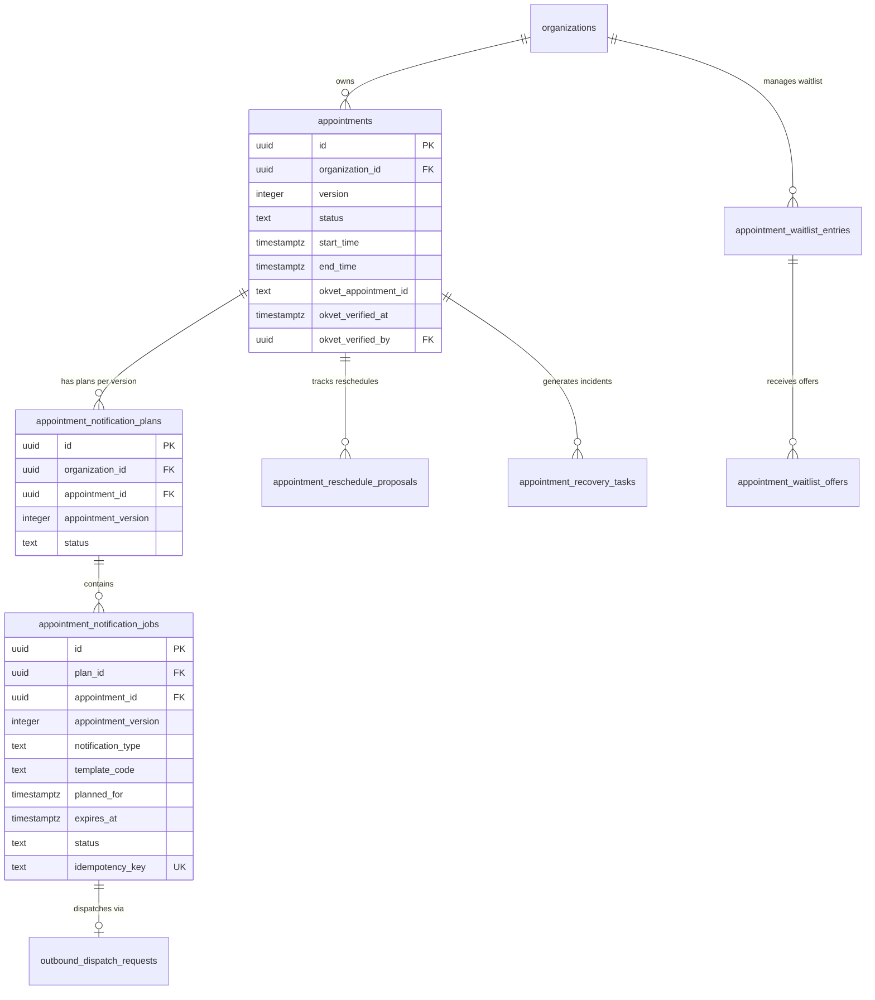

# VET FREEDOM OS — ESQUEMA DE BASE DE DATOS DE CITAS Y NOTIFICACIONES
**Módulo:** VET-CORE-05 | Appointment Notification Service & Scheduling Gate  
**Migración Base:** `028_appointment_notifications_lifecycle_and_okvet.sql`  
**Motor:** Supabase PostgreSQL 17  
**Seguridad:** 100% Row Level Security (RLS) habilitado

---

## 1. Diagrama Entidad-Relación

---

## 2. Diccionario de Tablas Creadas en Migración 028

### A. `public.appointment_notification_plans`
Rastrea la vigencia de la política de notificación para una versión específica de una cita:
* `id` (`uuid`, PK): Identificador único.
* `organization_id` (`uuid`, FK -> `organizations.id`): Aislamiento multi-tenant.
* `appointment_id` (`uuid`, FK -> `appointments.id`): Referencia a la cita.
* `appointment_version` (`integer`, NOT NULL): Versión específica de la cita (`1, 2, 3...`).
* `policy_version` (`text`, DEFAULT `'v1.0'`): Versión de la política de notificación.
* `status` (`text`, CHECK `ACTIVE`, `INVALIDATED`, `SUPERSEDED`, `CANCELLED`, `COMPLETED`).
* Restricción única: `UNIQUE (organization_id, appointment_id, appointment_version)`.

### B. `public.appointment_notification_jobs`
Trabajos de envío programados durables en base de datos:
* `id` (`uuid`, PK): Identificador del trabajo.
* `plan_id` (`uuid`, FK -> `appointment_notification_plans.id`): Plan padre.
* `organization_id` (`uuid`, FK): Organización.
* `appointment_id` (`uuid`, FK): Cita objetivo.
* `appointment_version` (`integer`): Versión de la cita al programarse.
* `notification_type` (`text`): `CONFIRMATION_OFFICIAL`, `REMINDER_24H`, `REMINDER_2H`, `RESCHEDULE_PROPOSAL`, `RESCHEDULE_CONFIRMED`, `CANCELLATION_CONFIRMED`, `NO_SHOW_FOLLOWUP`, `DELAY_NOTICE`, `WAITLIST_OFFER`.
* `channel` (`text`, DEFAULT `'WHATSAPP'`): Canal de comunicación.
* `recipient_phone` (`text`): Teléfono con código de país E.164 (`+57...`).
* `recipient_name` (`text`): Nombre del tutor.
* `template_code` (`text`): Plantilla oficial de Meta.
* `template_parameters` (`jsonb`): Diccionario de variables para Meta.
* `planned_for` (`timestamptz`): Momento exacto programado para el disparo.
* `eligible_after` (`timestamptz`): Umbral de inicio de elegibilidad.
* `expires_at` (`timestamptz`): Umbral de expiración (si el servidor estuvo caído, no enviar recordatorios viejos).
* `status` (`text`): `PENDING`, `QUEUED`, `DISPATCHED`, `SUPPRESSED`, `CANCELLED`, `SUPERSEDED`, `EXPIRED`, `FAILED`.
* `dispatch_request_id` (`uuid`, FK -> `outbound_dispatch_requests.id`): Enlace con CORE-03.
* `idempotency_key` (`text`, UNIQUE): Llave idempotente determinística.

### C. `public.appointment_reschedule_proposals`
Historial y trazabilidad de propuestas de cambio de horario:
* `id` (`uuid`, PK): Propuesta.
* `appointment_id` (`uuid`, FK): Cita a modificar.
* `source_version` (`integer`): Versión de la cita sobre la que se basó la propuesta.
* `original_start_time` / `proposed_start_time` / `proposed_end_time`: Tiempos comparativos.
* `proposed_veterinarian_id` (`uuid`, FK -> `staff_profiles.id`): Profesional propuesto.
* `reason` (`text`): Motivo de la reprogramación.
* `status` (`text`): `PENDING_ACCEPTANCE`, `ACCEPTED_BY_CLIENT`, `REJECTED_BY_CLIENT`, `PENDING_OKVET`, `CONFIRMED_APPLIED`, `CANCELLED`, `EXPIRED`.
* `okvet_reference` (`text`): Código oficial de cambio en OKVET.

### D. `public.appointment_waitlist_entries` y `appointment_waitlist_offers`
Gestión de listas de espera inteligente con ofertas cronometradas (60 min) ante cancelaciones de otros tutores.

### E. `public.appointment_recovery_tasks`
Tareas de recuperación operacional ante no-show o visitas no completadas (`incident_type`: `CLIENT_NO_SHOW`, `VET_UNABLE_TO_ATTEND`, `TRAFFIC_ROUTE_ABORTED`, `ADDRESS_UNREACHABLE`, `CLINICAL_FORCE_MAJEURE`).
