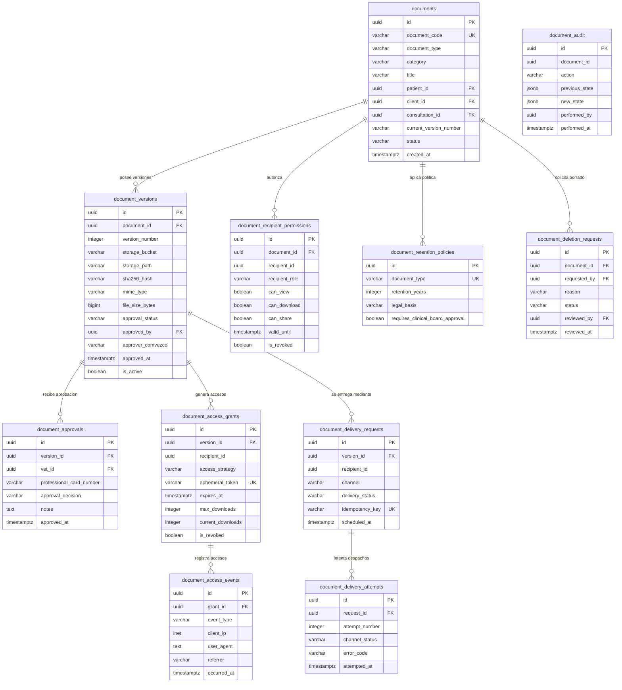

# VET FREEDOM OS — DOCUMENT METADATA SCHEMA
## Especificación Detallada del Modelo de Datos de Gestión Documental y Seguridad (Migration 035)

**Proyecto:** VET FREEDOM OS  
**Base de Datos:** PostgreSQL 17.12.0 (Supabase `sznvahhocgnhsqhksygq`)  
**Migración de Origen:** `035_approved_document_delivery_and_security_hub.sql`  
**Seguridad:** RLS habilitado en el 100% de tablas (`rowsecurity = true`)  
**Esquema:** `public`  
**Responsable Técnico:** Dr. Luis Eduardo Ríos

---

## 1. Diagrama Entidad-Relación (ERD)

---

## 2. Diccionario de Datos de Tablas

### 2.1 `public.documents`
Entidad raíz del documento. Mantiene la identidad persistente a través de múltiples revisiones o versiones.

| Columna | Tipo | Nulo | Default | Descripción |
| :--- | :--- | :--- | :--- | :--- |
| `id` | `uuid` | NO | `gen_random_uuid()` | Identificador único del documento |
| `document_code` | `varchar(64)` | NO | - | Código visible legible único (ej. `DOC-2026-00491`) |
| `document_type` | `varchar(64)` | NO | - | Tipo de documento (`CLINICAL_REPORT`, `REFERRAL_LETTER`, `LAB_RESULT`, `VACCINATION_CERTIFICATE`, `INVOICE`) |
| `category` | `varchar(32)` | NO | `'CLINICAL'` | Categoría operativa (`CLINICAL`, `ADMINISTRATIVE`, `LEGAL`, `FINANCIAL`) |
| `title` | `varchar(255)` | NO | - | Título descriptivo del documento |
| `patient_id` | `uuid` | SÍ | `NULL` | FK al paciente asociado (en `patients`) |
| `client_id` | `uuid` | SÍ | `NULL` | FK al propietario titular (en `clients`) |
| `consultation_id`| `uuid` | SÍ | `NULL` | FK a la consulta médica post-atención si aplica |
| `current_version_id` | `uuid` | SÍ | `NULL` | FK a la versión activa actual |
| `status` | `varchar(32)` | NO | `'DRAFT'` | Estado global (`DRAFT`, `PENDING_APPROVAL`, `APPROVED`, `SUPERSEDED`, `REVOKED`, `ARCHIVED`) |
| `created_at` | `timestamptz` | NO | `now()` | Fecha y hora de creación |
| `updated_at` | `timestamptz` | NO | `now()` | Fecha y hora de última modificación |

### 2.2 `public.document_versions`
Almacena cada revisión inmutable del archivo con su huella criptográfica e información de almacenamiento.

| Columna | Tipo | Nulo | Default | Descripción |
| :--- | :--- | :--- | :--- | :--- |
| `id` | `uuid` | NO | `gen_random_uuid()` | Identificador de la versión |
| `document_id` | `uuid` | NO | - | FK a `documents.id` |
| `version_number`| `integer` | NO | `1` | Número incremental de revisión (`1, 2, 3...`) |
| `storage_bucket`| `varchar(64)` | NO | `'medical-records'` | Bucket privado de Supabase Storage |
| `storage_path` | `varchar(512)` | NO | - | Ruta completa en el bucket (`records/{doc_id}/v{n}/{file}`) |
| `sha256_hash` | `varchar(64)` | NO | - | Huella SHA-256 calculada antes de la subida para verificación |
| `mime_type` | `varchar(128)` | NO | `'application/pdf'` | Tipo MIME estricto |
| `file_size_bytes`| `bigint` | NO | - | Tamaño exacto en bytes (máx 50MB) |
| `approval_status`| `varchar(32)` | NO | `'DRAFT'` | Estado de firma (`DRAFT`, `APPROVED`, `REJECTED`, `SUPERSEDED`) |
| `approved_by` | `uuid` | SÍ | `NULL` | FK al veterinario certificador |
| `approver_comvezcol` | `varchar(32)` | SÍ | `NULL` | Tarjeta profesional verificada de COMVEZCOL |
| `approved_at` | `timestamptz` | SÍ | `NULL` | Marca de tiempo de la aprobación médica |
| `is_active` | `boolean` | NO | `true` | Indica si es la versión vigente para entrega |

### 2.3 `public.document_approvals`
Log formal e inmutable de revisiones y firmas veterinarias según Ley 576 de 2000.

| Columna | Tipo | Nulo | Default | Descripción |
| :--- | :--- | :--- | :--- | :--- |
| `id` | `uuid` | NO | `gen_random_uuid()` | Identificador del registro de aprobación |
| `version_id` | `uuid` | NO | - | FK a `document_versions.id` |
| `vet_id` | `uuid` | NO | - | FK al perfil profesional en `staff` |
| `professional_card_number` | `varchar(32)` | NO | - | Número de matrícula COMVEZCOL |
| `approval_decision` | `varchar(32)` | NO | - | `'APPROVED'` o `'REJECTED'` |
| `notes` | `text` | SÍ | `NULL` | Comentarios clínicos o motivo de rechazo |
| `created_at` | `timestamptz` | NO | `now()` | Fecha y hora del registro de auditoría |

### 2.4 `public.document_recipient_permissions`
Matriz de control de acceso basada en roles sobre el documento específico.

| Columna | Tipo | Nulo | Default | Descripción |
| :--- | :--- | :--- | :--- | :--- |
| `id` | `uuid` | NO | `gen_random_uuid()` | ID del permiso |
| `document_id` | `uuid` | NO | - | FK a `documents.id` |
| `recipient_id` | `uuid` | NO | - | ID del usuario/cuidador/especialista |
| `recipient_role`| `varchar(32)` | NO | - | `'OWNER'`, `'CAREGIVER'`, `'EXTERNAL_SPECIALIST'`, `'STAFF'` |
| `can_view` | `boolean` | NO | `true` | Autorización para previsualizar |
| `can_download` | `boolean` | NO | `true` | Autorización para descargar copia local |
| `can_share` | `boolean` | NO | `false` | Autorización para redistribuir enlace |
| `valid_until` | `timestamptz` | SÍ | `NULL` | Fecha de expiración del permiso |
| `is_revoked` | `boolean` | NO | `false` | Bandera de revocación inmediata |

### 2.5 `public.document_access_grants`
Tokens efímeros de acceso seguro (Estrategia A: Gateway y Estrategia B: Signed URL).

| Columna | Tipo | Nulo | Default | Descripción |
| :--- | :--- | :--- | :--- | :--- |
| `id` | `uuid` | NO | `gen_random_uuid()` | ID de la concesión |
| `version_id` | `uuid` | NO | - | FK a `document_versions.id` |
| `recipient_id` | `uuid` | NO | - | Destinatario autorizado |
| `access_strategy` | `varchar(32)` | NO | `'AUTHENTICATED_GATEWAY'` | Estrategia (`AUTHENTICATED_GATEWAY`, `EPHEMERAL_SIGNED_URL`) |
| `ephemeral_token`| `varchar(255)` | NO | `encode(gen_random_bytes(32), 'hex')` | Token criptográfico de acceso |
| `expires_at` | `timestamptz` | NO | `now() + interval '24 hours'` | Vencimiento estricto del enlace (máx 24 horas) |
| `max_downloads` | `integer` | NO | `10` | Límite de descargas permitidas |
| `current_downloads`| `integer` | NO | `0` | Contador de descargas consumidas |
| `is_revoked` | `boolean` | NO | `false` | Revocación forzada por el veterinario |

### 2.6 `public.document_access_events`
Auditoría forense de accesos a documentos (Habeas Data Ley 1581 de 2012).

| Columna | Tipo | Nulo | Default | Descripción |
| :--- | :--- | :--- | :--- | :--- |
| `id` | `uuid` | NO | `gen_random_uuid()` | ID del evento de acceso |
| `grant_id` | `uuid` | NO | - | FK a `document_access_grants.id` |
| `event_type` | `varchar(32)` | NO | - | `'VIEW'`, `'DOWNLOAD'`, `'REVOCATION_BLOCKED'`, `'EXPIRED_BLOCKED'` |
| `client_ip` | `inet` | SÍ | `NULL` | Dirección IP de origen del solicitante |
| `user_agent` | `text` | SÍ | `NULL` | Cabecera User-Agent del navegador |
| `referrer` | `varchar(512)` | SÍ | `NULL` | Origen de la solicitud HTTP |
| `occurred_at` | `timestamptz` | NO | `now()` | Timestamp exacto del acceso |

### 2.7 `public.document_retention_policies`
Políticas de custodia y retención legal colombiana.

| Columna | Tipo | Nulo | Default | Descripción |
| :--- | :--- | :--- | :--- | :--- |
| `id` | `uuid` | NO | `gen_random_uuid()` | ID de la política |
| `document_type` | `varchar(64)` | NO | - | Tipo de documento (`CLINICAL_REPORT`, `INVOICE`, etc.) |
| `retention_years`| `integer` | NO | - | Años de custodia legal obligatoria |
| `legal_basis` | `varchar(255)` | NO | - | Marco legal (ej. `Ley 576 de 2000 Art. 35`, `Estatuto Tributario Art. 632`) |
| `requires_clinical_board_approval` | `boolean` | NO | `true` | Requiere aprobación colegiada para expurgo |

---

## 3. Procedimientos Almacenados (RPCs) Implementados

1. **`request_document_upload(p_doc_type, p_title, p_patient_id, p_client_id, p_mime_type, p_file_size)`**: Genera el registro borrador y valida tamaño/MIME.
2. **`finalize_document_upload(p_version_id, p_sha256_hash, p_storage_path)`**: Confirma la subida al bucket e inscribe el hash criptográfico.
3. **`approve_document_version(p_version_id, p_vet_id, p_comvezcol)`**: Gate veterinario. Exige `professional_card_number` válido; pasa estado a `APPROVED`.
4. **`reject_document_version(p_version_id, p_vet_id, p_reason)`**: Rechaza el borrador con notas clínicas.
5. **`authorize_document_recipient(p_doc_id, p_recipient_id, p_role, p_can_download)`**: Configura la matriz de permisos por destinatario.
6. **`request_document_delivery(p_version_id, p_recipient_id, p_channel, p_strategy)`**: Genera la orden de entrega y el grant temporal (24h).
7. **`validate_document_access(p_token, p_client_ip, p_user_agent)`**: Endpoint del gateway seguro. Valida expiración, descargas, revocación y registra auditoría.
8. **`revoke_document_access(p_grant_id, p_reason)`**: Revoca inmediatamente el token de acceso.
9. **`supersede_document_version(p_doc_id, p_new_version_id, p_reason)`**: Reemplaza una versión v1 por v2 preservando trazabilidad histórica inmutable.
