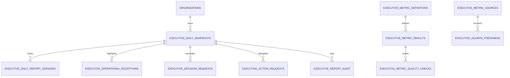

# Modelo de Datos de Reporte Ejecutivo (VET-CORE-16)

**Módulo:** `VET-CORE-16 | DAILY EXECUTIVE REPORTING`  
**Proyecto:** VET FREEDOM OS — Vet Life: Veterinaria a Domicilio  
**Dirección Médica:** Dr. Luis Eduardo Ríos  
**Dirección Estratégica:** Alpha Vision Method  
**Base de Datos:** Supabase PostgreSQL 17.12.0 (`sznvahhocgnhsqhksygq`)  
**Migración:** `037_daily_executive_reporting_and_decision_intelligence_hub.sql`  
**Fecha:** 2026-11-21  

---

## 1. Inventario de Tablas Creadas (17 Tablas con RLS Activo)

| Tabla | Propósito y Contenido | Clave Primaria / Índices |
| :--- | :--- | :--- |
| `executive_daily_snapshots` | Snapshot inmutable de cada jornada con métricas JSONB completas y resumen de 60s. | `id UUID`, `(organization_id, report_date, version_number)` |
| `executive_daily_reports` | Registro de cabecera de reporte por fecha y organización. | `id UUID`, `(organization_id, report_date)` |
| `executive_daily_report_versions` | Trazabilidad de versiones históricas generadas (v1, v2, etc.). | `id UUID`, `(report_id, version_number)` |
| `executive_metric_definitions` | Catálogo maestro de métricas (código, nombre, dominio, umbrales). | `id UUID`, `metric_code` |
| `executive_metric_results` | Valores numéricos o textuales calculados por métrica y fecha. | `id UUID`, `(organization_id, report_date, metric_definition_id)` |
| `executive_metric_sources` | Catálogo de fuentes de datos (DB, n8n, OKVET, pasarelas). | `id UUID`, `source_code` |
| `executive_metric_quality_checks` | Resultado de evaluación de calidad (`VERIFIED`, `SOURCE_UNAVAILABLE`, etc.). | `id UUID`, `metric_result_id` |
| `executive_source_freshness` | Bitácora de latidos y estado de frescura de conectores. | `id UUID`, `source_id` |
| `executive_operational_exceptions` | Incidentes o anomalías detectadas en el día operativo. | `id UUID`, `(organization_id, report_date)` |
| `executive_risk_signals` | Señales de riesgo clínico, financiero o logístico. | `id UUID`, `(organization_id, report_date)` |
| `executive_priority_recommendations` | Recomendaciones de prioridades para el día siguiente. | `id UUID`, `(organization_id, report_date)` |
| `executive_action_requests` | Tareas delegadas generadas para el equipo operativo. | `id UUID`, `(organization_id, report_date)` |
| `executive_decision_requests` | Decisiones escaladas específicamente para el Dr. Luis Ríos. | `id UUID`, `(organization_id, report_date)` |
| `executive_report_approvals` | Registro de aprobación o visto bueno de la dirección médica. | `id UUID`, `report_version_id` |
| `executive_report_delivery_requests` | Solicitudes de despacho por WhatsApp o email. | `id UUID`, `report_version_id` |
| `executive_report_delivery_results` | Registro de resultado de entrega (simulado en QA). | `id UUID`, `delivery_request_id` |
| `executive_report_audit` | Registro inmutable de auditoría forense para cada lectura o mutación. | `id UUID`, `created_at` |

---

## 2. Diagrama Entidad-Relación

---

## 3. Stored Procedures Oficiales Creados (14 RPCs)

1. `claim_daily_report_generation(p_org_id, p_report_date)`: Bloqueo pesimista para evitar colisiones de workers.
2. `get_daily_appointment_metrics(...)`: Agregación de citas.
3. `get_daily_visit_metrics(...)`: Agregación de visitas y cierres en OKVET.
4. `get_daily_staff_metrics(...)`: Conteo de médicos activos y ausencias.
5. `get_daily_route_metrics(...)`: Retrasos y paradas vehiculares.
6. `get_daily_financial_metrics(...)`: Recaudo verificado vs no verificado.
7. `get_daily_experience_metrics(...)`: CSAT y quejas.
8. `get_daily_continuity_metrics(...)`: Prevención, crónicos y especialistas.
9. `get_daily_integration_metrics(...)`: Salud de APIs conectadas.
10. `persist_daily_snapshot(...)`: Inserción atómica del snapshot del día.
11. `create_daily_report_version(...)`: Creación de versiones históricas v2..vn.
12. `record_daily_report_exception(...)`: Registro de alertas en base de datos.
13. `authorize_daily_report_delivery(...)`: Validación previa al despacho.
14. `record_daily_report_audit(...)`: Registro de traza de auditoría.
