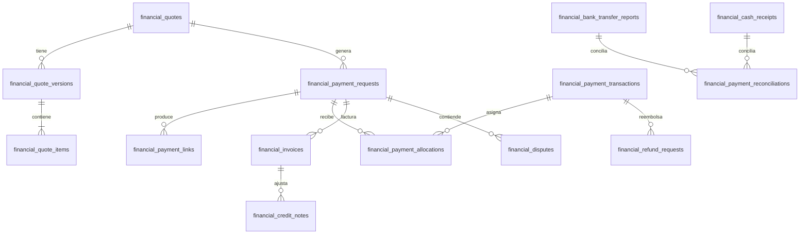

# VET FREEDOM OS — FINANCIAL DATA MODEL
## Modelo de Datos Relacional, Tablas, Restricciones y Stored Procedures (Migración 036)
**Módulo:** VET-CORE-14 | FINANCIAL NOTIFICATIONS  
**Dirección Médica:** Dr. Luis Eduardo Ríos  
**Dirección Estratégica:** Alpha Vision Method  
**Motor:** PostgreSQL 17.12.0 (Supabase)

---

## 1. Resumen de Entidades (19 Tablas)

La migración `036_financial_operations_and_invoicing_hub.sql` implementa las 19 tablas especializadas del subsistema financiero:

1. **`financial_service_rates`**: Catálogo tarifario oficial de servicios veterinarios, consultas, cirugías y vacunas.
2. **`financial_quotes`**: Presupuestos emitidos para atenciones clínicas domiciliarias.
3. **`financial_quote_versions`**: Historial monótono e inmutable de versiones de presupuestos (`v1..vn`).
4. **`financial_quote_items`**: Ítems, medicamentos y servicios desglosados en cada versión de presupuesto.
5. **`financial_quote_approvals`**: Aprobaciones de descuentos mayores a 0% por la Dirección Médica.
6. **`financial_payment_requests`**: Solicitudes de cobro asociadas a una cotización o consulta.
7. **`financial_payment_links`**: Enlaces de pago generados para pasarelas (Wompi, Bold, PSE, Mercado Pago).
8. **`financial_payment_transactions`**: Registro inmutable de transacciones recibidas de pasarelas.
9. **`financial_payment_allocations`**: Aplicación de pagos a obligaciones específicas con cálculo exacto.
10. **`financial_payment_reconciliations`**: Auditoría de conciliación bancaria cotejada contra extractos.
11. **`financial_bank_transfer_reports`**: Reportes de transferencias realizados por clientes con comprobantes.
12. **`financial_cash_receipts`**: Recibos de caja por efectivo recaudado en visitas domiciliarias.
13. **`financial_invoices`**: Facturación electrónica con validación DIAN, CUFE y código QR.
14. **`financial_credit_notes`**: Notas crédito para anulaciones o ajustes con autorización previa.
15. **`financial_refund_requests`**: Solicitudes formales de devolución con doble aprobación humana.
16. **`financial_disputes`**: Disputas, contracargos bancarios e investigaciones por cargos no reconocidos.
17. **`financial_customer_balances`**: Saldos consolidados, créditos a favor y montos pendientes por tutor.
18. **`financial_notification_jobs`**: Encolamiento y tracking de notificaciones de cobranza y recibos.
19. **`financial_audit_events`**: Bitácora inmutable de auditoría forense financiera.

---

## 2. Diagrama Entidad-Relación (Mermaid)

---

## 3. Stored Procedures (`SECURITY DEFINER`, `search_path = public`)

| Función / Procedimiento | Rol Operativo | Parámetros Clave |
|---|---|---|
| **`create_or_version_quote`** | Crea versión inicial o sucesiva de una cotización. | `p_appointment_id`, `p_owner_id`, `p_pet_id`, `p_items_json` |
| **`approve_quote_discount`** | Gate de aprobación de descuentos por Dirección. | `p_quote_id`, `p_approver_id`, `p_approved` |
| **`accept_quote`** | Aceptación formal por el tutor del paciente. | `p_quote_id`, `p_owner_id`, `p_ip_address` |
| **`create_payment_request`** | Genera orden de cobro con vencimiento e idempotencia. | `p_quote_id`, `p_amount`, `p_expires_hours`, `p_idempotency_key` |
| **`register_provider_payment_event`** | Procesa webhook de pasarela con validación. | `p_provider`, `p_provider_tx_id`, `p_amount`, `p_status`, `p_signature` |
| **`report_bank_transfer`** | Registra comprobante de transferencia como PENDING. | `p_payment_request_id`, `p_bank_name`, `p_amount`, `p_voucher_url` |
| **`reconcile_and_allocate_payment`** | Concilia extracto bancario/caja y liquida deuda. | `p_reconciliation_type`, `p_reference_id`, `p_bank_tx_id`, `p_verified_amount` |
| **`request_and_approve_refund`** | Proceso de 2 pasos para autorizar reembolsos. | `p_transaction_id`, `p_amount`, `p_reason`, `p_approver_id` |
| **`evaluate_financial_reminder_eligibility`** | Evalúa supresión por duelo, disputa o revocación. | `p_payment_request_id` |
