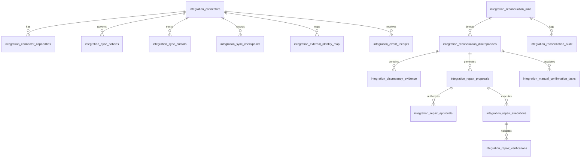

# VET FREEDOM OS — MODELO DE DATOS DE CONCILIACIÓN
## Esquema Relacional de 17 Tablas, Índices y Funciones Stored Procedure en Supabase

---

### 1. Visión General del Esquema Relacional

La migración `039_integration_reconciliation_and_cross_system_audit_hub.sql` desplegó en PostgreSQL 17 un clúster de 17 tablas relacionales y 8 funciones stored procedure con seguridad RLS integral:

---

### 2. Diccionario de las 17 Tablas de Conciliación

| Tabla | Propósito | Llave Primaria | Clave Foránea Principal | RLS Habilitado |
| :--- | :--- | :--- | :--- | :--- |
| `integration_connectors` | Catálogo de sistemas externos integrados y estados | `id` (UUID) | `organization_id` | Sí (Forzado) |
| `integration_connector_capabilities`| Capacidades específicas (read, write, webhook, etc.) | `id` (UUID) | `connector_id` | Sí (Forzado) |
| `integration_sync_policies` | Matriz de autoridad por campo y políticas de sincronización | `id` (UUID) | `connector_id` | Sí (Forzado) |
| `integration_sync_cursors` | Punteros incrementales y tokens de sincronización delta | `id` (UUID) | `connector_id` | Sí (Forzado) |
| `integration_sync_checkpoints`| Marcas históricas de lotes sincronizados y confirmados | `id` (UUID) | `connector_id` | Sí (Forzado) |
| `integration_external_identity_map`| Vinculación canónica de tutores, mascotas y citas con IDs externos| `id` (UUID) | `connector_id` | Sí (Forzado) |
| `integration_external_reference_map`| Referencias foráneas cruzadas (facturas, comprobantes, radicados)| `id` (UUID) | `connector_id` | Sí (Forzado) |
| `integration_event_receipts` | Bandeja transaccional Inbox de webhooks y eventos externos | `id` (UUID) | `connector_id` | Sí (Forzado) |
| `integration_reconciliation_runs`| Registro de ejecuciones del motor VET-CORE-18 | `id` (UUID) | `organization_id` | Sí (Forzado) |
| `integration_reconciliation_discrepancies`| Desviaciones detectadas entre sistemas | `id` (UUID) | `run_id`, `connector_id`| Sí (Forzado) |
| `integration_discrepancy_evidence`| Snapshots y pruebas en formato JSONB con hashes criptográficos | `id` (UUID) | `discrepancy_id` | Sí (Forzado) |
| `integration_repair_proposals`| Propuestas atómicas de reparación técnica o de datos | `id` (UUID) | `discrepancy_id` | Sí (Forzado) |
| `integration_repair_approvals`| Aprobaciones humanas de propuestas que requieren autorización | `id` (UUID) | `proposal_id` | Sí (Forzado) |
| `integration_repair_executions`| Registro de comandos o mutaciones ejecutadas durante la reparación| `id` (UUID) | `proposal_id` | Sí (Forzado) |
| `integration_repair_verifications`| Verificación instrumental post-reparación comprobando resolución| `id` (UUID) | `execution_id` | Sí (Forzado) |
| `integration_manual_confirmation_tasks`| Tareas humanas en cola para el Centro de Control Lovable | `id` (UUID) | `discrepancy_id` | Sí (Forzado) |
| `integration_reconciliation_audit`| Libro mayor inmutable de auditoría y cumplimiento legal | `id` (UUID) | `organization_id` | Sí (Forzado) |

---

### 3. Funciones Stored Procedure (`SECURITY DEFINER`)

Todas las funciones RPC operan con `SET search_path = public` y permisos revocados a `anon` y `PUBLIC`:

1. `claim_reconciliation_run(p_org_id, p_type)`: Adquiere advisory lock en PostgreSQL y crea o reclama una corrida de conciliación asegurando concurrencia única.
2. `match_external_identity(p_connector, p_entity_type, p_external_id)`: Consulta o resuelve la vinculación de identidad externa con cálculo de confianza.
3. `classify_reconciliation_discrepancy(p_discrepancy_id)`: Aplica las reglas de negocio para distinguir latencias normales (`EXPECTED_ASYNCHRONOUS_DELAY`) de discrepancias verdaderas (`CONFLICT_CONFIRMED`).
4. `propose_safe_repair(p_discrepancy_id, p_strategy, p_params)`: Genera una propuesta formal validando si cumple la política de reparación segura.
5. `approve_reconciliation_repair(p_proposal_id, p_approver_id, p_role)`: Registra la firma y autorización humana verificando que el rol coincida con la naturaleza del cambio.
6. `execute_authorized_safe_repair(p_proposal_id)`: Ejecuta la mutación segura o técnica en base de datos.
7. `verify_reconciliation_result(p_execution_id)`: Re-inspecciona los datos para corroborar que la discrepancia fue efectivamente resuelta.
8. `record_reconciliation_audit(p_org_id, p_action, p_entity_type, p_entity_id, p_details)`: Inserta un registro inmutable en el libro mayor de auditoría.
