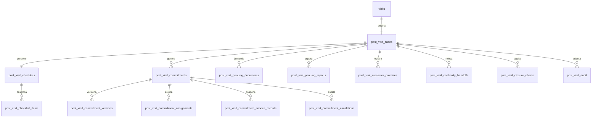

# VET FREEDOM OS — POST-VISIT DATA MODEL
## Modelo Relacional de Datos, Tablas, RPCs e Índices del Hub de Continuidad Asistencial
**Módulo:** VET-CORE-12 | POST-VISIT COMMITMENTS  
**Migración:** `supabase/migrations/034_post_visit_commitments_and_continuity_hub.sql`  
**Motor:** PostgreSQL 17.12.0 (Supabase Managed)  

---

## 1. Diagrama Entidad-Relación Consolidado

---

## 2. Inventario de Tablas de la Migración 034

| # | Tabla | Rol en el Sistema | Llaves y Restricciones Clave |
|---|---|---|---|
| 1 | `post_visit_cases` | Caso unificado de continuidad post-visita. | `visit_id` UNIQUE, FK `staff_profiles(id)`. |
| 2 | `post_visit_checklists` | Checklist de cierre de visita domiciliaria. | `case_id` UNIQUE, FK `visits(id)`. |
| 3 | `post_visit_checklist_items` | Ítems individuales obligatorios y opcionales. | FK `post_visit_checklists(id)`. |
| 4 | `post_visit_commitments` | Obligaciones y tareas de continuidad (20 estados). | FK `case_id`, `idempotency_key` UNIQUE por org. |
| 5 | `post_visit_commitment_versions` | Historial inmutable de versiones (v1..vn). | `(commitment_id, version_number)` UNIQUE. |
| 6 | `post_visit_commitment_assignments` | Trazabilidad de asignaciones y delegaciones. | FK `assigned_staff_id`, `acceptance_status`. |
| 7 | `post_visit_commitment_snooze_records` | Control de posposiciones con límite anti-snooze. | `snooze_number`, FK `requested_by`. |
| 8 | `post_visit_commitment_escalations` | Alertas de vencimiento y casos bloqueados. | `escalation_level`, FK `escalated_to_staff_id`. |
| 9 | `post_visit_pending_documents` | Resúmenes y órdenes clínicas por entregar. | `status`, FK `approved_by`. |
| 10 | `post_visit_pending_reports` | Informes de especialistas y laboratorios esperados. | `status`, FK `reviewed_by`. |
| 11 | `post_visit_customer_promises` | Promesas al cliente extraídas y auditadas. | `verification_status`, `confidence_score`. |
| 12 | `post_visit_continuity_handoffs` | Relevos clínicos entre veterinarios o turnos. | FK `outgoing_veterinarian_id`, `incoming`. |
| 13 | `post_visit_closure_checks` | Pistas de auditoría del pre-cierre. | `gate_passed`, `open_commitments_found`. |
| 14 | `post_visit_audit` | Log inmutable de eventos y acciones. | `case_id`, `commitment_id`, `action`, timestamp. |

---

## 3. Catálogo de Procedimientos Almacenados (RPCs)

1. `create_or_init_post_visit_case`: Inicializa o recupera el caso post-visita enlazando paciente, dueño y veterinario.
2. `record_post_visit_checklist`: Asienta los ítems completados del checklist por el profesional presencial.
3. `record_post_visit_operational_close`: Registra el fin operativo presencial sin alterar los compromisos posteriores.
4. `create_post_visit_commitment`: Crea compromisos con validación de idempotencia, versionado v1 y procedencia.
5. `assign_or_delegate_commitment`: Gestiona asignaciones y delegaciones con validación estricta de tarjeta profesional COMVEZCOL.
6. `accept_commitment_assignment`: Asienta la aceptación formal del compromiso por el responsable.
7. `snooze_post_visit_commitment`: Aplica prórroga con control estricto de máximo 3 posposiciones.
8. `report_and_verify_commitment`: Registra evidencia y certifica el cumplimiento por profesional habilitado.
9. `close_post_visit_continuity_verified`: Gate estricto que prohíbe cerrar la continuidad con compromisos o informes pendientes.
