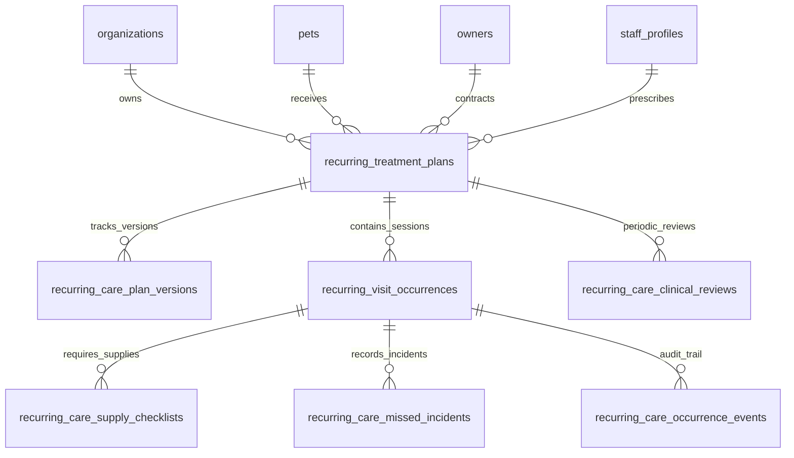

# VET FREEDOM OS — RECURRING CARE DATA MODEL
## Esquema Relacional de Cuidados Recurrentes y Protección Clínica
**Motor:** PostgreSQL 17 (Supabase)  
**Migración:** `031_recurring_care_plans_and_occurrences.sql`  

---

## 1. Entidades Principales y Relaciones

---

## 2. Definición Detallada de Tablas

### `recurring_treatment_plans`
- `id` (UUID, PK)
- `organization_id` (UUID, FK organizations)
- `pet_id` (UUID, FK pets)
- `owner_id` (UUID, FK owners)
- `prescribing_veterinarian_id` (UUID, FK staff_profiles)
- `diagnosis_title` (TEXT)
- `clinical_objective` (TEXT)
- `total_prescribed_sessions` (INTEGER)
- `completed_sessions_count` (INTEGER)
- `cadence_type` (TEXT: DAILY, WEEKLY, BIWEEKLY, MONTHLY, CUSTOM)
- `cadence_interval_days` (INTEGER)
- `start_date` (DATE)
- `is_window_strict` (BOOLEAN)
- `continuity_vet_id` (UUID, FK staff_profiles)
- `backup_vet_id` (UUID, FK staff_profiles)
- `plan_version` (INTEGER, Default 1)
- `clinical_authorization_status` (TEXT: DRAFT, PENDING_REVIEW, APPROVED, REJECTED, REVISED, TERMINATED)
- `abandonment_risk_status` (TEXT: NORMAL, WATCH, HIGH_RISK_MISSED, ABANDONED)

### `recurring_visit_occurrences`
- `id` (UUID, PK)
- `plan_id` (UUID, FK recurring_treatment_plans)
- `plan_version` (INTEGER)
- `occurrence_sequence` (INTEGER)
- `occurrence_code` (TEXT)
- `target_date` (DATE)
- `window_start_date` (DATE)
- `window_end_date` (DATE)
- `is_window_strict` (BOOLEAN)
- `assigned_veterinarian_id` (UUID, FK staff_profiles)
- `backup_veterinarian_id` (UUID, FK staff_profiles)
- `appointment_id` (UUID, FK appointments)
- `status` (TEXT: PLANNED, PENDING_SCHEDULING, APPOINTMENT_REQUESTED, SCHEDULED, CONFIRMED, EN_ROUTE, IN_SERVICE, COMPLETED, MISSED_REQUIRES_REVIEW, RESCHEDULED, CANCELLED_CLINICAL)

### `recurring_care_supply_checklists`
- `id` (UUID, PK)
- `occurrence_id` (UUID, FK recurring_visit_occurrences)
- `item_name` (TEXT)
- `item_category` (TEXT: MEDICATION, CONSUMABLE, EQUIPMENT, DIAGNOSTIC)
- `prescribed_quantity` (NUMERIC)
- `unit` (TEXT)
- `requires_cold_chain` (BOOLEAN)
- `lot_verification_required` (BOOLEAN)
- `lot_number` (TEXT)
- `is_prepared` (BOOLEAN)

### `recurring_care_missed_incidents`
- `id` (UUID, PK)
- `occurrence_id` (UUID, FK recurring_visit_occurrences)
- `plan_id` (UUID, FK recurring_treatment_plans)
- `missed_type` (TEXT: CLIENT_NO_SHOW, CLIENT_CANCELLATION_LATE, VET_EMERGENCY_OVERRUN, LOGISTIC_UNREACHABLE, PATIENT_UNSTABLE)
- `clinical_severity` (TEXT: CRITICAL_THERAPY_INTERRUPTION, MODERATE_DELAY, LOW_IMPACT)
- `attending_vet_notified_at` (TIMESTAMPTZ)
- `coordinator_notified_at` (TIMESTAMPTZ)
- `clinical_decision` (TEXT: PENDING_VET_REVIEW, RESCHEDULE_APPROVED, TREATMENT_ADJUSTED_BY_VET, PLAN_TERMINATED)
