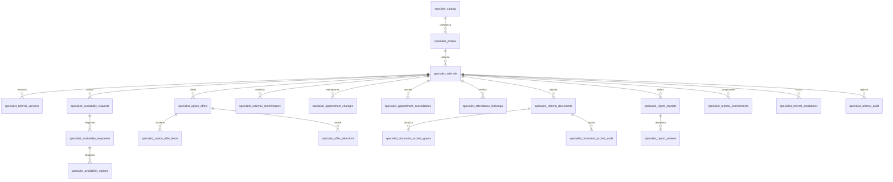

# VET FREEDOM OS — SPECIALIST REFERRAL DATA MODEL
## Modelo Relacional de Datos, Tablas, Funciones RPC y Triggers de Coordinación de Especialistas
**Módulo:** VET-CORE-11 | SPECIALIST COORDINATION  
**Migración:** `supabase/migrations/033_specialist_referrals_and_coordination_hub.sql`  
**Motor:** PostgreSQL 17.12.0 (Supabase Managed)  

---

## 1. Diagrama Entidad-Relación Consolidado

---

## 2. Inventario de las 26 Tablas Relacionales

| # | Nombre de la Tabla | Propósito y Contenido Principal | Restricciones Clave |
|---|---|---|---|
| 1 | `specialty_catalog` | Catálogo maestro de especialidades veterinarias. | `code` UNIQUE, `is_active` boolean. |
| 2 | `specialist_profiles` | Perfiles de médicos especialistas y centros aliados. | `verification_status`, `standard_tariff`. |
| 3 | `specialist_referrals` | Tabla central de remisiones con 24 estados. | `coordination_status`, FK paciente/tutor/vet. |
| 4 | `specialist_referral_versions` | Snapshots inmutables de versiones v1..vn. | `version_number`, monotonic numbering. |
| 5 | `specialist_availability_requests` | Peticiones formales de disponibilidad enviadas. | FK referral, FK specialist. |
| 6 | `specialist_availability_responses` | Respuestas de disponibilidad recibidas. | `is_ambiguous` boolean. |
| 7 | `specialist_availability_options` | Franjas horarias discretas con fecha/lugar/tarifa. | `validity_status`, `valid_until`. |
| 8 | `specialist_option_offers` | Ofertas presentadas al tutor con enlace tokenizado. | `token` UNIQUE, `expires_at`. |
| 9 | `specialist_option_offer_items` | Opciones individuales agrupadas dentro de una oferta. | FK offer, FK option. |
| 10 | `specialist_offer_selections` | Registro de la opción seleccionada por el cliente. | `revalidation_status`. |
| 11 | `specialist_external_confirmations` | Registro de confirmación externa con evidencia. | `external_booking_reference` UNIQUE. |
| 12 | `specialist_appointment_changes` | Historial de reprogramaciones de citas externas. | `new_external_reference`. |
| 13 | `specialist_appointment_cancellations` | Cancelaciones formales de citas externas. | `cancellation_status`. |
| 14 | `specialist_attendance_followups` | Seguimiento post-cita para verificar asistencia. | `attendance_status`. |
| 15 | `specialist_referral_documents` | Resúmenes clínicos y paraclínicos a compartir. | `storage_bucket = 'referral-documents'`. |
| 16 | `specialist_document_access_grants` | Tokens de acceso seguro temporal para terceros. | `access_token` UNIQUE, `expires_at`. |
| 17 | `specialist_document_access_audit` | Auditoría inmutable de accesos y descargas de PDFs. | IP, user agent, timestamp. |
| 18 | `specialist_report_receipts` | Informes médicos y resultados cargados al sistema. | `storage_path`, FK referral. |
| 19 | `specialist_report_reviews` | Dictamen y evaluación médica del informe externo. | `review_decision`, FK veterinario revisor. |
| 20 | `specialist_referral_commitments` | Tareas de continuidad clínica post-remisión. | `commitment_status`, FK referral. |
| 21 | `specialist_referral_escalations` | Casos escalados a supervisión humana/médica. | `escalation_level`, `reason`. |
| 22 | `specialist_referral_audit` | Pista inmutable de auditoría para toda la remisión. | Snapshot JSONB, timestamp. |

---

## 3. Catálogo de Stored Procedures (RPCs)

Todas las funciones RPC están blindadas con `SECURITY DEFINER` y `SET search_path = public`:

1. `create_specialist_referral`: Alta de remisión en borrador garantizando paciente y tutor activos.
2. `approve_specialist_referral`: Aprobación clínica exclusiva por médico veterinario habilitado.
3. `record_specialist_availability_response`: Asentamiento de horarios recibidos y desglose de opciones discretas.
4. `generate_and_dispatch_client_offer`: Creación de oferta tokenizada dirigida al tutor.
5. `record_client_slot_selection`: Registro de la preferencia del cliente y tránsito a hold/reserva.
6. `confirm_external_specialist_booking`: Gate de evidencia externa estricto para confirmar cita.
7. `grant_external_document_access`: Emisión de token opaco temporal para consulta de documentos por la clínica.
8. `record_and_review_specialist_report`: Recepción y calificación técnica del informe médico externo.
9. `close_specialist_referral_verified`: Gate estricto de cierre que prohíbe cerrar casos con compromisos pendientes.
