# Modelo de Datos de Reportería Ejecutiva Semanal (VET-CORE-17)

**Módulo:** `VET-CORE-17 | WEEKLY REPORTING`  
**Proyecto:** VET FREEDOM OS — Vet Life: Veterinaria a Domicilio  
**Dirección Médica:** Dr. Luis Eduardo Ríos  
**Dirección Estratégica:** Alpha Vision Method  
**Entorno:** DEVELOPMENT / QA  
**Fecha:** 2026-11-21  

---

## 1. Esquema Relacional de Base de Datos (Migración 038)

La migración `038_weekly_executive_reporting_and_capacity_intelligence_hub.sql` desplegó en Supabase (`sznvahhocgnhsqhksygq`) un ecosistema de **14 tablas relacionales**, todas protegidas mediante Row-Level Security (`rowsecurity = true`) y multi-tenant isolation.

```mermaid
erDiagram
    executive_weekly_reports ||--o{ executive_weekly_report_versions : "posee versiones"
    executive_weekly_reports ||--o{ executive_weekly_snapshots : "contiene snapshots"
    executive_weekly_reports ||--o{ executive_weekly_metric_results : "desglosa metricas"
    executive_weekly_reports ||--o{ executive_capacity_analyses : "evalua capacidad"
    executive_weekly_reports ||--o{ executive_founder_dependency_analyses : "mide autonomia"
    executive_weekly_reports ||--o{ executive_profitability_analyses : "calcula margen"
    executive_weekly_reports ||--o{ executive_continuity_analyses : "audita continuidad"
    executive_weekly_reports ||--o{ executive_weekly_action_plans : "genera planes"
    executive_weekly_reports ||--o{ executive_weekly_decision_requests : "solicita decisiones"
    executive_weekly_reports ||--o{ executive_weekly_report_deliveries : "registra entregas"
    executive_weekly_reports ||--o{ executive_weekly_audit : "audita cambios"
    executive_recurring_problem_clusters ||--o{ executive_improvement_proposals : "propone mejoras"
```

---

## 2. Descripción de las 14 Tablas Relacionales

| Tabla | Propósito y Contenido Clave |
| :--- | :--- |
| `executive_weekly_reports` | Cabecera maestra del reporte semanal: `year_week`, `week_start_date`, `week_end_date`, `current_version`, `status`, `data_quality_status`. |
| `executive_weekly_report_versions` | Historial inmutable de versiones generadas (`v1..vn`) con hash criptográfico del payload y autor del recálculo. |
| `executive_weekly_snapshots` | Snapshot integral serializado en JSONB de todos los subsistemas al momento del corte semanal. |
| `executive_weekly_metric_results` | Valores numéricos atómicos desglosados por código de métrica, tipología de agregación (1 a 7) y estado de verificación. |
| `executive_capacity_analyses` | Análisis de utilización del equipo médico: horas disponibles, tiempos de traslado, descansos protegidos y sobrecarga. |
| `executive_founder_dependency_analyses` | Métricas de libertad del Dr. Luis (`WF-075`): tareas reservadas vs delegables vs resueltas por equipo vs automatizadas. |
| `executive_profitability_analyses` | Análisis de rentabilidad: facturado, cobrado verificado, costos directos de insumos/combustible y margen de contribución. |
| `executive_continuity_analyses` | Auditoría de adherencia a tratamientos recurrentes (CORE-09), prevención (CORE-10), remisiones (CORE-11) y compromisos (CORE-12). |
| `executive_recurring_problem_clusters` | Detección de patrones y fallas repetitivas agrupadas por cluster temático (rutas, demoras de laboratorio, quejas de tutores). |
| `executive_improvement_proposals` | Iniciativas estructuradas de mejora continua canalizadas hacia CORE-07 (Rediseño de Operaciones). |
| `executive_weekly_action_plans` | Tareas correctivas asignadas a coordinadores o veterinarios con plazos estrictos y seguimiento. |
| `executive_weekly_decision_requests` | Peticiones formales de decisión estratégica reservadas para la Dirección Médica del Dr. Luis. |
| `executive_weekly_report_deliveries` | Registro de intentos y estados de entrega del informe (con soporte para Safe Mode en QA). |
| `executive_weekly_audit` | Bitácora inmutable de eventos de cálculo, recálculos extemporáneos, cambios de definición y diffs cuantitativos. |

---

## 3. Funciones Almacenadas (RPCs) Desplegadas

1. `resolve_weekly_period(target_date timestamptz)`: Delimita los instantes de inicio (Lunes 00:00:00) y fin exclusivo (Lunes siguiente 00:00:00) en `America/Bogota`.
2. `claim_weekly_report_generation(p_org_id, p_year_week, p_worker_id)`: Implementa PostgreSQL Advisory Lock para prevenir ejecuciones simultáneas.
3. `get_weekly_operation_metrics(p_org_id, p_start, p_end)`: Extrae citas, clientes únicos (`COUNT DISTINCT`) y visitas efectivas.
4. `get_weekly_capacity_metrics(p_org_id, p_start, p_end)`: Extrae turnos, descansos protegidos y traslados logísticos.
5. `get_weekly_financial_metrics(p_org_id, p_start, p_end)`: Agrega facturado, cobrado y costos directos registrados.
6. `record_weekly_report_audit(p_report_id, p_event, p_actor, p_reason, p_diff)`: Registra transiciones y diferencias entre versiones.
