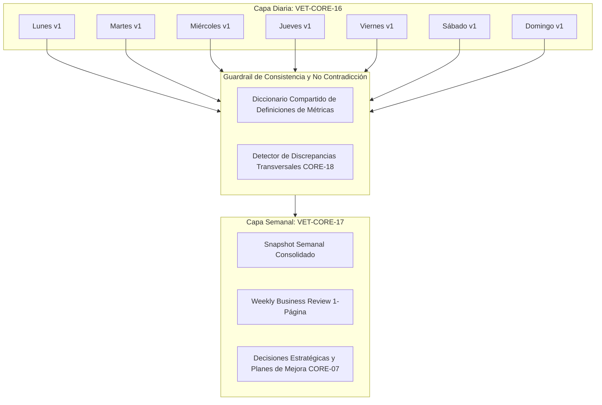

# Contrato de Relación y Consistencia Diario-Semanal (CORE-16 a CORE-17)

**Módulo:** `VET-CORE-17 | WEEKLY REPORTING`  
**Proyecto:** VET FREEDOM OS — Vet Life: Veterinaria a Domicilio  
**Dirección Médica:** Dr. Luis Eduardo Ríos  
**Dirección Estratégica:** Alpha Vision Method  
**Entorno:** DEVELOPMENT / QA  
**Fecha:** 2026-11-21  

---

## 1. Modelo de Interacción CORE-16 y CORE-17

El Reporte Diario (`CORE-16`) y el Reporte Semanal (`CORE-17`) forman una jerarquía analítica complementaria en Vet Freedom OS:

---

## 2. Reglas de Compatibilidad y Conciliación

### 1. Diccionario Unificado de Métricas
- Un término como *"Cita Confirmada"* posee idéntica definición en CORE-16 y CORE-17: estado `CONFIRMED` en la base de datos tras interacción positiva del tutor.
- Un *"Check-in Presencial"* requiere coordenadas GPS y marca de tiempo en la vivienda del tutor.

### 2. Conciliación de Métricas Aditivas
- La suma de los minutos de atención presencial de los 7 reportes diarios debe coincidir con el total aditivo del reporte semanal, salvo que haya ocurrido una corrección tardía formalizada mediante versión `v2`.

### 3. Tratamiento de Métricas No Aditivas (Axioma de Desacoplamiento)
- Los clientes únicos semanales **no coincidirán** con la suma de los clientes únicos diarios si hubo clientes recurrentes en la semana. Esto no es un error ni una discrepancia, sino una ley matemática elemental que el sistema documenta explícitamente en el informe.

### 4. Flujo de Correcciones Tardías (Backfilling)
- Si una visita del día jueves se corrigió el domingo en OKVET:
  1. Se actualiza el snapshot de CORE-16 del jueves mediante versión `v2`.
  2. El reporte semanal de CORE-17 del lunes siguiente toma automáticamente el dato corregido para su snapshot `v1`.
  3. No se produce desalineación histórica ni datos fantasmas.
