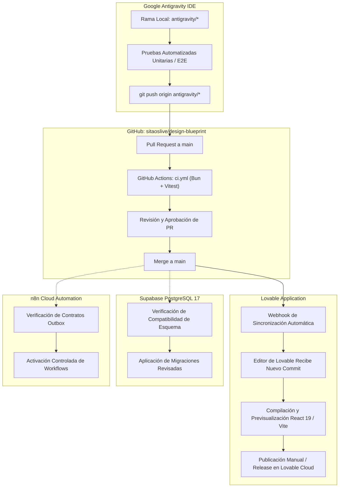

# VET FREEDOM OS — MAPA DE DESPLIEGUE Y COORDINACIÓN DE ENTORNOS
## Flujo de Sincronización, Despliegue, Activación y Mecanismos de Reversión (Rollback)
**Proyecto:** VET FREEDOM OS  
**Empresa:** Vet Life — Veterinaria a Domicilio  
**Dirección Médica:** Dr. Luis Eduardo Ríos  
**Dirección Estratégica:** Alpha Vision Method  
**Especificación:** Master Prompt 17 — Secciones 48 y 49  
**Fecha:** 2026-11-22  

---

## 1. FLUJO DE PROMOCIÓN DE CÓDIGO Y SINCRONIZACIÓN

---

## 2. ETAPAS DEL CICLO DE VIDA DE DESPLIEGUE

| Etapa | Responsable | Mecanismo | Validación Requerida |
|---|---|---|---|
| **1. Commit en Antigravity** | Antigravity Lead | Commit git local con firma y autoría formal. | Pruebas de integración locales superadas (100%). |
| **2. Pull Request en GitHub** | GitHub | Apertura de PR desde rama de características hacia `main`. | Diff revisado, sin secretos expuestos, sin conflictos. |
| **3. Validación CI/CD** | GitHub Actions | Ejecución automática de `.github/workflows/ci.yml`. | `bun install` y `bunx vitest run` exitosos en Linux. |
| **4. Merge a `main`** | Director / Lead | Merge seguro (Squash o Merge commit preservando linealidad). | Checks en verde; `main` actualizado al nuevo SHA. |
| **5. Sincronización con Lovable** | Lovable Bot | Integración nativa GitHub ↔ Lovable. | Lovable importa el commit en el canvas de edición. |
| **6. Despliegue Frontend** | Lovable Platform | Publicación de la aplicación en Lovable Cloud. | Build de TanStack Start / Nitro completado exitosamente. |
| **7. Migraciones de Base de Datos** | Antigravity + DBA | Migraciones atómicas numeradas en Supabase (`001` a `044`). | RLS forzado, 0 lints en Security Advisors. |
| **8. Activación de Automatización** | n8n Cloud Admin | Transición de workflows a estado activo tras gate de aprobación. | Pruebas instrumentales exitosas, `send_enabled: false`. |

---

## 3. ESTRATEGIA DE ROLLBACK (REVERSIÓN SEGURA)

En caso de detectarse anomalías o regresiones posdespliegue:

### 3.1 Reversión Frontend (Lovable):
- Lovable mantiene historial de versiones publicadas. En caso de emergencia, se puede re-publicar la versión previa con un solo clic desde el panel de Lovable Cloud.
- En GitHub, se genera un commit de reversión (`git revert <commit_sha>`) sobre una rama de hotfix, fusionándose a `main` sin reescribir la historia Git.

### 3.2 Reversión de Automatizaciones (n8n):
- Cada workflow cuenta con su versión previa exportada en `automation/n8n/workflows/`.
- Ante un error en ejecución, el workflow se desactiva inmediatamente (`active: false`) o se restaura la versión estable anterior desde n8n Cloud.

### 3.3 Reversión de Base de Datos (Supabase):
- **Regla Estricta:** Jamás se revierten pagos reales, atenciones veterinarias ejecutadas o historias clínicas.
- Las migraciones DDL se diseñan con compatibilidad hacia atrás (columnas opcionales, extensiones no destructivas).
- En caso de fallo en una migración, se aplica un script de remediación compensatorio previamente probado en QA.
