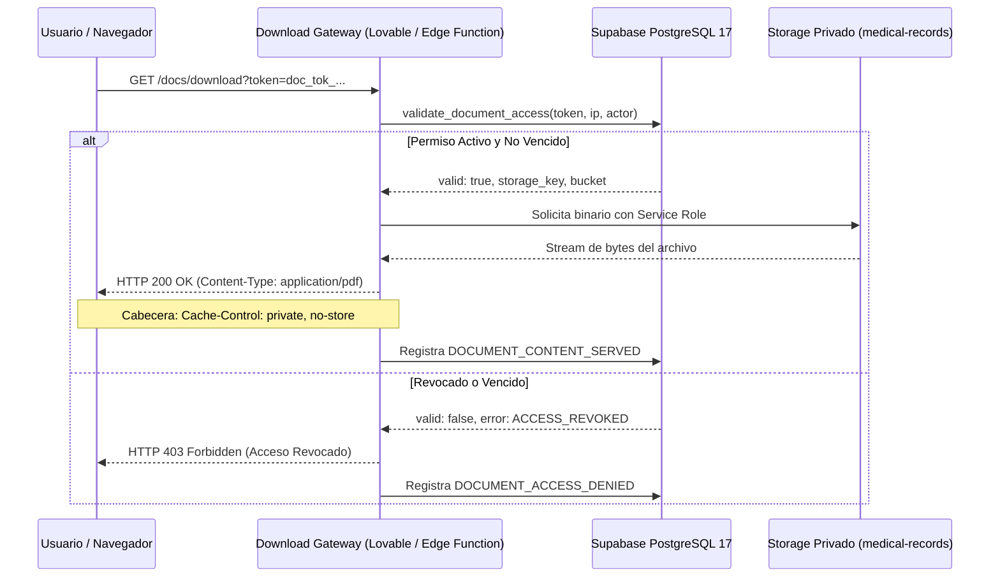

# VET FREEDOM OS — SECURE DOWNLOAD ACCESS GATEWAY
## Arquitectura de Gateway de Descarga Autenticada y Verificación por Solicitud
**Módulo:** VET-CORE-13 | APPROVED DOCUMENT DELIVERY  
**Dirección Médica:** Dr. Luis Eduardo Ríos  
**RPC de Validación:** `public.validate_document_access()`  

---

## 1. La Necesidad del Gateway Frente a URLs Firmadas

Las URLs firmadas estándar de servicios de almacenamiento (S3 / Supabase Storage) operan como **tokens al portador (bearer links)**: una vez firmada una URL con vigencia de 24 horas, la infraestructura de Storage sirve el archivo a cualquiera que posea el enlace hasta que expire, imposibilitando la revocación individual e instantánea si los permisos del usuario cambian en el ínterin.

Para documentos de alta criticidad clínica (biopsias, informes judiciales o tratamientos restringidos), Vet Freedom OS implementa un **Gateway de Descarga Autenticado**:



---

## 2. Parámetros de Control y Cabeceras HTTP

Para evitar que navegadores compartidos o proxys intermedios almacenen copias residuales de documentos médicos privados, el gateway fuerza cabeceras estrictas:

```http
HTTP/1.1 200 OK
Content-Type: application/pdf
Content-Disposition: inline; filename="informe_clinico_vet_life.pdf"
Cache-Control: private, no-cache, no-store, must-revalidate, max-age=0
Pragma: no-cache
Expires: 0
X-Content-Type-Options: nosniff
```

---

## 3. Registro de Eventos Observables

Cada interacción con el gateway genera un registro auditable en `public.document_access_events`:
- `DOCUMENT_ACCESS_REQUESTED`: Solicitud recibida.
- `DOCUMENT_ACCESS_AUTHORIZED`: Permisos y vigencia validados.
- `DOCUMENT_CONTENT_SERVED`: Bytes transmitidos con éxito.
- `DOCUMENT_ACCESS_DENIED`: Bloqueo por revocación, vencimiento o manipulación.
