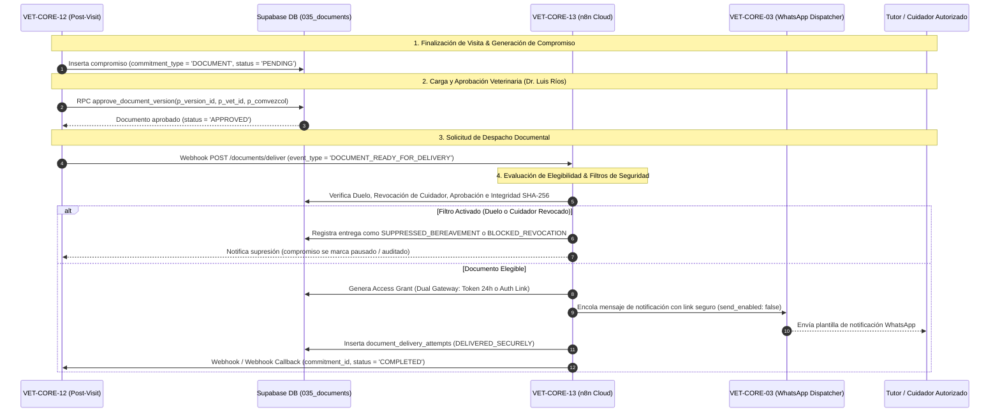

# VET FREEDOM OS — DOCUMENT POST-VISIT CONTRACT
## Contrato de Integración entre Seguimiento Post-Visita (CORE-12) y Entrega Documental Segura (CORE-13)

**Proyecto:** VET FREEDOM OS  
**Empresa:** Vet Life — Veterinaria a Domicilio  
**Dirección Médica:** Dr. Luis Eduardo Ríos  
**Módulos Involucrados:** `VET-CORE-12` (Post-Visit Commitments) & `VET-CORE-13` (Approved Document Delivery)  
**Versión de Contrato:** 1.0.0  
**Estado:** PRODUCCIÓN AUDITADA (DRAFT / SAFE MODE ACTIVADO)

---

## 1. Propósito y Alcance

Este contrato rige la orquestación asíncrona y segura entre el motor de compromisos post-visita (`VET-CORE-12`) y el servicio centralizado de gestión y entrega de documentos autorizados (`VET-CORE-13`). Garantiza que ningún documento clínico (fórmulas médicas, órdenes de laboratorio, reportes ecográficos, cartas de remisión) sea enviado al tutor o cuidador sin:
1. Haber completado la aprobación clínica explícita de un médico veterinario con tarjeta profesional COMVEZCOL vigente.
2. Contar con firma digital/sello inmutable y hash SHA-256 verificado.
3. Evaluar los protocolos de seguridad de contacto: bloqueo por duelo (Bereavement Policy), revocación de cuidadores y validación de consentimiento previo.
4. Actualizar el estado del compromiso en `post_visit_commitments` una vez que la entrega segura haya sido procesada.

---

## 2. Flujo de Trabajo y Secuencia de Interacción



---

## 3. Especificación de Eventos y Payloads

### 3.1 Evento de Solicitud de Entrega: `DOCUMENT_READY_FOR_DELIVERY`
Disparado por `VET-CORE-12` cuando el veterinario aprueba el documento asociado a una visita post-atención.

**Endpoint:** `POST https://vet-life.app.n8n.cloud/webhook/documents/deliver`  
**Headers Requeridos:**
```http
Content-Type: application/json
X-Vet-Signature: sha256=... (HMAC secret)
X-Source-Module: VET-CORE-12
```

**Payload JSON:**
```json
{
  "event_id": "evt_doc_deliv_78a8f1e2-b5e1-482a-9e12-32b49c00192a",
  "event_type": "DOCUMENT_READY_FOR_DELIVERY",
  "occurred_at": "2026-11-21T15:30:00.000Z",
  "commitment_id": "cmt_9941a3bc-7412-4f3b-8521-aef47183011a",
  "consultation_id": "cst_440182bb-2391-447a-ba99-881203847a12",
  "document": {
    "document_id": "doc_550e8400-e29b-41d4-a716-446655440000",
    "version_id": "dvr_661f9511-f30c-42e5-b827-557766551111",
    "version_number": 1,
    "document_type": "CLINICAL_REPORT_APPROVED",
    "title": "Informe Clínico Post-Consulta Domiciliaria - Canino Max",
    "storage_bucket": "medical-records",
    "storage_path": "records/doc_550e8400/v1/informe_clinico_max.pdf",
    "sha256_hash": "e3b0c44298fc1c149afbf4c8996fb92427ae41e4649b934ca495991b7852b855",
    "mime_type": "application/pdf",
    "file_size_bytes": 1048576,
    "is_approved": true,
    "approver": {
      "staff_id": "stf_vet_luis_rios_01",
      "professional_card_number": "COMVEZCOL-28491",
      "approved_at": "2026-11-21T15:28:45.000Z"
    }
  },
  "recipient": {
    "recipient_id": "rec_usr_owner_001",
    "role": "OWNER",
    "name": "Carlos Rodríguez",
    "phone_e164": "+573001234567",
    "email": "carlos.rodriguez@example.com",
    "is_bereaved": false,
    "caregiver_revoked": false
  },
  "patient": {
    "patient_id": "pat_dog_max_01",
    "name": "Max",
    "species": "CANINE",
    "is_deceased": false
  },
  "delivery_options": {
    "channel": "WHATSAPP",
    "access_strategy": "AUTHENTICATED_GATEWAY",
    "link_expiry_hours": 24,
    "send_enabled": false
  }
}
```

### 3.2 Evento de Confirmación de Entrega: `DOCUMENT_DELIVERY_CONFIRMED`
Emitido por `VET-CORE-13` a `VET-CORE-12` cuando el mensaje de entrega ha sido registrado con éxito.

**Payload JSON:**
```json
{
  "event_id": "evt_conf_99bb1234-a123-44bb-99cc-123456789abc",
  "event_type": "DOCUMENT_DELIVERY_CONFIRMED",
  "occurred_at": "2026-11-21T15:30:15.000Z",
  "commitment_id": "cmt_9941a3bc-7412-4f3b-8521-aef47183011a",
  "delivery_id": "del_11aa22bb-33cc-44dd-55ee-66ff77aa88bb",
  "document_id": "doc_550e8400-e29b-41d4-a716-446655440000",
  "recipient_id": "rec_usr_owner_001",
  "status": "DELIVERED_SECURELY",
  "access_url_issued": "https://vetlife.com.co/docs/view?token=tok_sec_99482...",
  "expires_at": "2026-11-22T15:30:15.000Z"
}
```

---

## 4. Gestión de Excepciones y Supresiones

1. **Protocolo de Duelo Activo (`is_bereaved: true` o `is_deceased: true`):**
   - Acción: `VET-CORE-13` suprime inmediatamente cualquier comunicación de marketing, recordatorio o encuesta. Si el documento es un certificado de defunción o necropsia solicitado explícitamente, la entrega se enruta a un canal de contacto empático asistido por el Dr. Luis Ríos con plantilla sobria y sin automatismos invasivos.
   - Estado devuelto: `SUPPRESSED_BEREAVEMENT`.
2. **Cuidador Revocado (`caregiver_revoked: true`):**
   - Acción: Si el destinatario registrado era un cuidador (`CAREGIVER`) cuyos permisos fueron revocados por el tutor principal, la entrega se bloquea en seco. Se notifica a `VET-CORE-12` para reasignar la entrega al tutor titular.
   - Estado devuelto: `BLOCKED_REVOCATION`.
3. **Documento No Aprobado / Falta COMVEZCOL:**
   - Acción: Rechazo inmediato de entrega. `VET-CORE-12` genera una alerta operativa en el dashboard de compromisos para el Dr. Luis Ríos.
   - Estado devuelto: `REJECTED_UNAPPROVED`.

---

## 5. Garantía de Idempotencia y Reintentos

- Toda solicitud de entrega incluye un `commitment_id` y `version_id`.
- La tabla `document_delivery_requests` almacena la clave `(commitment_id, document_version_id, recipient_id)`.
- Si se recibe una petición duplicada, el sistema retorna el registro existente sin reemitir mensajes ni regenerar tokens innecesarios.
