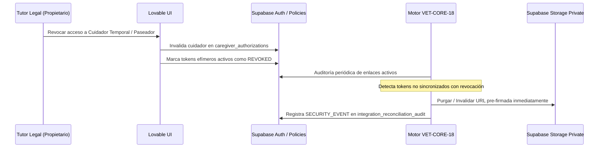

# VET FREEDOM OS — CONCILIACIÓN DE DOCUMENTOS SEGUROS
## Entregas Efímeras, Revocación Inmediata de Cuidadores y Hash Inmutable

---

### 1. El Ciclo de Documentos Clínicos y Administrativos (VET-CORE-13)

Las constancias médicas, fórmulas, resultados de exámenes y recetas veterinarias emitidas por Vet Life son documentos altamente confidenciales amparados por la ley de protección de datos (Habeas Data Ley 1581 de 2012).

- **Almacenamiento**: Supabase Private Storage (`clinical_documents_private` / `invoices_private`) con acceso exclusivo restringido por políticas RLS.
- **Mecanismo de Entrega**: Enlaces efímeros pre-firmados (*signed URLs*) con caducidad estricta máxima de 24 horas.
- **Invariante en QA**: Documentos clínicos reales deshabilitados. Solo se procesan documentos ficticios de prueba.

---

### 2. Discrepancias y Protocolos de Seguridad Documental

1. **`DOCUMENT_DELIVERY_REVOKED_CAREGIVER`**:
   - Detección de un intento de descarga o existencia de enlace activo perteneciente a un cuidador cuyo acceso fue revocado por el tutor legal.
   - *Acción Inmediata*: Invalidación instantánea del token efímero (`propose_safe_repair`), bloqueo de IP y registro en la auditoría de seguridad. **Bajo ninguna circunstancia se reexpide un enlace a un cuidador revocado.**
2. **`DOCUMENT_HASH_MISMATCH`**:
   - Discrepancia entre el hash SHA-256 almacenado en base de datos al momento de la firma médica y el hash del archivo residente en el bucket de storage.
   - *Severidad*: `CRITICAL_SECURITY`. Indica posible alteración no autorizada del archivo binario. El documento se bloquea para descarga pública y se notifica al Director Médico.
3. **`DOCUMENT_UNAPPROVED_LEAK_PREVENTION`**:
   - Intento de despacho de una constancia o fórmula que no ha recibido el estado `APPROVED` por el médico tratante.
   - *Acción*: Bloqueo preventivo en el Outbox y anulación de la tarea de despacho.
