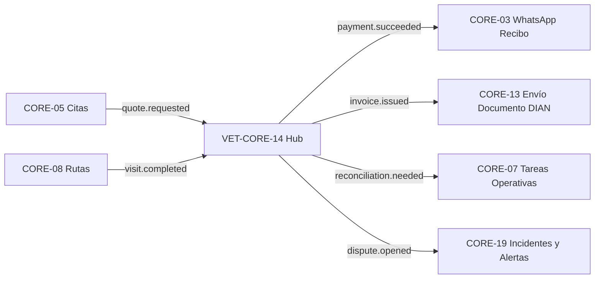

# VET FREEDOM OS — FINANCIAL EVENT CONTRACT
## Contrato de Eventos Financieros entre Módulos Internos (Outbox / Event Bus)
**Módulo:** VET-CORE-14 | FINANCIAL NOTIFICATIONS  
**Dirección Médica:** Dr. Luis Eduardo Ríos  
**Dirección Estratégica:** Alpha Vision Method  
**Plataforma:** PostgreSQL 17 + n8n Event Queue

---

## 1. Topología de Eventos Financieros

El subsistema financiero se comunica con el resto de Vet Freedom OS mediante eventos estructurados emitidos a la tabla de cola `financial_audit_events` o consumidos por `VET-CORE-14`:



---

## 2. Esquema Estándar de Eventos Financieros

Todos los eventos emitidos o consumidos deben cumplir la siguiente estructura JSON Schema:

```json
{
  "$schema": "http://json-schema.org/draft-07/schema#",
  "title": "VetFreedomFinancialEvent",
  "type": "object",
  "required": ["event_id", "event_type", "timestamp", "aggregate_id", "payload"],
  "properties": {
    "event_id": { "type": "string", "format": "uuid" },
    "event_type": {
      "type": "string",
      "enum": [
        "FINANCIAL.QUOTE_CREATED",
        "FINANCIAL.QUOTE_APPROVED",
        "FINANCIAL.PAYMENT_REQUEST_ISSUED",
        "FINANCIAL.PAYMENT_SUCCEEDED",
        "FINANCIAL.BANK_TRANSFER_REPORTED",
        "FINANCIAL.RECONCILIATION_COMPLETED",
        "FINANCIAL.INVOICE_GENERATED",
        "FINANCIAL.REFUND_REQUESTED",
        "FINANCIAL.REFUND_EXECUTED",
        "FINANCIAL.DISPUTE_OPENED"
      ]
    },
    "timestamp": { "type": "string", "format": "date-time" },
    "aggregate_id": { "type": "string" },
    "payload": { "type": "object" }
  }
}
```
