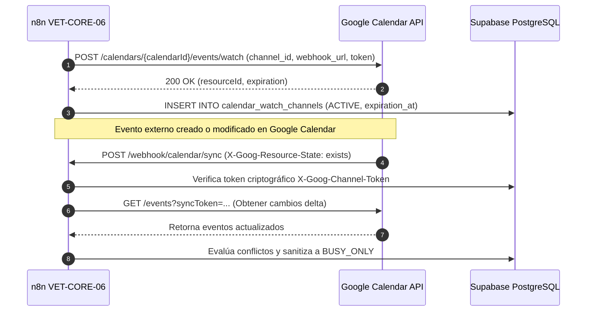

# INTEGRACIÓN DE CANALES WATCH PUSH — VET-CORE-06
## Notificaciones Push en Tiempo Real, Suscripción, Tokens de Verificación y Renovación

**Proyecto:** VET FREEDOM OS  
**Módulo:** `VET-CORE-06 | GOOGLE CALENDAR SYNC`  
**Empresa:** Vet Life — Veterinaria a Domicilio  
**Dirección Médica:** Dr. Luis Eduardo Ríos  
**Estado:** QA / STAGING (Safe Mode: `send_enabled: false`)

---

## 1. Arquitectura de Canales Watch (Push Notifications)

Para responder inmediatamente a modificaciones de agenda sin depender exclusivamente de consultas periódicas (polling), Vet Freedom OS establece canales de escucha (Watch Channels) mediante Google Calendar Push Notifications.



---

## 2. Suscripción y Registro del Canal

- **Endpoint de Creación:** `POST https://www.googleapis.com/calendar/v3/calendars/{calendarId}/events/watch`
- **Cuerpo de Creación:**
  ```json
  {
    "id": "e4f8d2b1-0000-0000-0000-000000000001",
    "type": "web_hook",
    "address": "https://alphavision.app.n8n.cloud/webhook/calendar/sync",
    "token": "token_hmac_sha256_verification_hash",
    "params": {
      "ttl": "604800"
    }
  }
  ```

---

## 3. Validación de Notificaciones Push Entrantes

Toda notificación push entrante incluye las siguientes cabeceras HTTP que deben ser validadas estrictamente:
- `X-Goog-Channel-ID`: Identificador único de canal registrado en `calendar_watch_channels`.
- `X-Goog-Channel-Token`: Token criptográfico HMAC generado durante la suscripción.
- `X-Goog-Resource-State`:
  - `sync`: Mensaje de ping inicial confirmando que el canal está activo. **No debe disparar sincronización de eventos.**
  - `exists`: Indica que ha ocurrido una creación o actualización de evento. Dispara la sincronización incremental.
  - `not_exists`: Indica eliminación de recurso.

---

## 4. Política de Renovación Proactiva y Cierre Limpio

1. **Expiración:** Los canales watch de Google expiran por diseño en un plazo máximo de 7 días.
2. **Monitoreo Automático:** La tarea periódica de `VET-CORE-06` inspecciona `calendar_watch_channels` donde `expiration_at - now() < interval '24 hours'`.
3. **Cierre Limpio (`stop`):** Antes de suscribir un nuevo canal, se emite una llamada a `POST /channels/stop` para cerrar el canal anterior y evitar notificaciones huérfanas.
4. **Resiliencia ante Caídas Push:** Si Google experimenta intermitencias en la entrega push, la tarea programada (`Schedule Trigger` cada 15 min) actúa como red de seguridad (fallback a polling de sincronización incremental).
