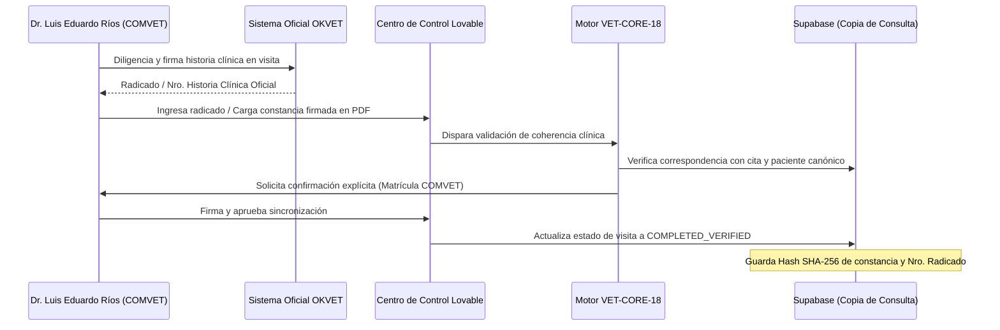

# VET FREEDOM OS — CONCILIACIÓN ASISTIDA CON OKVET
## Procedimiento Asistido, Autoridad Clínica Exclusiva y Prohibición de Scraping

---

### 1. El Rol de OKVET en VET FREEDOM OS

**OKVET** es el software médico oficial donde reposan las historias clínicas legales, diagnósticos, fórmulas médicas, fichas de vacunas y procedimientos veterinarios de Vet Life.

- **Conector**: `okvet_assisted`
- **Modo**: `MANUAL_IMPORT_ONLY` / `MANUAL_CONFIRMATION`
- **Autoridad**: Autoridad clínica absoluta e inamovible (SSOT Clínico).
- **Invariante Crítica**: **CERO SCRAPING Y CERO APIS FICTICIAS**. OKVET no proporciona una API REST pública ni webhooks oficiales en este entorno. Intentar técnicas de web scraping no autorizadas o automatizaciones de interfaz frágiles sobre OKVET viola los términos del proveedor y las normas de seguridad clínica.

---

### 2. Flujo de Conciliación Asistida Médica

---

### 3. Detección y Tratamiento de Conflictos Clínicos

1. **`OKVET_RECORD_NOT_CONFIRMED`**:
   - Cita domiciliaria realizada hace más de 24 horas que carece de confirmación de historia clínica oficial en OKVET.
   - *Severidad*: `HIGH`.
   - *Acción*: Tarea prioritaria asignada al Dr. Luis Eduardo Ríos con recordatorio diario. Ningún compromiso post-visita ni constancia documental puede emitirse como oficial hasta que OKVET esté confirmado.
2. **`OKVET_CLINICAL_DATA_MISMATCH`**:
   - Discrepancia entre los datos registrados en el resumen preliminar de Supabase y el radicado formal en OKVET (ej. dosis de medicamento o fecha de refuerzo vacunal).
   - *Resolución*: OKVET prevalece siempre sobre cualquier sistema secundario. El dato en Supabase se corrige para reflejar fielmente lo firmado por el médico en OKVET.
3. **`PATIENT_IDENTITY_MISMATCH`**:
   - El número de historia clínica en OKVET está asociado a un paciente distinto del registrado en la cita de Supabase.
   - *Bloqueo Inmediato*: Se congela la emisión de documentos, se alerta de inmediato al Director Médico y se prohíbe cualquier auto-reparación automatizada.
