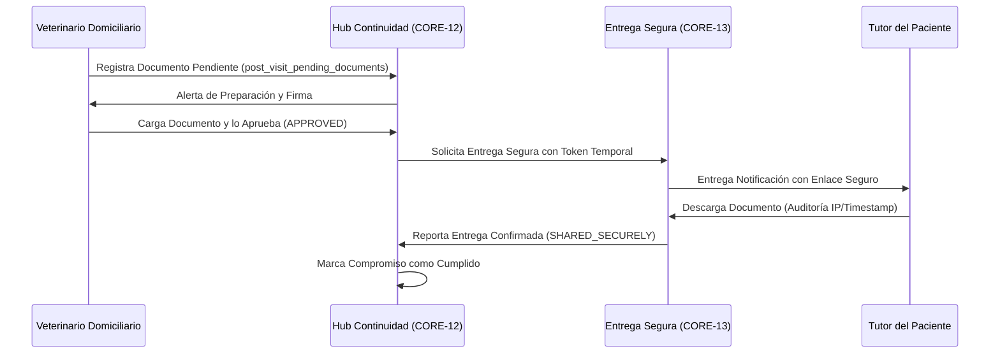

# VET FREEDOM OS — POST-VISIT DOCUMENT CONTRACT
## Especificación de Intercambio Documental entre Continuidad (CORE-12) y Entrega Segura (CORE-13)
**Módulos:** VET-CORE-12 & VET-CORE-13  
**Dirección Médica:** Dr. Luis Eduardo Ríos  

---

## 1. Ciclo de Vida del Documento Pendiente

---

## 2. Invariantes de Seguridad Documental

1. **Prohibición de Entrega de Borradores:** Ningún documento en estado `REQUESTED`, `PREPARED` o `PENDING_APPROVAL` puede ser remitido a CORE-13 para entrega.
2. **Bucket Privado:** Los documentos residen en `referral-documents` o `medical-records` con acceso público estrictamente bloqueado.
3. **Cero Suposiciones de Entrega:** El simple almacenamiento del archivo en Supabase **nunca** equivale a documento entregado. Se requiere confirmación de despacho por CORE-13.
