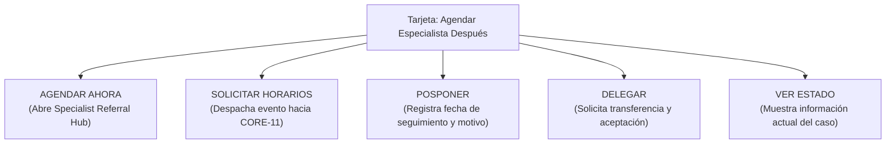

# VET FREEDOM OS — POST-VISIT REFERRAL CONTRACT
## Interfaz de Integración entre Continuidad Asistencial (CORE-12) y Coordinación de Especialistas (CORE-11)
**Módulos:** VET-CORE-12 & VET-CORE-11  
**Dirección Médica:** Dr. Luis Eduardo Ríos  

---

## 1. La Tarjeta «Agendar Especialista Después»

Al finalizar una consulta domiciliaria donde el médico veterinario indica una derivación especializada pero no es posible concretar la cita en el momento (por horario no hábil, preferencia de la familia o disponibilidad externa), el sistema despliega la tarjeta interactiva:

---

## 2. Invariantes del Contrato CORE-12 <-> CORE-11

1. **Autoridad Clínica Conservada:** La indicación médica de remisión reside en `specialist_referrals` gobernada por el criterio del veterinario tratante. CORE-12 no altera la especialidad ni el motivo médico.
2. **La Selección NO es Confirmación:** CORE-12 no marca una remisión como resuelta porque el cliente haya pulsado un botón de horario. Solo la confirmación externa verificada de CORE-11 valida el hito.
3. **Continuidad Bloqueada sin Informe:** CORE-12 no permite el cierre del caso (`post_visit_cases`) si la remisión en CORE-11 no cuenta con informe recibido y revisado por el veterinario tratante.
