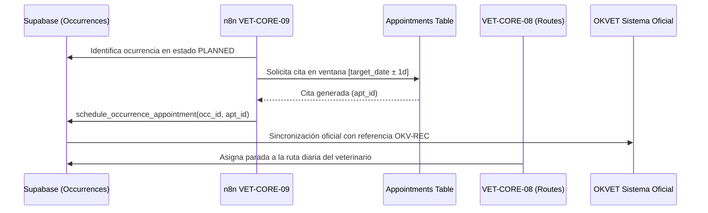

# VET FREEDOM OS — RECURRING CARE SCHEDULING
## Integración con Calendario, Rutas (CORE-08) y Agendamiento Oficial
**Módulo:** VET-CORE-09  
**Interacción:** `appointments` $\leftrightarrow$ `recurring_visit_occurrences` $\leftrightarrow$ `routes` (CORE-08)  

---

## 1. Reglas de Acoplamiento Temporal

El agendamiento de una sesión recurrente debe satisfacer simultáneamente tres restricciones:
1. **Restricción de Ventana Clínica:** La fecha de la cita debe estar contenida estrictamente en $[ \text{window\_start\_date}, \text{window\_end\_date} ]$.
2. **Capacidad y Rutas de Desplazamiento (VET-CORE-08):** La parada debe integrarse en la ruta diaria del veterinario titular sin violar los buffers de descanso ni el límite máximo de paradas.
3. **Disponibilidad y Confirmación del Tutor:** Franja horaria acordada previamente mediante recordatorios automáticos de CORE-09 / CORE-03.

---

## 2. Inmutabilidad de Paradas Clínicamente Protegidas

En el módulo **VET-CORE-08 (Route Logistics)**, toda parada proveniente de un plan recurrente se marca con:
`is_clinically_protected = true`.

Esto previene que la función de reoptimización heurística de rutas mueva o postergue la visita para optimizar tiempos de tráfico a expensas de la continuidad del tratamiento del paciente crítico.
