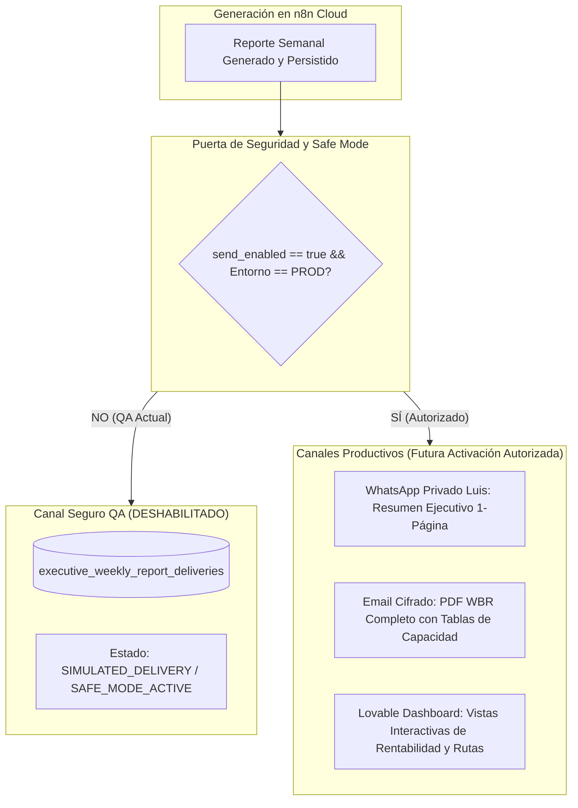

# Protocolo de Despacho y Entrega Segura del Reporte Semanal (VET-CORE-17)

**Módulo:** `VET-CORE-17 | WEEKLY REPORTING`  
**Proyecto:** VET FREEDOM OS — Vet Life: Veterinaria a Domicilio  
**Dirección Médica:** Dr. Luis Eduardo Ríos  
**Dirección Estratégica:** Alpha Vision Method  
**Entorno:** DEVELOPMENT / QA  
**Fecha:** 2026-11-21  

---

## 1. Canales de Distribución y Audiencia Autorizada

El Reporte Semanal contiene información altamente sensible sobre rentabilidad, costos, desempeño médico individual y decisiones estratégicas. Por ende, su distribución está estrictamente restringida a:
1. **Dr. Luis Eduardo Ríos:** Director Médico y Fundador de Vet Life.
2. **Asistente Privada Ejecutiva:** Canal privado de inteligencia para preparación de reuniones y seguimiento de compromisos.
3. **Lovable Executive Hub:** Interfaz ejecutiva privada con autenticación Supabase y control estricto de roles (RBAC).

---

## 2. Invariante Safe Mode y Auditoría de Entrega

- **Variable Global:** `send_enabled: false`.
- **Comportamiento en QA:** Ningún nodo de n8n invoca endpoints de envío real hacia la API de WhatsApp de Meta ni hacia proveedores de correo electrónico (Resend/SendGrid).
- **Trazabilidad en Base de Datos:** Cada intento de despacho registra una fila en `executive_weekly_report_deliveries`:
  - `delivery_channel`: `WHATSAPP_EXECUTIVE` o `EMAIL_EXECUTIVE`.
  - `delivery_status`: `SIMULATED_SAFE_MODE`.
  - `recipient_role`: `MEDICAL_DIRECTOR`.
  - `payload_preview`: Extracto de los primeros 250 caracteres del WBR.

---

## 3. Formato del Resumen Ejecutivo (Weekly Business Review - WBR)

El WBR se formatea para lectura rápida en móvil (pantalla de WhatsApp) o panel web de Lovable:
- **Cabecera:** Semana ISO, fechas de corte, estado general y semáforo operativo.
- **Sección 1: Actividad y Conversión:** Clientes únicos, visitas completadas, tasa de cohorte.
- **Sección 2: Capacidad y Logística:** Horas utilizables, sobrecarga médica, incidentes viales.
- **Sección 3: Finanzas y Rentabilidad:** Cobrado verificado, costos directos, margen de contribución.
- **Sección 4: Autonomía de Luis:** Tareas reservadas vs delegables, tasa de autonomía efectiva.
- **Sección 5: Continuidad y Mejora:** Compromisos vencidos, clusters de quejas y 3 prioridades estratégicas para la semana que inicia.
