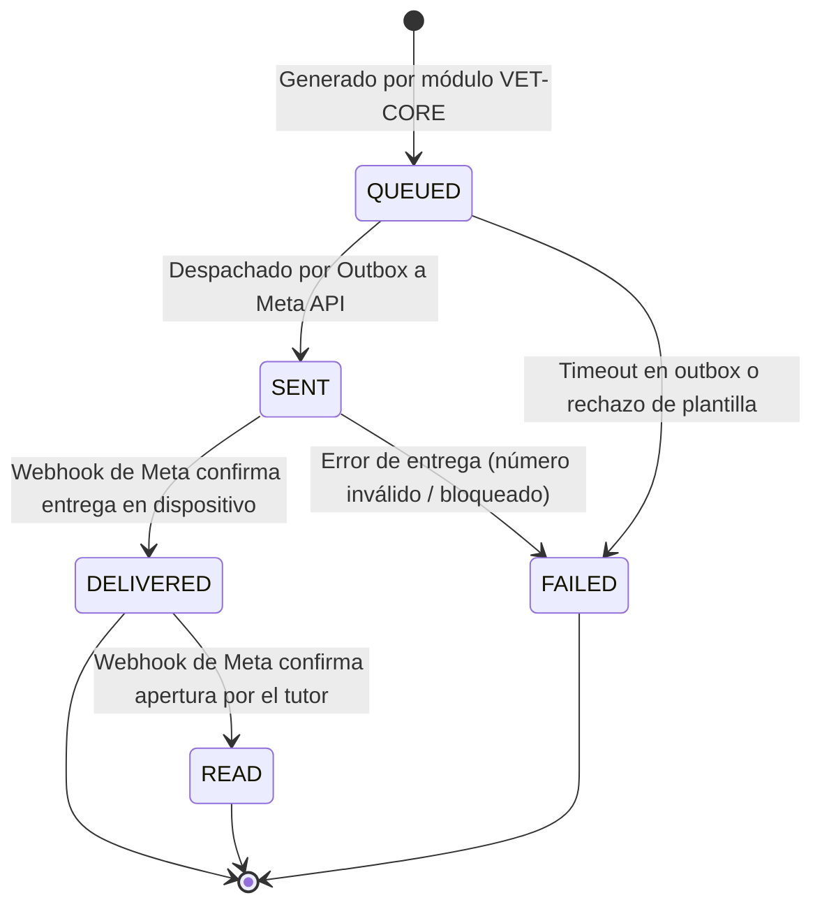

# VET FREEDOM OS — CONCILIACIÓN DE ESTADOS DE WHATSAPP BUSINESS
## Recibos de Entrega, Idempotencia de Webhooks y Prevención de Pérdida de Citas

---

### 1. El Rol de Meta WhatsApp Business Cloud API

WhatsApp es el canal primordial de comunicación y notificación directa con los tutores de mascotas para Vet Life.

- **Conector**: `whatsapp_business`
- **Modo**: `EVENT_DRIVEN` (Webhooks bidireccionales firmados con `X-Hub-Signature-256`)
- **Autoridad**: Autoridad absoluta sobre el estado de entrega y lectura del mensaje saliente (`SENT` -> `DELIVERED` -> `READ` -> `FAILED`).
- **Invariante en QA**: `send_enabled: false`. Cero mensajes reales a números de clientes. Los tests se ejecutan en entorno sandbox o simuladores controlados.

---

### 2. Ciclo de Estados de Mensajería y Jerarquía Irreversible

Los mensajes transicionan de manera estrictamente ascendente:

- **Regla de No Degradación**: Si un mensaje ya está en estado `DELIVERED` o `READ`, la llegada tardía o fuera de orden de un webhook anterior con estado `SENT` es clasificada como `EXPECTED_ASYNCHRONOUS_DELAY` y descartada sin degradar el estado en la base de datos.

---

### 3. Tratamiento de Fallas de Entrega y Protección de Citas

Una regla de oro en la operación de Vet Life:
> **UN ERROR EN LA ENTREGA DE UN MENSAJE DE WHATSAPP JAMÁS ANULA NI CANCELA UNA CITA CONFIRMADA EN SUPABASE.**

1. **Escenario de Falla de Entrega**:
   - Meta reporta error de entrega (ej. código 131026: teléfono apagado, sin cobertura en la zona rural o tutor sin WhatsApp activo).
2. **Acción de Conciliación**:
   - El estado del mensaje se marca como `FAILED` con su respectivo código de diagnóstico.
   - La cita médica se mantiene **CONFIRMADA** e intacta en Supabase y Google Calendar.
   - Se crea inmediatamente una tarea humana de alta prioridad en `integration_manual_confirmation_tasks` para que el coordinador contacte telefónicamente al tutor por llamada de voz directa.
   - Se evita dejar plantado al médico veterinario o perder la atención de la mascota por un problema de conectividad celular.
