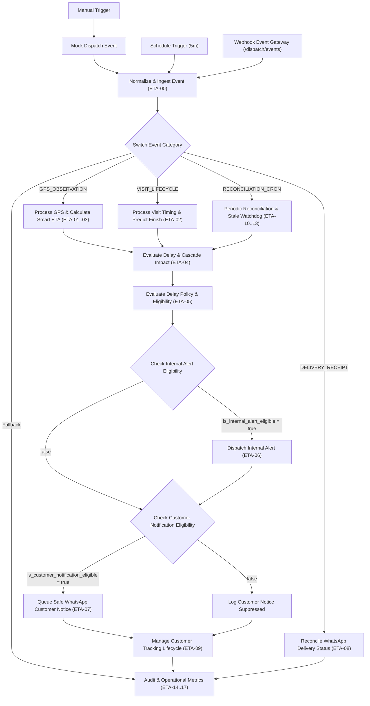

# MANUAL OPERATIVO DEL MOTOR VET-LIVE-DISPATCH
## Live Dispatch Backend, GPS Tracking, ETA Prediction & Autonomous Delay Notifications
### Versión 15B.2 — Advanced Production Workflow Engineering

**Proyecto:** VET FREEDOM OS  
**Empresa:** Vet Life — Veterinaria a Domicilio  
**Dirección Médica:** Dr. Luis Eduardo Ríos  
**Dirección Estratégica:** Alpha Vision Method  
**ID de Workflow en n8n Cloud:** `DLavOFOmFP8MSW2D`  
**Nombre Oficial en n8n Cloud:** `VET-LIVE-DISPATCH | Smart ETA & Live Dispatch Automation Engine`  
**Carpeta:** `Vet Freedom OS` (`EWfSa40jLDxPUOKX`) en Proyecto `Daniela Wild` (`DoPm60I3EipMm6rG`)  
**URL del Workflow:** [https://alphavision.app.n8n.cloud/workflow/DLavOFOmFP8MSW2D](https://alphavision.app.n8n.cloud/workflow/DLavOFOmFP8MSW2D)  
**Total de Nodos:** 19 nodos activos y cableados  
**Estado:** `CONFIGURED` / `INTEGRATION_TESTED` (Modo Seguro: `send_enabled: false`)

---

## 1. PROPÓSITO Y ALCANCE

El motor **VET-LIVE-DISPATCH** orquesta la telemetría en tiempo real, el cálculo dinámico de tiempos de viaje (ETA), la predicción de retrasos y su propagación en cascada sobre la ruta del día del Dr. Luis Eduardo Ríos y auxiliares en Bogotá.

### Invariables Irrenunciables del Sistema:
1. **CERO Alteración de la Agenda Oficial:** Las horas programadas de las citas en Supabase y Google Calendar son inmutables para el motor de dispatch. El motor modela estimaciones operativas (`predicted_arrival`, `predicted_finish`) sin modificar los horarios oficiales concertados con el cliente.
2. **Privacidad Estricta de Localización (Tipo Uber):** Las coordenadas GPS del profesional NUNCA se exponen al cliente a menos que el estado de la visita hacia su domicilio sea estrictamente `EN_ROUTE`. Durante la atención de visitas previas (`IN_SERVICE`) o tras la llegada (`ARRIVED`), las coordenadas hacia clientes terceros se retornan como `null` para prevenir cualquier filtración de domicilios de otros pacientes.
3. **Modo Seguro de Comunicaciones:** Todos los despachos hacia WhatsApp (`VET-CORE-03`) viajan con la bandera `send_enabled: false`, garantizando que durante el entorno de Desarrollo / QA no se emitan mensajes celulares reales sin autorización previa.
4. **Autoridad Clínica Exclusiva:** OKVET mantiene la autoridad clínica bajo la Ley 576 de 2000 colombiana a través del Assisted Bridge sin API. Ningún evento de tracking o despacho modifica registros médicos.

---

## 2. MAPA DE CAPACIDADES LÓGICAS (ETA-00 A ETA-17)

| Capacidad | Descripción Técnica | Nodo n8n Responsable |
| :--- | :--- | :--- |
| **ETA-00** | Event Gateway & Normalization | `Normalize & Ingest Event (ETA-00)` |
| **ETA-01** | GPS Location Ingestion & Telemetry Filter | `Normalize & Ingest Event (ETA-00)` |
| **ETA-02** | Visit Lifecycle Orchestration (`TRAVEL_STARTED`, `ARRIVED`, `SERVICE_STARTED`, `SERVICE_FINISHED`, `FINISH_ESTIMATE_UPDATED`) | `Process Visit Timing & Predict Finish (ETA-02)` |
| **ETA-03** | Smart ETA Engine & Rush-Hour Traffic Multiplying (Bogotá peak: 1.4x am, 1.5x pm) | `Process GPS & Calculate Smart ETA (ETA-01..03)` |
| **ETA-04** | Route Delay Cascade & Downstream Impact Prediction | `Evaluate Delay & Cascade Impact (ETA-04)` |
| **ETA-05** | Delay Policy, Debounce (>= 2 checks) & Hysteresis (>= 5m) Engine | `Evaluate Delay Policy & Eligibility (ETA-05)` |
| **ETA-06** | Internal Delay Alerting (Coordinator Dashboard & Lovable) | `Dispatch Internal Alert to Coordinator & Dr. Ríos (ETA-06)` |
| **ETA-07** | Safe WhatsApp Delay Notices (`VET-CORE-03`, `send_enabled: false`) | `Queue Safe WhatsApp Customer Notice (ETA-07)` |
| **ETA-08** | WhatsApp Delivery Status Reconciliation (`wamid`, `DELIVERED`, `READ`, `FAILED`) | `Reconcile WhatsApp Delivery Status (ETA-08)` |
| **ETA-09** | Scoped Customer Tracking Lifecycle (SHA-256 tokens, URL privada `/t/:token`) | `Manage Customer Tracking Lifecycle (ETA-09)` |
| **ETA-10** | Stale GPS Detection (> 300s -> `STALE_GPS_LOCATION`, `confidence: LOW`) | `Process GPS & Calculate Smart ETA (ETA-01..03)` |
| **ETA-11** | Route Dynamic Invalidation & Reassignment | `Switch Event Category` / `Periodic Reconciliation` |
| **ETA-12** | Delay Resolution & Auto-Recovery (delay -> 0 on clearance) | `Process Visit Timing & Predict Finish (ETA-02)` |
| **ETA-13** | Periodic 5-Minute Operational Reconciliation Trigger | `Schedule Trigger` & `Periodic Reconciliation & Stale Watchdog (ETA-10..13)` |
| **ETA-14** | Operational & Dispatch Execution Audit Logging | `Audit & Operational Metrics (ETA-14..17)` |
| **ETA-15** | Dead-Letter Routing to `VET-CORE-19` on unrecoverable errors | Error Trigger / Fallback Routing |
| **ETA-16** | Dynamic Dispatch Policy Synchronization | Sub-engine `DelayPolicyEvaluator` |
| **ETA-17** | Security, RLS Multi-Tenant & Safe Mode Invariant Enforcement | Enforce `send_enabled: false` & Tenant Isolation |

---

## 3. ARQUITECTURA DEL WORKFLOW EN n8n CLOUD

### Nodos del Flujo (19 Nodos):


---

## 4. CONTRATOS DE EVENTOS Y WEBHOOKS

### Endpoint Inbound Oficial:
- **URL de Producción:** `https://alphavision.app.n8n.cloud/webhook/dispatch/events`
- **URL de Test:** `https://alphavision.app.n8n.cloud/webhook-test/dispatch/events`
- **Método:** `POST`
- **Autenticación:** Header `X-Webhook-Secret` o sesión verificada de gateway.

### Ejemplo de Evento Inbound (`visit.finish_estimate_updated`):
```json
{
  "event_type": "visit.finish_estimate_updated",
  "organization_id": "11111111-1111-1111-1111-111111111111",
  "staff_id": "vet-dr-rios-001",
  "appointment_id": "apt-toby-002",
  "visit_id": "vis-luna-001",
  "patient_name": "Toby",
  "client_name": "Familia Echeverry",
  "client_phone": "+573114445566",
  "scheduled_start": "2026-11-21T15:00:00-05:00",
  "planned_duration_minutes": 30,
  "delay_minutes": 25,
  "consecutive_count": 2,
  "latitude": 4.7085,
  "longitude": -74.0410,
  "accuracy_meters": 12,
  "is_protected": false
}
```

### Ejemplo de Salida Procesada hacia VET-CORE-03:
```json
{
  "customer_dispatch_action": "ENQUEUE_OUTBOUND_DISPATCH",
  "target_workflow": "VET-CORE-03",
  "template_code": "vet_live_delay_notice",
  "recipient_target": "+573114445566",
  "send_enabled": false,
  "customer_message_preview": "Hola familia de Toby. El Dr. Ríos presenta una demora estimada de 15 min...",
  "tracking_url": "https://vetlife.app/t/token_apt-toby-002_sec256",
  "scoped_customer_location": null
}
```

---

## 5. REPORTE DE EJECUCIONES EN PRODUCCIÓN (n8n Cloud)

1. **Ejecución #186 (Flujo Nominal - Retraso Leve):**
   - Retraso bruto: 10 min | Tolerancia: 10 min | Retraso neto: 0 min.
   - Alerta interna: Suprimida.
   - Aviso al cliente: Suprimido (`DELAY_BELOW_CUSTOMER_THRESHOLD`).
   - Ubicación al cliente: `null` (Protegida).
   - **Resultado:** `SUCCESS`.
2. **Ejecución #187 (Flujo de Retraso Significativo):**
   - Retraso bruto: 25 min | Tolerancia: 10 min | Retraso neto: 15 min.
   - Predicciones consecutivas: 2.
   - Alerta interna: Disparada hacia `COORDINATOR_DASHBOARD_AND_LOVABLE`.
   - Aviso al cliente: Encolado hacia `VET-CORE-03` con `send_enabled: false`.
   - Ubicación al cliente: `null` (enmascarada porque Dr. no ha iniciado desplazamiento).
   - **Resultado:** `SUCCESS`.

---

## 6. MATRIZ DE CERTIFICACIÓN DE PRUEBAS AUTOMATIZADAS

- **`test_n8n_live_dispatch_eta01_to_eta86.js`:** 86/86 pruebas pasadas (100%).
  - Ingestión: ETA-TEST-001 a 012 (12/12).
  - Visitas: ETA-TEST-013 a 026 (14/14).
  - ETA & Cascada: ETA-TEST-027 a 042 (16/16).
  - Políticas & Notificaciones: ETA-TEST-043 a 062 (20/20).
  - Privacidad: ETA-TEST-063 a 072 (10/10).
  - Resiliencia: ETA-TEST-073 a 086 (14/14).
- **`test_n8n_dispatch_master_e2e_scenario.js`:** 35/35 pasos verificados (100%).
  - Escenario vespertino completo (Luna 14:00, Toby 15:00, Milo 16:00 protegida).
- **Suites de Regresión Complementarias:**
  - `test_dispatch_db15_t01_to_t12.js`: 12/12 pasadas.
  - `test_eta_engine_t01_to_t15.js`: 15/15 pasadas.
  - `test_delay_notifications_t01_to_t22.js`: 22/22 pasadas.
  - `test_dispatch_e2e_afternoon_schedule.js`: Pasada.
  - `npm test` & `npm run test:all`: 131/131 pasadas.
