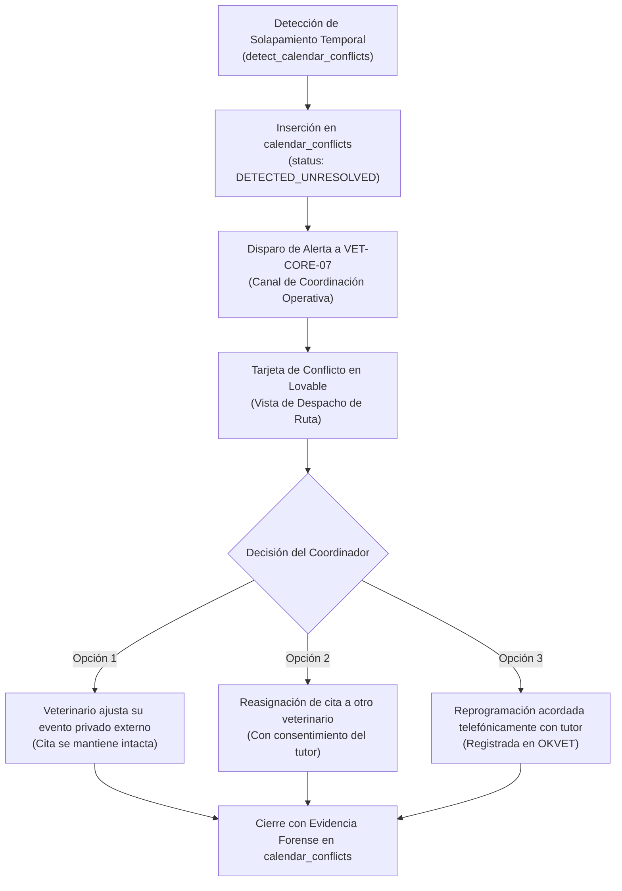

# GESTIÓN Y RESOLUCIÓN DE CONFLICTOS DE CALENDARIO — VET-CORE-06
## Protocolo Clínico-Operativo sin Cancelaciones Automáticas

**Proyecto:** VET FREEDOM OS  
**Módulo:** `VET-CORE-06 | GOOGLE CALENDAR SYNC`  
**Empresa:** Vet Life — Veterinaria a Domicilio  
**Dirección Médica:** Dr. Luis Eduardo Ríos  
**Estado:** QA / STAGING (Safe Mode: `send_enabled: false`)

---

## 1. Principio Fundamental: Cero Cancelaciones Automáticas

En la atención veterinaria domiciliaria, cancelar o reprogramar unilateralmente una cita médica genera desconfianza en el tutor, pone en riesgo la continuidad de tratamientos de pacientes crónicos o posquirúrgicos, y deteriora la reputación de Vet Life.

Por tanto:
- **Ningún evento creado o movido en Google Calendar cancela automáticamente una cita de negocio.**
- **Ningún evento externo reprograma automáticamente la hora de visita acordada con el cliente.**
- Todo solapamiento temporal se registra como una discrepancia operativa que requiere **mediación y resolución humana informada**.

---

## 2. Tipología y Severidad de Conflictos

| Tipo de Conflicto | Descripción | Severidad | Acción Inmediata |
| :--- | :--- | :--- | :--- |
| `EXTERNAL_BUSY_CONFLICT` | Solapamiento directo de horario entre cita clínica confirmada y evento personal | `HIGH_OPS` | Notificar al coordinador operativo y alertar al veterinario asignado |
| `TRAVEL_TIME_OVERLAP` | Intervalo entre citas menor a 45 minutos (tiempo insuficiente de desplazamiento en Bogotá) | `HIGH_OPS` | Evaluar ruta vial en Lovable y ajustar márgenes logísticos |
| `UNAPPROVED_LEAVE_CONFLICT` | Cita agendada en franja donde el profesional registró una licencia médica imprevista | `CRITICAL_CLINICAL` | Reasignación prioritaria de la cita a otro veterinario disponible del staff |
| `SKILL_MISMATCH_CONFLICT` | Evento que demanda cirugía o ecografía donde el veterinario disponible carece de la competencia | `CRITICAL_CLINICAL` | Escalar al Dr. Luis Eduardo Ríos para reasignación clínica adecuada |

---

## 3. Flujo de Escalamiento a VET-CORE-07 y Lovable

---

## 4. Registro de Evidencia y Cierre de Conflicto

Para cerrar un conflicto en el sistema, el operador debe registrar:
- `resolution_status`: `'RESOLVED_BY_COORDINATOR'` o `'DISMISSED_AUTHORIZED'`
- `resolution_owner`: ID del usuario en `staff_profiles` que tomó la decisión.
- `resolution_evidence`: Justificación textual detallada (ejemplo: *"Dr. Ríos confirmó vía telefónica que su compromiso personal fue postergado para las 18:00; la visita a Lucas se ejecuta a las 10:00 según lo acordado"*).
- `resolved_at`: Marca de tiempo UTC registrada automáticamente.
