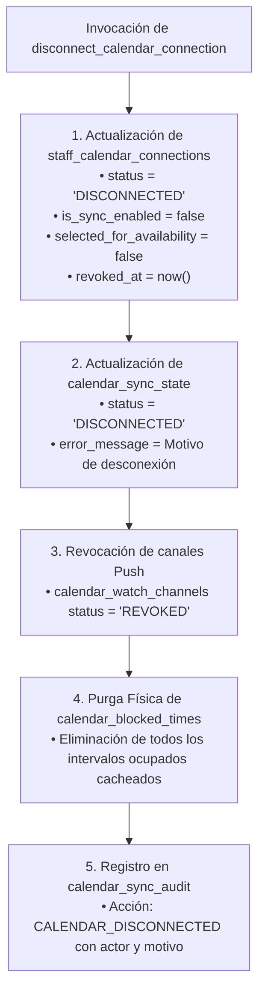

# PROCEDIMIENTO DE DESCONEXIÓN Y REVOCACIÓN DE CALENDARIOS — VET-CORE-06
## Protocolo de Desconexión Voluntaria, Revocación de Canales y Purga de Datos Privados

**Proyecto:** VET FREEDOM OS  
**Módulo:** `VET-CORE-06 | GOOGLE CALENDAR SYNC`  
**Empresa:** Vet Life — Veterinaria a Domicilio  
**Dirección Médica:** Dr. Luis Eduardo Ríos  
**Estado:** QA / STAGING (Safe Mode: `send_enabled: false`)

---

## 1. Casos de Uso para la Desconexión

La desconexión formal de un calendario externo se produce en tres escenarios operativos:
1. **Petición Voluntaria del Profesional:** El veterinario o auxiliar decide retirar su calendario personal o vincular una cuenta distinta.
2. **Desvinculación Laboral / Fin de Contrato:** El profesional cesa sus actividades en Vet Life.
3. **Revocación de Seguridad:** Sospecha de compromiso de credenciales o anomalías de seguridad en la cuenta Google del usuario.

---

## 2. Ejecución Atómica del Procedimiento (`disconnect_calendar_connection`)

El procedimiento almacenado `disconnect_calendar_connection` en PostgreSQL garantiza la ejecución atómica de cuatro acciones críticas:

---

## 3. Verificación Post-Desconexión

Una vez ejecutada la desconexión:
1. **Comprobación de Disponibilidad:** El motor `VET-CORE-01` deja de considerar al profesional para asignación de nuevos domicilios, o lo evalúa únicamente según su horario de turno fijo si así se configura administrativamente.
2. **Cero Retención de Datos Privados:** Al consultar `calendar_blocked_times` con el `connection_id` desconectado, el resultado debe ser cero registros (`count = 0`).
3. **Cierre de Canales de Google:** Se cancela el webhook push en Google API para evitar tráfico innecesario en los endpoints de n8n.
