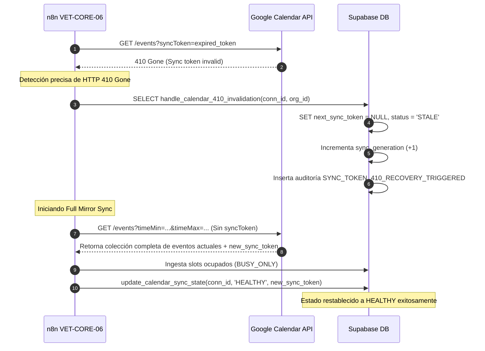

# PROCEDIMIENTO DE RECUPERACIÓN ANTE HTTP 410 GONE — VET-CORE-06
## Protocolo de Recuperación de Cursores syncToken Caducados sin Pérdida de Datos

**Proyecto:** VET FREEDOM OS  
**Módulo:** `VET-CORE-06 | GOOGLE CALENDAR SYNC`  
**Empresa:** Vet Life — Veterinaria a Domicilio  
**Dirección Médica:** Dr. Luis Eduardo Ríos  
**Estado:** QA / STAGING (Safe Mode: `send_enabled: false`)

---

## 1. Naturaleza del Error HTTP 410 Gone de Google Calendar

En la API v3 de Google Calendar, los cursores de sincronización delta (`syncToken`) tienen una vida útil finita o pueden ser invalidados unilateralmente por los servidores de Google debido a cambios internos en la infraestructura de almacenamiento.

Cuando esto ocurre, cualquier petición incremental con dicho cursor retorna:
```http
HTTP/1.1 410 Gone
Content-Type: application/json

{
  "error": {
    "code": 410,
    "message": "Sync token is no longer valid, a full sync is required."
  }
}
```

---

## 2. Invariante de Seguridad Clínica durante la Recuperación

> [!IMPORTANT]
> **REGLA DE ORO DE VET FREEDOM OS:**  
> La recepción de un error HTTP 410 Gone de Google Calendar **NUNCA DEBE PROVOCAR LA ELIMINACIÓN DE CITAS MÉDICAS (`appointments`), HISTORIAS CLÍNICAS, TRATAMIENTOS NI REGISTROS OKVET EN SUPABASE**.
> 
> El error 410 solo invalida el cursor de lectura del espejo externo; la realidad clínica de Vet Life permanece intacta.

---

## 3. Protocolo Automatizado de Recuperación Paso a Paso



---

## 4. Medidas de Mitigación y Alarmas

- Si una conexión permanece en estado `STALE` por más de 6 horas sin regenerar su cursor, se emite una alerta a `VET-CORE-20 (System Health Monitor)`.
- El equipo de soporte técnico puede inspeccionar la causa exacta en la tabla `calendar_sync_audit` buscando la acción `SYNC_TOKEN_410_RECOVERY_TRIGGERED`.
