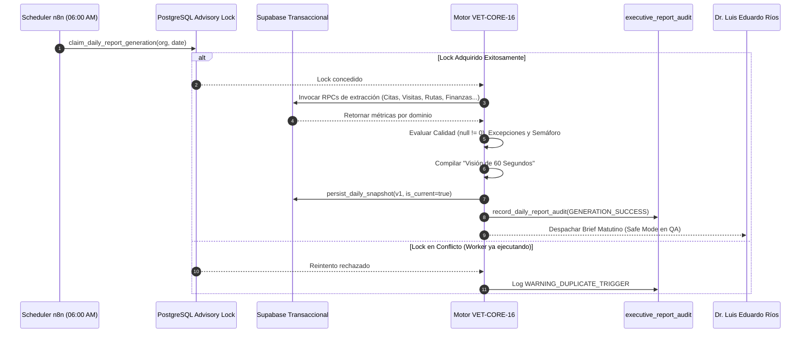

# Procedimiento Operativo Estándar: Generación del Reporte Diario (VET-CORE-16)

**Módulo:** `VET-CORE-16 | DAILY EXECUTIVE REPORTING`  
**Proyecto:** VET FREEDOM OS — Vet Life: Veterinaria a Domicilio  
**Dirección Médica:** Dr. Luis Eduardo Ríos  
**Dirección Estratégica:** Alpha Vision Method  
**Código SOP:** `SOP-OPS-016`  
**Fecha:** 2026-11-21  

---

## 1. Cronograma y Secuencia Diaria

---

## 2. Parámetros de Ejecución del Job Programado

- **Hora de Ejecución:** `06:00:00 AM` (America/Bogota, UTC-5).
- **Timeout Máximo:** 45 segundos para la agregación total.
- **Reintentos Automáticos:** Hasta 2 reintentos con backoff exponencial (10s, 30s) en caso de caída transitoria de red.
- **Notificación de Falla:** Si tras 2 reintentos el reporte no se compila, se emite una alerta técnica inmediata a la Coordinación Operativa.
